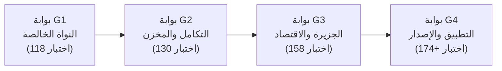

# 🛡️ بوابات الجودة والسقوف الصارمة — تكة (v5)

> **الهدف:** وضع معايير قياس رقمية قابلة للفحص الآلي والميداني، خالية من الوعود الإنشائية، تضمن سلامة الأداء والخصوصية وتجربة الطفل على الأجهزة الواقعية.
> **المرجعية:** استشارة Qwen3.7-Plus (2026-10-29) وقرارات المالك المعمارية النهائية.

---

## 1. السقوف الرقمية للحزم والأداء (Budgets & Ceilings)

| المؤشر | السقف الأقصى / المستهدف | آلية الفحص | الإجراء عند التجاوز |
|---|---|---|---|
| **إجمالي حجم الـ JS Bundles** | ≤ 400KB لجميع الـ chunks مجتمعة | فحص تلقائي في `vite build` | إيقاف البناء (Fail Build) فوراً |
| **سقف الـ Chunk الجديد** | ≤ 60KB لكل chunk مستحدث للجزيرة | تحليل مخرجات Rollup / Vite | مراجعة التقطيع وتخفيف الاستيرادات |
| **أرضية الحزم القائمة** | المحافظة على نطاق 44–94KB gzip القائم | تتبع سجل الأحجام التاريخي | تنبيه المطور عند أي قفزة غير مبررة |
| **حجم ملف التطبيق (APK)** | ≤ 28MB نهائي شامل الأصول | فحص حجم الحزمة بعد بناء Capacitor | رفض اعتماد حزمة الإصدار |
| **معدل الإطارات (FPS)** | ≥ 30fps مستقرة على جهاز 2GB RAM | قياس ميداني عبر DevTools Profile | مراجعة عدد العناصر وطبقة Canvas |
| **زمن الإقلاع والجاهزية** | ≤ 2.0 ثانية حتى جاهزية الواجهة الأولى | قياس من لحظة تشغيل التطبيق | تأجيل تحميل الأصول غير الضرورية |
| **استهلاك الذاكرة (RAM)** | ≤ 95MB في أقصى جلسة تفاعلية | فحص heap snapshot على الجهاز | تنظيف المراجع ومستمعي الأحداث |

> [!NOTE]
> تم استبعاد مقاييس Lighthouse التقليدية (Lighthouse Performance ≥ 85) لأن التطبيق يعمل محلياً بالكامل دون خادم ودون شبكة، والقياس الحقيقي يعتمد على سرعة الإقلاع واستهلاك الذاكرة ومعدل الإطارات على الجهاز المرجعي.

---

## 2. مصفوفة بوابات الجودة الأربعة (The 4 Quality Gates)

### البوابة الأولى (G1) — النواة الخالصة والكتالوج
- **النطاق:** `src/domain/island/` (الحالة، الاقتصاد، جدول الترقيات، الرفاق، الكتالوج).
- **الشروط الإلزامية للعبور:**
  1. `npm run typecheck` نظيف دون أي تجاوز أو تجاهل (`no ts-ignore`).
  2. اجتياز 118 اختباراً وحدوياً بنسبة نجاح 100% دون أي اختبار متذبذب (Zero Flaky Tests).
  3. إثبات عدم التكرار (Idempotency) في منح مكافآت المهارات بنسبة 100%.
  4. التحقق الرياضي من توازن الاقتصاد وفائض الأمان (~19%).

### البوابة الثانية (G2) — التكامل ومخزن البيانات
- **النطاق:** ربط المهام `mission-link` بمحرك الجلسات `session/builder`، ومخزن Dexie المحلي لمواضع المباني `placement`.
- **الشروط الإلزامية للعبور:**
  1. اجتياز 130 اختباراً ناجحاً (إضافة 12 اختبار تكامل وتخزين).
  2. صمود التخزين أمام البيانات التالفة وتفعيل خطة الرجوع الآمن (Fallback) التلقائية دون انهيار الواجهة.
  3. التحقق الصارم من صحة `skillIds` ومطابقتها التامة مع الحزم المعتمدة `g1-ar` و `g1-math`.

### البوابة الثالثة (G3) — الجزيرة التفاعلية والاقتصاد الحي
- **النطاق:** واجهة شبكة الجزيرة 12×12، تفاعل برج تكة المركزي، عدّاد الموارد وشريط الأدوات.
- **الشروط الإلزامية للعبور:**
  1. اجتياز 158 اختباراً ناجحاً.
  2. استجابة كاملة لواجهة RTL ودعم نمط تقليل الحركة `prefers-reduced-motion`.
  3. الترقية فورية بدون أي تأخير اصطناعي، والتأثير الحركي للترقية ≤ 800ms ولا يمنع تحكم الطفل.
  4. استقرار سقف الموارد عند 9999 والتصفير التلقائي لمراجعات اليوم مع تغير التاريخ.

### البوابة الرابعة (G4) — كمال الجزيرة، حذف القديم، وحزمة الإصدار
- **النطاق:** تشغيل المباني التسعة، الرفاق الأربعة، تنظيف كود الأرخبيل القديم، وبناء APK.
- **الشروط الإلزامية للعبور:**
  1. اجتياز 174 اختباراً أو أكثر بنجاح كامل.
  2. خلو السجل البرمجي من أي إشارة لكود عرض الأرخبيل القديم بعد تنظيف الإرث.
  3. تفعيل تنظيف تلقائي للبيانات القديمة في Dexie عند أول تشغيل بعد التحديث.
  4. APK ≤ 28MB وتثبيت ناجح واختبار تشغيل دون اتصال لمدة 72 ساعة دون أي محاولة طلب شبكي.

---

## 3. قائمة تدقيق الأمان والخصوصية (Argon QA Checklist)

تُفحص هذه القائمة إلزامياً قبل اعتماد أي إصدار تجريبي أو نهائي:

- [ ] **انعدام الاتصال تماماً (Zero Outbound Requests):** فحص عبر Network Interceptor للتأكد من عدم خروج أي طلب HTTP/WebSocket أثناء تجربة الطفل.
- [ ] **حماية الخصوصية المطلقة:** لا يتم تسجيل أو طلب أو تخزين اسم حقيقي أو صورة أو بصمة صوتية للطفل.
- [ ] **خلو كامل من أنماط الاستدراج المظلمة (Dark Patterns):**
  - لا مؤقتات زمنية للبناء.
  - لا نظام طاقة أو قلوب تعيق التعلم.
  - لا خسارة للموارد أو المباني تحت أي ظرف.
  - لا لوحات صدارة تنافسية أو مقارنات سلبية بين الأطفال.
  - لا إعلانات ولا مشتريات داخل التطبيق في مرحلة MVP.
- [ ] **صمود الأصول والوسائط:**
  - كل صورة مبنى أو أيقونة رفيق تمتلك صورة بديلة خفيفة (Inline SVG Fallback).
  - عند تعذر تحميل ملف صوتي أو بصري، يتم إعادة المحاولة 3 مرات محلياً ثم التسجيل في السجل الصامت دون توقف التطبيق.
- [ ] **لغة الدعم الإيجابي:** رسائل التنبيه خالية من اللوم أو الإحباط وتستخدم عبارات تشجيعية دافئة.

---

## 4. قائمة التحقق الميداني مع الأطفال والأسر (Real Observation Checklist)

بدلاً من الوعود النظرية («صفر انسحاب»)، يُقاس نجاح الإصدار عبر مؤشرات واقعية مرصودة:

1. **فهم الواجهة التلقائي:** الطفل قادر على الوصول للنشاط الأول خلال 30 ثانية دون مساعدة الوالدين.
2. **وضوح خيارات البناء:** الطفل يفهم أن ترقية البرج تفتح مبانٍ جديدة من خلال الشرح اللطيف المعروض.
3. **أهداف اللمس الآمنة:** جميع العناصر التفاعلية بمساحة لمس ≥ 56dp لمنع النقرات الخاطئة.
4. **استمرارية الجلسة الهادئة:** جلسة التعلم اليومية تنتهي بمكافأة إتقان واضحة تشجع الطفل على العودة غداً دون إدمان أو إحباط.
