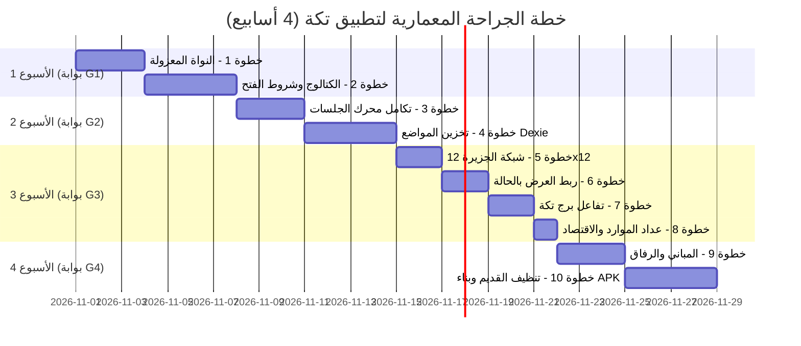

# 📅 خطة البناء: 4 بوابات وإسنادات الأسابيع — تكة (v5)

> **الهدف:** خطة تنفيذية أسبوعية محكمة تربط خطوات الجراحة العشر (10 خطوات) ببوابات الجودة الأربع (G1–G4)، محددة المخرجات الدقيقة وشروط التسليم.
> **المدة الإجمالية:** 4 أسابيع متتالية تنتهي بحزمة APK مستقرة ومختبرة ميدانياً.

---

## 1. الخريطة الزمنية العامة للبناء



---

## 2. التفصيل التنفيذي للأسبوع الأول: النواة والكتالوج (بوابة G1)

- **الهدف:** بناء النواة الدومينية الخالصة غير المعتمدة على أي مكتبات واجهة أو مخازن خارجية.
- **خطوات الجراحة المشمولة:**
  - **الخطوة 1:** إنشاء `src/domain/island/` (الحالة، الاقتصاد، جدول الترقيات، الرفاق، المواضع، ربط المهام).
  - **الخطوة 2:** إنشاء الكتالوج `building-catalog.ts` ودالة الكشف التدريجي `revealedBuildings`.
- **المخرجات الملموسة:**
  1. 6 ملفات TypeScript نقية مع مخططات التحقق بـ Zod.
  2. 20 اختباراً وحدوياً جديداً (الوصول إلى 118 اختباراً كلياً ناجحاً).
  3. إثبات عدم التكرار (Idempotency) في منح المهارات وتوازن مصفوفة الموارد.
- **شرط عبور البوابة G1:** `npm run typecheck` خالٍ من التحذيرات + 118/118 اختباراً أخضر.

---

## 3. التفصيل التنفيذي للأسبوع الثاني: تكامل الجلسات والتخزين (بوابة G2)

- **الهدف:** ربط مباني الجزيرة بمحرك الجلسات القائم وتوفير مخزن محلي آمن ومقاوم للأعطال.
- **خطوات الجراحة المشمولة:**
  - **الخطوة 3:** ربط `session/builder` بـ `mission-link` للتحقق من أهداف المهارات من حزمتي `g1-ar` و `g1-math`.
  - **الخطوة 4:** مخزن `placement` في Dexie تحت ملف الطفل مع آليات الاسترجاع الآمن (Fallback).
- **المخرجات الملموسة:**
  1. تكامل سلس يمنح الجلسات أهدافاً حقيقية من الحزم المعتمدة دون المساس بمحرك التدفق القائم.
  2. طبقة تخزين محلية صامدة تمنع انهيار الواجهة في حال حدوث أي تشوه في بيانات المواضع.
  3. 12 اختباراً جديداً (الوصول إلى 130 اختباراً كلياً ناجحاً).
- **شرط عبور البوابة G2:** 130/130 اختباراً ناجحاً + اختبار سيناريو تلف البيانات بنجاح تام.

---

## 4. التفصيل التنفيذي للأسبوع الثالث: واجهة الجزيرة والاقتصاد الحي (بوابة G3)

- **الهدف:** تجديد مسرح العالم (WorldStage) بالشبكة الهادئة 12×12 وتفعيل برج تكة والاقتصاد.
- **خطوات الجراحة المشمولة:**
  - **الخطوة 5:** شبكة الجزيرة 12×12 مع مراعاة RTL وتقليل الحركة.
  - **الخطوة 6:** ربط الواجهة بحالة الجزيرة كقراءة فقط وتعتيم المباني المقفلة.
  - **الخطوة 7:** تفاعل برج تكة، تأكيد الترقيات الفورية، ورسائل عدم كفاية الموارد اللطيفة.
  - **الخطوة 8:** واجهة عداد الموارد وربطها بنظام الإتقان والمراجعة اليومية.
- **المخرجات الملموسة:**
  1. واجهة بصرية هادئة وجذابة تعتمد Canvas 2D للأرضية و DOM للنصوص والأزرار العربية.
  2. شريط موارد واضح بتصميم طفولي مريح ومساحات لمس ≥ 56dp.
  3. 28 اختباراً إضافياً (الوصول إلى 158 اختباراً كلياً ناجحاً).
- **شرط عبور البوابة G3:** 158/158 اختباراً ناجحاً + ثبات معدل الإطارات ≥ 30fps على جهاز الاختبار المرجعي.

---

## 5. التفصيل التنفيذي للأسبوع الرابع: اكتمال المباني والرفاق وحزمة الإصدار (بوابة G4)

- **الهدف:** تشغيل المباني التسعة، الرفاق الأربعة، تنظيف الإرث القديم بالكامل، واستخراج APK.
- **خطوات الجراحة المشمولة:**
  - **الخطوة 9:** تفعيل المباني والرفاق بالتتابع الآمن (فطين، نورة، زيد، بدر).
  - **الخطوة 10:** حذف كود ومكونات الأرخبيل القديم، تنظيف الأصول، تفعيل التنظيف التلقائي للبيانات القديمة، وضبط سقف الحزمة.
- **المخرجات الملموسة:**
  1. تجربة طفل متكاملة تبدأ من جزيرة هادئة تنمو مع كل إتقان حقيقي.
  2. حزمة بناء نهائية نظيفة خالية من كود الأرخبيل القديم والتبعيات الزائدة.
  3. حزمة APK بحجم ≤ 28MB مجتازة لقائمة تدقيق الأمان والخصوصية (Argon QA Checklist).
  4. الوصول إلى 174 اختباراً ناجحاً بنسبة 100%.
- **شرط عبور البوابة G4:** اجتياز قائمة تدقيق Argon QA كاملة + فحص البناء النهائي والأداء دون اتصال.

---

## 6. بروتوكول التسليم والتحقق لكل خطوة (Step Handshake Protocol)

قبل وسم أي خطوة بالانتهاء والانتقال لغيرها، يلتزم المطور / الوكيل بالخطوات الأربع التالية:

1. **فحص السلامة الآلي:**
   ```bash
   npm run typecheck
   npm run test:run
   npm run build
   ```
2. **التحقق من الرتابة:** التأكد من أن عدد الاختبارات زاد بالقدر المخطط ولم ينقص منه شيء.
3. **فحص الخطوط الحمراء:** مراجعة التغييرات عبر `git diff` للتأكد من عدم لمس ملفات خارج نطاق الخطوة، وعدم إضافة مكتبات خارجية أو طلبات شبكة أو مؤقتات استدراج.
4. **توثيق التسليم:** تسجيل نتيجة الفحص وأرقام الاختبارات في تقرير موجز.
