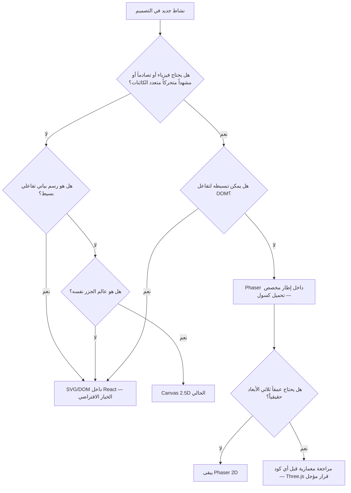
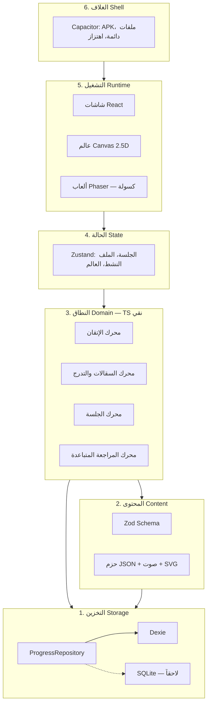
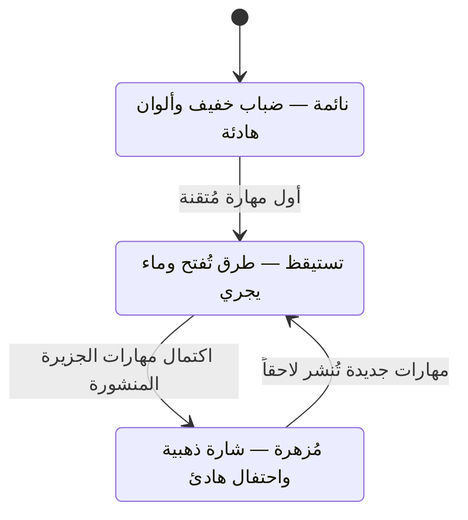
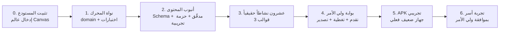

# 🧭 الرؤية النهائية لمشروع «تكة»

> **الإصدار:** 1.0 — 18 تشرين الأول 2026
> **الحالة:** وثيقة رؤية ومعمارية نهائية، مقترحة للاعتماد من المالك. لا تلغي دستور المنتج (`takka-main/تكة.md`) بل تكمله: الدستور يحكم **ماذا نبني ولماذا**، وهذه الوثيقة تحكم **كيف يُبنى وبأي حدود**.
> **تُحدّث أو تستبدل:** الوثيقة `09` في ما يخص المكدس (Three.js / R3F)، والوثيقة `03` في ما يخص طبيعة العالم (3D كامل)، والوثيقة `05` في لوحة الألوان.
> **المكدس المثبت هنا:** **React + TypeScript + Canvas 2.5D الحالي**، مع **Phaser** عند الحاجة الفعلية فقط، و**تأجيل Three.js**.

---

## 0. كيف تُقرأ هذه الوثيقة

كل عبارة حاسمة تحمل أحد أربعة وسوم:

| الوسم | المعنى |
| :--- | :--- |
| **[مثبت]** | حقيقة من المستودع أو المصادر المحلية أو الدستور. |
| **[قرار]** | قرار معماري في هذه الوثيقة، يصبح ملزماً بتوقيع المالك. |
| **[توصية]** | رأي مهني قابل للنقض، مع سبب. |
| **[افتراض]** | غير متحقق، يحتاج قياساً أو دليلاً قبل البناء عليه. |

> **ملاحظة صدق واحدة قبل البدء:** فحصتُ المستودع، ولم أجد فيه كود عالم جزر أو تطبيقاً مبرمجاً؛ `takka-main/التطبيق/` مجلد فارغ بملف README فقط، و`العمل/التصميم/` يضم معاينة HTML ثابتة ببيانات شكلية. لذلك تعاملتُ مع «عالم الجزر الحالي على Canvas» على أنه **موجود لدى المالك خارج المستودع**، وكتبتُ معايير قبوله واستبداله بدل وصف كود لم أقرأه. أول عمل هندسي في المشروع يجب أن يكون **إدخال هذا العالم إلى المستودع**، وإلا صارت كل قرارات الأداء تقديرات.

---

## 1. الحكم النهائي في تسع نقاط

هذه خلاصة رأيي، مفصّلة في بقية الوثيقة:

1. **المشروع سليم في جوهره، والمكدس المختار صحيح.** React + TypeScript يخدمان العربية وRTL والتفاعل والقوالب؛ Canvas يكفي لعالم 2.5D؛ Phaser أداة موضعية للألعاب التي تحتاج مشاهد وتصادم؛ Three.js تكلفة حجم وبطارية بلا عائد حالي. **[توصية: اعتماد المكدس كما هو]**

2. **الخطر الأول ليس تقنياً، بل تشغيلياً: إنتاج المحتوى.** 24 ملف PDF مصدرها 898.8 MiB، لكنها ليست محتوى تطبيق. حساب واقعي: الصف الأول وحده ≈ 70 وحدة/درساً و≈ 420 نشاطاً؛ بمعدل 30–60 دقيقة لكل نشاط (تأليف + فحص داخلي + صوت) = **210–420 ساعة عمل** لصف واحد. ستة صفوف ≈ **1.5–2 سنة عمل محتوى متواصل**. أي خطة تقول «نبني التطبيق أولاً ثم نضيف الدروس» ستنهار عند هذه النقطة.

3. **القرار الأهم ليس المحرك، بل وحدة الجلسة.** الدستور يصف دورة درس من 12 دقيقة، والوثيقة `01` تقول إن مدى انتباه الصف الأول 5–7 دقائق. التعارض حقيقي. الحل: **«تكة» = جلسة قصيرة متغيرة الطول بحسب الصف**، والدورة الثمانية تبقى قالباً يُضغط ويُقصّ، لا وصفة ثابتة لكل الأعمار.

4. **ثمانية قوالب في البداية كثيرة جداً.** ابنِ **ثلاثة** قوالب، وأثبت خط الأنابيب من المصدر إلى الشاشة بـ **عشرين نشاطاً حقيقياً**، ثم أضف القوالب بالطلب لا بالتخطيط.

5. **العالم يجب أن يكون قابلاً للتراجع.** Canvas 2.5D يبقى بشرط ثلاثة: وضع منخفض (خريطة شبه ثابتة) للأجهزة الضعيفة، ونصوص عربية في DOM لا داخل الكانفس، ومنطق إسقاط/التقاط قابل للاختبار كدوال نقية.

6. **الحفظ المحلي يحتاج خطة نسخ احتياطي الآن لا لاحقاً.** ملف تصدير/استيراد JSON محلي (بدون سحابة وبدون حساب) يحل سؤال «الاستعادة بعد تبديل الجهاز» بتكلفة يومين عمل، بدل تركه مفتوحاً لسنوات.

7. **سقف 25MB لا يتسع لستة صفوف.** الصوت وحده ≈ 5–6MB لكل صف. إما **حزمة لكل صف**، أو رفع السقف إلى ~45MB. القرار يجب أن يُتخذ **قبل** بناء نظام الحزم، لأنه يغيّر بنية البيانات والتوزيع.

8. **الدفع مؤجّل، لكن حدّ «حزمة المحتوى» يجب تصميمه الآن** كوحدة بيانات (صف + مادة + إصدار + حالة تدقيق)، وإلا صار الترخيص لاحقاً إعادة هيكلة كاملة.

9. **لا تُقاس الجودة بوقت الشاشة.** المقاييس المحلية هي: نسبة الإتقان المستقل، معدل طلب التلميح، نجاح التوقف، والعودة الطوعية بعد فاصل — لا مدة الجلسة ولا عدد الفتحات.

---

## 2. ما هو تكة، وما ليس هو

| تكة **هو**                                       | تكة **ليس هو**                       |
| :----------------------------------------------- | :----------------------------------- |
| محرك إتقان (Mastery Engine) بواجهة عالم كرتوني.  | لعبة تعليمية تغلف أسئلة مدرسية.      |
| مسار تعلّم قصير له بداية مفهومة ونهاية مريحة.    | كتاب رقمي أو بنك أسئلة أو أرشيف PDF. |
| تطبيق يعمل بجوهره دون إنترنت، ويحفظ محلياً.      | منصة سحابية أو خدمة محتوى متصل.      |
| عالم يُرمَّم: كل مهارة تُتقن تُعيد شيئاً للحياة. | نظام نقاط وسلاسل أيام ولوحات صدارة.  |
| مسار مُعلن النطاق: «رزم غزة المتاحة للصف الأول». | ادعاء «المنهاج الفلسطيني الكامل».    |
| أداة أسرة على هاتف واحد، بملفات أطفال متعددة.    | تطبيق حسابات وبريد ومزامنة.          |
| محتوى أصلي مربوط بمهارة ومصدر وإصدار.            | نسخ صفحات أو رسوم أو أناشيد الكتب.   |

**السطر الواحد:** تكة يجعل الطفل يعود لأنه **فهم**، ويستطيع أن **يتوقف**، ويعرف **أين وصل**.

---

## 3. السياق الذي يحكم كل قرار

| القيد **[مثبت]** | الأثر المعماري المباشر |
| :--- | :--- |
| انقطاع كهرباء وطاقة متقطعة | كتابة ذرية عند كل تغيّر حالة؛ لا عمل مؤجل في الذاكرة؛ فتح بارد < 3 ثوانٍ. |
| هواتف أندرويد 2GB RAM ومعالجات متواضعة | WebView فقط؛ لا محرك ألعاب في المسار الحرج؛ DPR مقيّد بـ 2؛ مسار مخفّض تلقائي. |
| شاشات متضررة/مخدوشة | هوامش أمان ≥ 16dp؛ أهداف لمس ≥ 56dp؛ لا أزرار في الحواف القصوى. |
| طفل متفاوت القراءة | نص قصير + صورة + فعل + صوت اختياري؛ لا معلومة أساسية في الصوت وحده. |
| جهاز أسرة واحد لعدة أطفال | ملفات محلية متعددة، منفصلة، بلا حساب. |
| لا مراجعة معلم خارجية إلزامية | **الفحص الداخلي الموثق** إلزامي قبل نشر أي نشاط (بوابة جودة، لا بوابة إدارية). |
| حقوق الكتب غير محسومة | أنشطة أصلية فقط؛ المصدر يُسجَّل ولا يُنسخ. |

**النتيجة:** كل قرار «جميل» يكلّف بطارية أو ذاكرة أو وقت تحميل يجب أن يُبرَّر بمهارة يتعلمها الطفل، لا بجمال المشهد.

---

## 4. المكدس النهائي: القرار وحدوده

### 4.1 الجدول الحاكم

| الطبقة | الاختيار **[قرار]** | الدور الدقيق | الحدّ الذي لا يتجاوزه | متى نعيد النظر |
| :--- | :--- | :--- | :--- | :--- |
| الواجهات | **React 18/19** | الشاشات، النصوص العربية، RTL، النماذج، بوابة ولي الأمر، الحوارات. | لا يدير حلقة رسم ولا حركة إطارية. | إذا زادت إعادة الرسم في الأنشطة عن 30% من الإطارات. |
| المنطق | **TypeScript** (strict) | محرك الإتقان، التدرج، التقييم، التحقق من المحتوى، التخزين. | لا يستورد React ولا DOM ولا Canvas. | لا. |
| العالم | **Canvas 2.5D الحالي** | الأرخبيل، الجزر، حالة الإزهار، التنقل البصري. | لا نصوص عربية داخله؛ لا ظلال ديناميكية في الحلقة؛ لا أكثر من 120 عنصراً متحركاً. | إذا احتجنا تصادم/فيزياء/مشاهد متعددة → Phaser. إذا احتجنا دوران 3D حقيقي → Three.js. |
| الألعاب | **Phaser** (عند الطلب) | ألعاب تحتاج مشهداً وفيزياء وتصادم وحركة كائنات (متاهة، ميزان، مختبر، قطار الأرقام). | يُحمَّل بـ `dynamic import` عند فتح اللعبة فقط؛ داخل إطار مخصص؛ لا نص عربي داخله. | إذا لم يتجاوز أي نشاط حاجة DOM/SVG فلا يُضاف أصلاً. |
| 3D | **Three.js — مؤجّل** | لا شيء حالياً. | لا يدخل حزمة الإصدار الأول. | إذا ثبت أن 2.5D لا يحقق «الإحساس بالعالم» في اختبار أسر، أو لزم عرض جزيرة دوّارة. |
| البناء | **Vite** | تجميع، تقسيم حزم لكل جزيرة/لعبة. | — | — |
| الحالة | **Zustand** | حالة الجلسة والعالم والملف النشط. | لا تُخزَّن فيه بيانات المنهاج. | — |
| التحقق | **Zod** | مصادقة JSON المحتوى عند البناء وعند التحميل. | — | — |
| التخزين | **Dexie (IndexedDB)** عبر مستودع مجرّد | التقدم، المحاولات، البلاغات، الإعدادات. | لا يُستدعى من مكوّن React مباشرة. | إذا أثبت القياس أن SQLite أنسب على أندرويد. |
| الصوت | **Howler / Web Audio** | التعليمات، التغذية الراجعة، مؤثرات ناعمة. | لا تشغيل تلقائي؛ لا صوت إلزامي. | حسب نتيجة مقارنة TTS/تسجيلات. |
| الغلاف | **Capacitor 6** | APK، نظام الملفات الدائم، الاهتزاز الخفيف. | لا صلاحيات زائدة (لا ميكروفون، لا جهات اتصال). | — |
| الاختبار | **Vitest** | محرك الإتقان، التدرج، الحفظ، التحقق. | لا اختبارات UI شاملة في المرحلة الأولى. | — |

### 4.2 شجرة القرار: أين تُنفَّذ كل شاشة؟



**قاعدة الحسم:** المحرك يُضاف بسبب **متطلب تفاعل**، لا بسبب جمال متوقع. كل محرك إضافي يكلّف حجماً وذاكرة وزمن تحميل، ويُقاس قبل الإضافة.

### 4.3 لماذا Canvas 2.5D يكفي (ولماذا لا 3D)

| المعيار | Canvas 2.5D | Three.js 3D |
| :--- | :--- | :--- |
| الحجم | ~0 (كود فقط) | ~600KB gzip + مجسمات + خامات |
| الذاكرة | عشرات الميغابايت | 100MB+ على أجهزة ضعيفة |
| البطارية | رسم 2D مع ظلال مسبقة | رسم WebGL مستمر |
| خط الأنابيب | لا يحتاج Blender/gltfpack/KTX2 | يحتاج سلسلة أدوات كاملة |
| النصوص العربية | DOM فوقه (مثالي) | DOM فوقه (ممكن لكنه غريب) |
| الإحساس المطلوب | «جزر عائمة دافئة تُرمَّم» ✅ | زائد على الحاجة |

الوثيقة `03` اقترحت 3D لأنها تصورت «جزراً دوّارة». الواقع أن **الإحساس** المطلوب (جزيرة تُزهر، منارة تُضيء، جسر يُبنى) يمكن تحقيقه بإسقاط أيزومتري وطبقات وإضاءة مرسومة مسبقاً، بجزء ضئيل من التكلفة. **[قرار: 2.5D هو الافتراضي، و3D قرار مؤجل يحتاج دليلاً من اختبار أسر]**

---

## 5. المعمارية: ست طبقات، اتجاه واحد



**قاعدة الاعتماد الوحيدة [قرار]:** `domain` لا يعرف شيئاً عن React ولا Canvas ولا Dexie. يستورد فقط أنواع المحتوى وواجهة المستودع. هذا هو الشرط الذي يجعل المحرك قابلاً للاختبار، وقابلاً للنقل، وقابلاً للبقاء لو تغيّر الإطار بعد ثلاث سنوات.

### هيكل المجلدات المقترح

```text
التطبيق/
├─ src/
│  ├─ domain/                 # TS نقي — بلا React
│  │  ├─ mastery/             # مهارة، دليل، قواعد إتقان
│  │  ├─ session/             # بناء جلسة، انتقالات، إنهاء
│  │  ├─ scaffolding/         # مستويات المساعدة والتلاشي
│  │  ├─ review/              # التباعد والاسترجاع
│  │  └─ content/             # أنواع + Zod + محمّل الحزم
│  ├─ data/                   # مستودعات Dexie وتصدير/استيراد
│  ├─ runtime/
│  │  ├─ screens/             # شاشات React
│  │  ├─ world/               # Canvas: إسقاط، طبقات، التقاط، حالات
│  │  ├─ games/               # أغلفة Phaser الكسولة
│  │  └─ design/              # الرموز والمكونات
│  ├─ assets/                 # خطوط، صوت، SVG، خريطة الجزر
│  └─ content-packs/          # حزم JSON المنشورة
└─ tools/                     # مولّدات، مدقّق محتوى، تقارير تغطية
```

---

## 6. قلب المشروع: محرك الإتقان

المحرك هو **المنتج الحقيقي**. العالم والرسوم هي غلافه. يجب أن يكون صغيراً، قابلاً للاختبار، وقابلاً للشرح لمعلم في دقيقتين.

### 6.1 الكيانات

```ts
// [قرار] هذه هي الحدود الدنيا؛ لا نضيف حقولاً قبل حاجة فعلية.
type Grade = 1 | 2 | 3 | 4 | 5 | 6;
type SubjectId = 'arabic' | 'math' | 'english' | 'civic' | 'science';

interface Skill {
  id: string;                 // "g1.ar.letter.ba.recognize"
  grade: Grade;
  subject: SubjectId;
  title: string;              // «تمييز حرف الباء في أول الكلمة»
  prerequisites: string[];    // مهارات سابقة (رسم بياني، لا قائمة مسطحة)
  sourceRef: SourceRef;       // مصدر موثق أو وسم «تأسيس أصلي»
}

interface SourceRef {
  kind: 'pack' | 'curriculum-index' | 'foundational';
  file?: string;              // Grade-1-Arabic.pdf
  page?: number;
  unit?: string;
  edition?: string;           // 2024
}

type EvidenceKind = 'independent' | 'with_hint' | 'with_scaffold' | 'exposed_only';

interface Evidence {
  skillId: string;
  at: number;                 // epoch ms — وقت محلي
  kind: EvidenceKind;
  templateId: string;
  itemId: string;
  attempts: number;
  durationMs: number;
}

type SkillState =
  | 'not_reached'    // لم يصل إليها بعد
  | 'tried'          // جرّب
  | 'with_help'      // أكمل بمساعدة
  | 'independent';   // أظهر إتقاناً مستقلاً
```

### 6.2 قواعد الإتقان **[قرار]**

لا نستخدم تعلّم آلة ولا «درجة». نستخدم قاعدة قابلة للشرح:

> **المهارة تُعدّ «مُتقنة» إذا ظهرت مستقلةً ثلاث مرات، في جلستين مختلفتين على الأقل، وبفاصل زمني لا يقل عن يوم، دون تلميح.**

- **«جرّب»**: تفاعل وغادر قبل خطوة التحقق.
- **«أكمل بمساعدة»**: نجح بعد تلميح أو سقالة أو إعادة محاولة.
- **«أظهر إتقاناً مستقلاً»**: نجح في تحقق بلا مساعدة.
- **الانحدار (Decay)**: إذا مرّ 21 يوماً بلا دليل مستقل، تعود المهارة إلى «تحتاج مراجعة» في الاقتراح فقط — **ولا تُلغى من سجل الطفل أبداً**، ولا تُعرض كخسارة.

### 6.3 السقالات (Scaffolding)

أربع درجات تتلاشى:

| الدرجة | ما يحدث | متى تُستخدم |
| :--- | :--- | :--- |
| 1. نمذجة كاملة | الرفيق «فطين» يحل الخطوة الأولى أمام الطفل | أول لقاء بمهارة |
| 2. توجيه بصري | إبراز العنصر الصحيح، سهم، وميض هادئ | بعد خطأ واحد |
| 3. تلميح نصي/صوتي | جملة واحدة تقول الخطوة التالية لا الجواب | بعد خطأين |
| 4. تبسيط المهمة | نفس المهارة بمثال أسهل أو خيارات أقل | بعد ثلاث محاولات |

**قاعدة:** لا نمنع المحاولة، ولا ننقص شيئاً، ولا نُظهر «فشلاً». عند الدرجة 4 نقترح **جسراً تأسيسياً** اختيارياً، لا نفرضه.

### 6.4 الجسر التأسيسي والمراجعة المتباعدة

- **الجسر**: مهارة سابقة قصيرة (3–5 دقائق) تُفتح كخيار داخل السياق، موسومة «تأسيس» ولا تُنسب للمنهاج.
- **المراجعة**: بعد إتقان مهارة، تُعاد في «تكة دافئة» بعد ~2 أيام ثم ~7 أيام. الفاصل **افتراض تصميمي** يُعاد ضبطه بقياس محلي، لا حقيقة علمية مثبتة لتكة.

---

## 7. وحدة الجلسة: «تكة واحدة»

هذا أهم تعديل على الوثيقة `08`. دورة الـ 12 دقيقة تصلح للصفوف 5–6، وتُرهق الصف الأول.

| الصف | طول «تكة» | المراحل المُضمَّنة | عدد التفاعلات |
| :--- | :--- | :--- | :--- |
| 1–2 | **4–6 دقائق** | تنشيط ← نمذجة ← ممارسة موجهة ← تحقق ← احتفال | 3–5 |
| 3–4 | **7–10 دقائق** | + جولة طلاقة قصيرة ← نقل الأثر | 6–9 |
| 5–6 | **11–15 دقيقة** | الدورة الثمانية كاملة | 10–14 |

**القاعدة [قرار]:** الطفل ينهي «تكة» كاملة في جلسة واحدة، ويستطيع الخروج في أي لحظة. لا تُقطع الجلسة على الطفل، ولا تُمدَّد قسراً.

### 7.1 الدورة الثمانية للوثيقة `08` بعد الضغط

| # | المرحلة | صفوف 1–2 | صفوف 3–4 | صفوف 5–6 |
| :--- | :--- | :--- | :--- | :--- |
| 1 | تنشيط معرفة سابقة | سؤال واحد بصري | سؤالان | سؤالان + تبرير |
| 2 | نمذجة صريحة | مثال محسوس فقط | محسوس ← شبه محسوس | محسوس ← رمز |
| 3 | ممارسة موجهة | خطوة واحدة | خطوتان | خطوتان + تفسير |
| 4 | جولة طلاقة | ❌ تُدمج | 60–90 ثانية | 90–120 ثانية |
| 5 | نقل الأثر في الجزيرة | ❌ | ✅ | ✅ |
| 6 | تحقق مستقل | ✅ واحد | ✅ | ✅ + «كيف عرفت؟» |
| 7 | تفرع وتغذية راجعة | تلقائي هادئ | تلقائي | تلقائي + سؤال تأملي |
| 8 | إغلاق آمن | ✅ | ✅ | ✅ |

**ملاحظة:** إسقاط مرحلتين في الصفوف الصغرى ليس تقليلاً للجودة؛ هو احترام لمدى الانتباه. الجودة تُعوَّض بتكرار الجلسات القصيرة عبر الأسبوع، لا بجلسة طويلة واحدة.

---

## 8. العالم: عقد Canvas 2.5D

### 8.1 ما يملكه الكانفس وما يملكه DOM **[قرار]**

| الكانفس يملك | DOM يملك |
| :--- | :--- |
| البحر، السحب، الجزر، الطرق، المنارات | كل نص عربي (عناوين، أسماء، أرقام) |
| حالة الإزهار، الفتح، الضباب | الأزرار، البطاقات، التلميحات، الحوارات |
| الحركة الخفيفة (موج، طيور، جزيئات) | شريط الحالة، زر الصوت، زر الخروج |
| الالتقاط (Hit-testing) على الجزر | إمكانية الوصول، التركيز، قارئ الشاشة |

**لماذا:** تشكيل العربية والتفاف الأسطر وBiDi معقّدة داخل الكانفس؛ المتصفح يحلها في DOM مجاناً. وأي نص في الكانفس يخرج من إمكانية الوصول ومن التكبير ومن البحث.

### 8.2 نموذج الإسقاط

- إسقاط أيزومتري ثابت: `screenX = (x - y) * 0.5 * tileW`، `screenY = (x + y) * 0.5 * tileH - z * heightUnit`.
- **كل** دوال الإسقاط والالتقاط **دوال نقية** في `runtime/world/projection.ts`، مغطاة باختبارات Vitest. هذه هي الطريقة الوحيدة لجعل عالم Canvas قابلاً للصيانة.
- الالتقاط بترتيب العمق (Painter's algorithm) + مساحة نقر لكل جزيرة تُحسب مسبقاً، لا لكل إطار.

### 8.3 حالات الجزيرة



**قاعدة:** الحالة تُحسب من بيانات الإتقان، ولا تُخزَّن كحقل مستقل. مصدر حقيقة واحد = لا تناقض بين الخريطة والتقدم.

### 8.4 الوضع المنخفض (Degraded Mode)

يُفعَّل تلقائياً عند أي من: `deviceMemory < 2GB`، أو `hardwareConcurrency ≤ 4`، أو متوسط إطار > 25ms لثلاث ثوانٍ، أو `prefers-reduced-motion`.

في الوضع المنخفض: خريطة شبه ثابتة، بلا موج ولا جزيئات، وحركات انتقال قصيرة، ونفس المعلومات والوظائف. **لا يُحرم الطفل من محتوى بسبب جهازه.**

### 8.5 ميزانية الأداء **[قرار]**

| البند | السقف | كيف يُقاس |
| :--- | :--- | :--- |
| إطارات | 60fps هدف، 30fps حد أدنى | `requestAnimationFrame` + متوسط متحرك |
| عناصر متحركة | ≤ 120 | عدّاد في وضع التطوير |
| عمليات رسم/إطار | ≤ 400 | تتبّع يدوي |
| DPR | ≤ 2 | قصّ عند الإقلاع |
| ذاكرة التطبيق | ≤ 120MB | Android Profiler |
| زمن الفتح البارد | < 3 ثوانٍ | قياس على جهاز فعلي |
| حزمة JS الأولية | ≤ 450KB gzip | `vite build` |

---

## 9. المحتوى: من المصدر إلى الشاشة

### 9.1 خط الأنابيب

```mermaid
flowchart LR
    SRC["مصدر موثق: PDF + صفحة/وحدة"] --> MAP["خريطة تغطية الصف"]
    MAP --> SKILL["مهارة معرّفة + متطلبات سابقة"]
    SKILL --> ACT["نشاط أصلي بصيغة JSON"]
    ACT --> VAL["مدقّق Zod + مدقّق تربوي آلي"]
    VAL --> HUM["فحص داخلي موثق: صحة، لغة، تشكيل، عمر، تلميح"]
    HUM --> AUD["صوت اختياري + بديل نصي"]
    AUD --> PUB["حزمة منشورة: صف + مادة + إصدار"]
    PUB --> APP["التطبيق: تحميل محلي"]
```



### 9.2 عقد النشاط (موسّع عن الوثيقة `04`)

```json
{
  "id": "g1.ar.letter.ba.match.01",
  "grade": 1,
  "subject": "arabic",
  "islandId": "island-letters",
  "skillId": "g1.ar.letter.ba.recognize",
  "template": "drag_match",
  "title": "أي صورة تبدأ بحرف الباء؟",
  "difficulty": 1,
  "scaffolding": { "level": 2, "hint": "قل «بـ» ثم ابحث عن الصورة التي تبدأ بها." },
  "source": {
    "kind": "pack",
    "file": "Grade-1-Arabic.pdf",
    "unit": "حرف الباء",
    "page": 34,
    "edition": "غير محددة على الغلاف المفحوص"
  },
  "audit": { "status": "internal_reviewed", "reviewedAt": "2026-10-18", "notes": "" },
  "audio": { "instruction": "audio/g1/ar/ba_q.mp3", "optional": true },
  "config": {
    "prompt": "اختر الصورة التي تبدأ بحرف الباء",
    "options": [
      { "id": "a", "label": "بَاب", "image": "svg/ba/door.svg", "correct": true },
      { "id": "b", "label": "تُفَّاح", "image": "svg/ba/apple.svg", "correct": false }
    ]
  },
  "feedback": {
    "success": "أحسنت! «بَاب» تبدأ بحرف الباء.",
    "retry": "قريب! جرّب أن تسمع أول صوت في الكلمة."
  }
}
```

**قاعدة [قرار]:** أي نشاط لا يملك `source` أو `audit.status` لا يُبنى ولا يُحمَّل. المدقّق يفشل البناء، لا يُحذّر فقط.

### 9.3 ميزانية المحتوى — الرقم الذي يجب أن يواجهه المالك

| البند | الصف الأول | ستة صفوف |
| :--- | :--- | :--- |
| وحدات/دروس موثقة | ~70 (30 عربية + 14 إنجليزي + 4 رياضيات + 20 وطنية) | ~420 |
| أنشطة (≈6 لكل درس) | ~420 | ~2,500 |
| ساعات تأليف + فحص + صوت | 210–420 ساعة | 1,300–2,500 ساعة |
| بالعمل المتواصل 20 ساعة/أسبوع | 2.5–5 أشهر | 15–30 شهراً |

**الاستنتاج:** المشروع يحتاج **خط إنتاج** لا **حرفة فردية**. ولذلك: قوالب أقل، مدقّق آلي، ومكتبة صوت مشتركة، وقوالب نصوص جاهزة للمعلمين.

---

## 10. القوالب: من ثمانية إلى ثلاثة + واحد

| # | القالب | القرار | السبب |
| :--- | :--- | :--- | :--- |
| 1 | سحب ومطابقة | **الآن** | يغطي العربية والإنجليزية والوطنية والعلوم؛ أبسط وأرخص. |
| 2 | تتبع الحروف والأرقام | **الآن** | أساسي للصف الأول؛ يحتاج رياضيات مسار فقط (لا AI). |
| 3 | استماع وتمييز | **الآن** | يخدم الصوت والتشكيل والفونيكس؛ رخيص تقنياً. |
| 5 | ميزان الكسور/المقادير | **الآن (مبسّط)** | ضروري للرياضيات؛ نسخة SVG كافية، بلا فيزياء. |
| 4 | تجميع كلمات/جمل | لاحقاً | مشابه لقالب 1 في البنية؛ لا يُستحق الآن. |
| 6 | متاهة منطقية | لاحقاً — **مرشح Phaser الأول** | يحتاج شبكة وحركة وتصادماً؛ هنا يُبرَّر المحرك. |
| 7 | مختبر افتراضي | لاحقاً | مكلف تربوياً وتقنياً؛ يحتاج محاكاة ومتغيرات. |
| 8 | قصة متفرعة | لاحقاً | مكلف تأليفاً، وعائده غير مثبت (الوثيقة `07`). |

**قاعدة [قرار]:** لا يُبنى قالب قبل أن يوجد **عشرة أنشطة حقيقية** تحتاجه. القالب يُستخرج من المحتوى، لا يُفرض عليه.

---

## 11. التخزين والأوفلاين والنسخ الاحتياطي

### 11.1 المستودع المجرّد

```ts
interface ProgressRepository {
  loadProfile(profileId: string): Promise<Profile | null>;
  saveEvidence(e: Evidence): Promise<void>;         // كتابة ذرية
  saveSession(s: SessionRecord): Promise<void>;
  getSkillStates(profileId: string): Promise<Record<string, SkillState>>;
  exportProfile(profileId: string): Promise<Blob>;  // JSON
  importProfile(file: Blob): Promise<Profile>;
}
```

- **Dexie** اليوم، **SQLite** خيار لاحق خلف نفس الواجهة.
- **كتابة ذرية**: كل تغيير حالة يُكتب في معاملة واحدة. لا ننتظر «نهاية الجلسة» للحفظ.
- **طلب تخزين دائم** عند أول إقلاع (`navigator.storage.persist()`).
- **تحذير مساحة صادق** لولي الأمر قبل أي حذف.

### 11.2 النسخ الاحتياطي **[توصية قوية]**

الدستور يترك «الاستعادة بعد تبديل الجهاز» مفتوحة. الحل الأرخص والمتوافق مع الخصوصية:

> **ملف تقدم واحد (JSON) يُصدَّر إلى مجلد التنزيلات أو يُشارَك عبر تطبيق الملفات، ويُستورد لاحقاً.**

- لا حساب، لا سحابة، لا شبكة.
- يحتوي: معرّف الملف الرمزي، الصف، الحالات، الأدلة، الإصدار.
- يُوقَّع بمجموع تحقق بسيط لمنع الاستيراد التالف.
- تكلفة التنفيذ: **يومان**، ويغلق سؤالاً مفتوحاً منذ إصدار الدستور.

---

## 12. الخصوصية والحدود الأخلاقية (غير قابلة للتفاوض)

| القاعدة | التفصيل |
| :--- | :--- |
| لا هوية | لا اسم حقيقي، لا هاتف، لا بريد، لا موقع، لا صورة، لا صوت طفل. |
| لا ميكروفون | في الـMVP ولا في أي إصدار قريب. |
| لا شبكة في الجوهر | التعلم والتقدم يعملان كاملاً دون اتصال. |
| لا تتبع | لا تحليلات، لا إرسال أحداث، لا معرّفات إعلانية. |
| لا دفع للطفل | لا شاشة شراء في رحلة الطفل، ولا إشارة إلى سعر. |
| لا إدمان | لا سلاسل عقابية، لا صناديق حظ، لا مؤقت ضغط، لا تمرير لا نهائي، لا إشعارات استدراج. |
| لا لوم | لا أحمر صارخ، لا صوت خطأ، لا «خسرت»، لا مقارنة بأطفال آخرين. |

**الاستثناء الوحيد المسموح:** بلاغ خطأ يكتبه ولي الأمر محلياً، يبقى على الجهاز حتى يقرر تصديره.

---

## 13. الميزانية: الحجم والصوت

### 13.1 حساب الصوت (سبب سقف 25MB)

بمعدل **24kbps أحادي Opus** = 3KB/ثانية:

| النوع | العدد | المدة | الحجم |
| :--- | :--- | :--- | :--- |
| تعليمات مشتركة (تُعاد في كل الأنشطة) | 60 | 4ث | ~720KB |
| حروف وتشكيل | 84 | 2ث | ~500KB |
| بنك كلمات الصف | 600 | 1.5ث | ~2.7MB |
| تغذية راجعة | 40 | 3ث | ~360KB |
| **الإجمالي** | | | **~4.3MB** (+25% احتياط = 5.4MB) |

### 13.2 النتيجة الحاسمة

| السيناريو | الحجم التقديري | الحكم |
| :--- | :--- | :--- |
| صف واحد (محتوى + صوت + SVG) | 6–8MB | ✅ داخل السقف |
| صفان | 12–16MB | ✅ داخل السقف |
| ستة صفوف | 36–48MB | ❌ يتجاوز 25MB |

**الخيارات [قرار مطلوب من المالك]:**

1. **حزمة لكل صف** (APK أو حزمة محتوى منفصلة) — الأنظف، ويحل الترخيص لاحقاً.
2. **رفع السقف إلى ~45MB** — أبسط للمستخدم، أثقل للتنزيل.
3. **حزمة الصف الأول فقط في الإصدار الأول** — الأكثر أماناً للميزانية والوقت.

**توصيتي:** الخيار 3 فوراً، مع تصميم البيانات منذ اليوم على أن «الحزمة = صف + مادة + إصدار»، حتى لا يصير الخيار 1 إعادة هيكلة.

---

## 14. المخاطر العشرة مرتّبة

| # | الخطر | الاحتمال | الأثر | التخفيف | إشارة الإنذار |
| :--- | :--- | :--- | :--- | :--- | :--- |
| 1 | توقف المشروع بسبب حجم المحتوى | مرتفع | قاتل | تضييق النطاق لصف واحد ومادتين؛ خط إنتاج ومدقّق | «لم ننشر نشاطاً منذ شهر» |
| 2 | بناء قوالب كثيرة لا يستخدمها المحتوى | مرتفع | مرتفع | قاعدة العشرة أنشطة | قالب بلا محتوى بعد أسبوعين |
| 3 | ضعف أداء Canvas على أجهزة 2GB | متوسط | مرتفع | وضع منخفض + ميزانية قياس | إطارات < 30fps في اختبار |
| 4 | خط عربي سيئ/تشكيل مكسور | متوسط | مرتفع | خط محزوم، اختبار تشكيل، مراجعة بصرية | شكاوى قراءة |
| 5 | تعارض «المنهاج الكامل» مع الواقع | متوسط | مرتفع | بيان تغطية صريح في بوابة ولي الأمر | سؤال ولي أمر: «هل هذا كل المنهاج؟» |
| 6 | حقوق الكتب | متوسط | مرتفع | أنشطة أصلية + سجل مصدر | أي طلب نسخ صفحة |
| 7 | تعارض الطلب: تصميم جميل ↔ بطارية | مرتفع | متوسط | ميزانية أداء ملزمة + وضع منخفض | إطارات تسقط عند إضافة مؤثر |
| 8 | ضياع تقدم الطفل | متوسط | مرتفع | كتابة ذرية + تصدير JSON | بلاغ «ضاع تقدمي» |
| 9 | انزلاق نحو التلعيب المظهري | متوسط | متوسط | قائمة Anti-patterns في المراجعة | ظهور نقاط/سلاسل في نقاش |
| 10 | التشتت بين ستة صفوف | مرتفع | متوسط | بوابة: لا صف جديد قبل اعتماد السابق | فتح نقاش الصف الرابع |

---

## 15. خارطة الطريق والبوابات

الخريطة تحترم بوابات الدستور (المراحل 1–9)، لكنها تعيد ترتيب **العمل الهندسي** داخلها.



| المرحلة | المخرج | شرط العبور | يعتمد على |
| :--- | :--- | :--- | :--- |
| 0 | مستودع Git، عالم Canvas داخل `runtime/world`، بناء يعمل | `pnpm build` ناجح + فتح العالم على جهاز | — |
| 1 | `domain/` كامل + اختبارات إتقان وسقالات | تغطية ≥ 80% لمنطق الإتقان | قرار المكدس (هذه الوثيقة) |
| 2 | Zod schema + مدقّق + حزمة صف أول تجريبية | حزمة تُبنى وتُحمّل وتُعرض | اعتماد خريطة الصف الأول |
| 3 | 20 نشاطاً موثقاً بـ3 قوالب | فحص داخلي موثق لكل نشاط | اعتماد العينة من المالك |
| 4 | بوابة ولي الأمر + تصدير/استيراد | ولي أمر يفهم التقدم والتغطية دون مساعدة | — |
| 5 | APK ≤ 28MB على جهاز 2GB | 30fps مستقر + فتح < 3ث | — |
| 6 | تقرير تجربة أسر | موافقة ولي أمر + خطة خصوصية | — |

**بوابة إلزامية:** لا انتقال بين مرحلتين دون حزمة مراجعة للمالك (وArgon إن أمكن)، وفق قالب الدستور.

---

## 16. المقاييس: ما نقيسه فعلاً

كل القياس **محلي**، ويُعرض في بوابة ولي الأمر، ولا يُرسَل إلى أي جهة.

| المقياس | التعريف | الهدف الأولي **[افتراض]** |
| :--- | :--- | :--- |
| نسبة الإتقان المستقل | مهارات ظهرت مستقلة ÷ مهارات جُرّبت | ≥ 40% بعد أسبوعين |
| معدل طلب التلميح | تلميحات ÷ تفاعلات | 15–30% (أقل = صعب، أكثر = غير واضح) |
| نجاح التوقف | جلسات انتهت بزر «نوقف هون» بلا إحباط ملاحظ | ≥ 90% |
| العودة الطوعية | عودة خلال 72 ساعة بلا إلحاح | ≥ 50% |
| فك التعليمة | نسبة إتمام النشاط الأول دون مساعدة | ≥ 70% للصف 1–2 |
| أداء الجهاز | متوسط الإطارات، زمن الفتح | 60/30fps، < 3ث |

**ما لا نقيسه ولا نعرضه:** مدة الشاشة، عدد الفتحات، «أفضل طفل»، أو أي ترتيب بين الأطفال.

---

## 17. ما أوصي به الآن

### خمسة قرارات

1. **اعتمد المكدس كما هو** (React + TS + Canvas 2.5D، Phaser مؤجل الاستخدام، Three.js مؤجل القرار).
2. **اضبط النطاق على الصف الأول ومادتين** (العربية + الرياضيات) حتى نهاية المرحلة 3. الإنجليزية والوطنية بعد إثبات الخط.
3. **ابنِ المحرك أولاً، ثم المدقّق، ثم الشاشة.** لا شاشة جميلة لمحتوى غير قابل للتحقق.
4. **قرر الآن**: حزمة لكل صف أم سقف 45MB. تأجيله يكلّف إعادة هيكلة.
5. **أضف تصدير/استيراد التقدم في المرحلة 4** — لا تؤجله إلى «ما بعد الإطلاق».

### ثلاثة توقفات

1. **توقف عن توسيع القوالب** قبل أن يوجد محتوى حقيقي يستخدمها.
2. **توقف عن التخطيط لستة صفوف** قبل اعتماد الصف الأول كاملاً.
3. **توقف عن وصف التطبيق بأنه «المنهاج الفلسطيني»**؛ سمّه بما هو: «مسار رزم غزة المتاحة للصف الأول».

---

## 18. التعارضات التي حسمتها هذه الوثيقة

| التعارض | الحل المعتمد | الأثر |
| :--- | :--- | :--- |
| `03`/`09`: 3D بـ Three.js ↔ واقع الأجهزة | **2.5D على Canvas** | حجم أصغر، بلا سلسلة Blender/gltfpack |
| `05`: ألوان زاهية ↔ `DESIGN.md`: ألوان ترابية | **`DESIGN.md` 0.1 هو الاتجاه**، `05` مرجع تاريخي | هوية أهدأ؛ يلزم فحص تباين فعلي |
| `08`: درس 12 دقيقة ↔ `01`: انتباه 5–7 دقائق | **«تكة» متغيرة الطول بحسب الصف** | جلسات أقصر للصغار، الدورة تُضغط |
| `04`: ثمانية قوالب ↔ طاقة الإنتاج | **3 + 1 الآن**، والباقي بالطلب | تركيز وجودة أعلى |
| `00`: مشاركة P2P دون إنترنت | **مؤجلة وغير معتمدة** | تعقيد أمني/تقني بلا حاجة مثبتة |
| `09`: SQLite ↔ سرعة التطوير | **Dexie الآن خلف مستودع مجرّد** | تبديل بلا لمس المنطق |
| `03`: خمس جزر لكل صف ↔ «لا حجز أماكن لم يُنشر» | **الجزيرة تظهر فقط إذا كان لها محتوى منشور** | لا فراغات ولا وعود زائفة |
| `DESIGN.md` + `تكة.md`: الاستعادة غير محسومة | **تصدير/استيراد JSON محلي** | يغلق سؤالاً مفتوحاً بتكلفة منخفضة |

---

## 19. علاقة هذه الوثيقة بالوثائق السابقة

| الوثيقة | العلاقة |
| :--- | :--- |
| `00 - الرؤية الشاملة` | تبقى بيان المهمة والركائز؛ هذه الوثيقة تُنزلها إلى قرارات. |
| `01 - السيكولوجية` | تُعتمد كمصدر لطول الجلسة والتغذية الراجعة. |
| `02 - التلعيب` | تُعتمد كاملة؛ تُضاف قائمة Anti-patterns إلى مراجعة كل شاشة. |
| `03 - الجزر` | تُعدّل: 2.5D بدل 3D؛ خمس جزر مشروطة بالمحتوى. |
| `04 - القوالب` | تُقلَّص إلى 3+1؛ عقد JSON يُوسَّع بالمصدر والتدقيق. |
| `05 - كانفس UI-UX` | مرجع تاريخي؛ نظام التصميم الحاكم هو `DESIGN.md`. |
| `07 - الأبحاث` | مصدر الأدلة؛ لا يُستشهد به كإثبات أثر لتكة. |
| `08 - المقارنة العالمية` | يُعتمد مع تعديل طول الدورة. |
| `09 - المناظرة المعمارية` | تُستبدل في بند المكدس؛ تبقى مرجعاً لخط أنابيب الأصول. |
| `تكة.md` (الدستور) | **هو الحاكم**؛ هذه الوثيقة لا تتجاوزه، وأي تعارض يُحسم لصالحه أو يُرفع للمالك. |
| `11 - كانفس المشروع الكامل` | الخريطة التنفيذية المشتقة من هذه الرؤية. |

---

## 20. خلاصة في ثلاث جمل

> تكة ليس مشروع محرك ألعاب؛ هو **محرك إتقان** يلبس عالماً كرتونياً، ونجاحه يتحدد بقدرة الفريق على إنتاج محتوى موثق بسرعة وجودة، لا بجمال المشهد.
> المكدس المختار صحيح، بشرط أن يبقى Canvas غلافاً قابلاً للتراجع، وأن يُضاف Phaser بسبب متطلب لا بسبب حماس، وأن يبقى Three.js خارج الحزمة.
> القرار الأكثر أثراً في الأشهر القادمة ليس تقنياً: **هو تضييق النطاق إلى الصف الأول، مادتين، ثلاثة قوالب، وعشرين نشاطاً حقيقياً** — ثم التوسع بما يثبت أنه يعمل.
