# 🏁 الرؤية النهائية لمشروع «تكة» — والحكم المعماري على الستاك المختار

**الإصدار:** 1.0 — 18 أكتوبر 2026
**الحالة:** وثيقة تجميع وحسم. تلخّص الرؤية النهائية للمشروع، وتعطي الحكم النقدي الختامي في الستاك المقترح من المالك:
> React للواجهات التعليمية • TypeScript لمنطق التكيف والتقييم • الاستمرار بالـ Canvas الحالي لعالم الجزر ما دام يحقق المطلوب • إضافة Phaser عند الحاجة الفعلية لمحرك مشاهد وفيزياء • تأجيل Three.js لأن العالم 2.5D الحالي لا يحتاجه بالضرورة.

**العلاقة بالوثائق الأخرى:** هذه الوثيقة لا تُلغي دستور «تكة» (`تكة.md` — الحاكم على القرارات التربوية والمرحلية)، ولا وثائق الرؤية 00–09 (مصدر التفصيل التربوي والبصري والهندسي). وظيفتها ثلاثية:
1. **خلاصة الرؤية** في مكان واحد (توحيد 00–09 + الدستور + نظام التصميم).
2. **حسم الستاك** وعلاقته بخلاصة وثيقة 09 (التي انتهت إلى React + Three.js/R3F) ووثيقة 03 (التي جعلت Three.js محرك خريطة الجزر).
3. **ربط القرار التقني ببوابات الدستور**: الستاك يبقى قراراً مقترحاً حتى بوابة المرحلة 4، حيث يُقاس على أجهزة حقيقية قبل تثبيته.

---

## 0. الملخص التنفيذي — الصفحة التي تكفي

**الحكم العام:** أوافق على الستاك المقترح **كاتجاه عمل**، وأعتبره أقرب إلى روح دستور «تكة» من خلاصة وثيقة 09 (React + Three.js + R3F). أوافق عليه بشروط صريحة لكل عنصر مؤجل، وبشرط ألا يُتجاوز به بوابة المرحلة 4 في الدستور: **قياس على أجهزة مرجعية قبل التثبيت النهائي**.

أهم عشر نقاط:

1. **React + TypeScript: إقرار بدون تحفظ.** أقوى سبب باقٍ كما هو: النصوص العربية المشكولة وRTL تُنتَج عبر DOM بأفضل جودة ممكنة، والقوالب الثمانية مبنية على JSON يجري تشغيله داخل مكونات قابلة لإعادة الاستخدام للصفوف 1–6.
2. **الاستمرار بالـ Canvas 2.5D لعالم الجزر: إقرار بشرطين.** (أ) قائمة متطلبات مكتوبة يقيّم ضدها العالم الحالي (القسم 7.3). (ب) عزل طبقة العالم خلف واجهة `WorldStage` حتى يكون الانتقال مستقبلاً إلى Phaser أو Three.js استبدالاً للمصيّر لا إعادة كتابة للتطبيق.
3. **تأجيل Three.js: إقرار مع معايير إعادة تقييم موضوعية.** أهم محفّز مستقبلي معروف مسبقاً: **المجسمات** في منهاج الرياضيات (الصف الأول، الوحدة 4؛ وتكرارها في الصفوف الأعلى) حيث يلزم استكشاف مجسم ثلاثي الأبعاد تفاعلي حقيقي.
4. **Phaser لاحقاً: إقرار التأجيل مع تعريف محفّزات الإطلاق.** يُضاف عند حاجة قالب إلى فيزياء أجسام صلبة/تصادمات (ميزان الكسور)، أو خرائط مربعات ومسارات (متاهة المنطق)، أو إدارة مشاهد/كاميرا معقدة (المختبرات المصغّرة) — أو عند اجتماع ثلاثة قوالب كهذه. يدخل حزمة البداية عبر `import()` ديناميكي فقط.
5. **قاعدة معمارية حاكمة:** النص والأزرار والحالات في DOM؛ الحركة المستمرة في Canvas. كل نشاط يُسجّل مصيّره: `dom | svg | canvas2d | phaser(مؤجل)`.
6. **إكمال الستاك من وثيقة 09:** Vite + Zustand + Dexie.js (نمط المستودع + `navigator.storage.persist()`) + Zod + Howler.js + Capacitor 6 + Vitest. خط عربي مستضاف محلياً ومقسّماً (WOFF2).
7. **تبسيط خط أنابيب الأصول:** لا حاجة لـ Blender→glTF→KTX2/meshopt في المرحلة الحالية. الأصول تصبح: أطلس سبريتات WebP/AVIF + SVG + خطوط مقسّمة. هذا يخفض عنق زجاجة الإنتاج الحقيقي.
8. **تناقضات وثائقية يجب إصلاحها فوراً:** وثيقة 03 §2.1 ووثيقة 09 §5 خلاصتهما Three.js؛ فهرس وثيقة 00 يذكر ملفاً مفقوداً («06 - المكدس التقني»). بدون تصحيح مكتوب، سيبني الوكيل/المطور التالي المنظومة على Three.js ثم يتراجع.
9. **عنق الزجاجة الحقيقي ليس الكود بل المحتوى والتدقيق.** التقنية تُختار لخدمة سرعة إنتاج المحتوى (JSON + قوالب + فحص داخلي موثق)، لا العكس.
10. **البوابة تبقى قائمة:** لا يُثبَّت الستاك قبل المرحلة 4، ولا يُقاس عليه حتى تُختار أجهزة مرجعية (على الأقل: أندرويد 8–10، ذاكرة 2GB، شاشة متضررة/مخدوشة).

---

## 1. هوية المشروع في سطرين

«تكة» تطبيق تعلّم ترفيهي عربي، يعمل أساسه دون إنترنت، موجّه لأطفال غزة في الصفوف 1–6 الأساسية. يحوّل التعلم إلى رحلات قصيرة ممتعة بين «جزر» معرفية، يقود فيها الطفل رفيقه «فطين» لاستكشاف وبناء وترميم المعرفة — بلا ضغط، وبلا عقاب على الخطأ أو الانقطاع، وبلا أي تصميم يسرق الوقت أو يزرع القلق.

> الوعد: **«أنا أتعلم وأنا أكتشف، وأقدر أوقف وأرجع وقت ما بدي.»**

## 2. ما المشروع عليه أن يكون — وما ليس منه

| «تكة» **هو** | «تكة» **ليس** |
|---|---|
| بيئة تعلّم غامرة خفيفة (< 25MB) تعمل دون إنترنت | بنك أسئلة رقمي أو كتاب PDF مغلّف بواجهة |
| رحلة معرفة مقسّمة إلى جزر ومحطات قصيرة | لعبة مكافآت يفصلها درسٌ جاف |
| نظام محتوى موسوم المصدر وحالة التدقيق بصدق | ادعاء بـ«المنهاج كامل» أو «الفصلين كاملين» قبل إثبات التغطية |
| رفيق آمن للطفل المتيقظ/القلق (تربية حساسة للصدمات) | ممتحن يخوّن الطفل أو يقارنه بأطفال آخرين |
| مجاني بالكامل في الـMVP، بدفع مستقبلي اختياري لمسارات محددة | تطبيق بإعلانات أو اشتراكات زمنية أو سلاسل أيام عقابية |

## 3. القيود الحاكمة (الواقع الميداني أولاً)

هذه القيود هي مُصطَبَ كل قرار تقني في المشروع:

1. **انعدام الاتصال الأصلي (Offline-Native):** التطبيق يعمل بكامل قدراته دون أي طلب شبكة. المحتوى يُنزَّل مرة إلى **مساحة ملفات دائمة داخل التطبيق** (لا Cache قد يحذفها أندرويد عند نقص المساحة).
2. **صمود انقطاع الكهرباء:** الحفظ المحلي هو القاعدة؛ «بنك الإنجاز التراكمي» بدل سلاسل الأيام؛ لا يُفقد شيء إذا أُغلق الهاتف.
3. **عتاد متواضع:** الأهداف (2GB RAM، معالج رسوميات بسيط، شاشات مخدوشة) هي **أهداف قياس ومعاينة، لا وعوداً مسبقة** (قسم 7.7).
4. **اللغة العربية أولاً:** RTL، تشكيل حيث يمنع الالتباس، صوت اختياري يقرأ ما يُعرَض فقط (لا معلومة حصراً بالصوت)، ولا ميكروفون في الـMVP.
5. **خصوصية بأدنى بيانات:** لا اسم حقيقي، لا حساب، لا مزامنة، لا إعلانات، لا تتبع، لا إرسال بيانات الطفل لخدمة خارجية.

---

## 4. نموذج المتعلم والتعلّم

### 4.1 المستخدمون الثلاثة
- **الطفل:** قدرة قراءته متفاوتة؛ كل خطوة أساسية = نص قصير + صورة/حركة + صوت اختياري. يجرب ويخطئ ويخرج بلا لوم.
- **ولي الأمر:** يضبط الملف الرمزي والصف والصوت، ويرى التقدم بلغة وصفية مساندة، ويطّلع على بيان التغطية الصادق، ويبلّغ عن خطأ (يُحفظ البلاغ محلياً عند انقطاع الاتصال).
- **المعلم/المختص:** مرجع استشاري اختياري، وليس بوابة تعطيل؛ الفحص الداخلي الموثق هو الإلزام.

### 4.2 حلقة التعلم والدورة الذرية
الحلقة الخمسية: **ألاحظ ← أفهم ← أجرب ← أكتشف ← أحفظ أو أتابع**، وداخل الدرس الدورة الذرية (وثيقة 08):
تنشيط المعرفة السابقة (1د) ← النمذجة الصريحة الحسية CPA (1.5د) ← الممارسة الموجّهة بتلاشي السقالات (2د) ← جولة الطلاقة المصغّرة (2.5د) ← تحدي نقل المهارة في عالم الجزيرة (2د) ← تحقق مستقل (1.5د) ← تفرّع ذكي وتغذية راجعة توضيحية (1د) ← إغلاق آمن (0.5د) ≈ **12 دقيقة**.

### 4.3 حالات التقدم الأربع (بدل الدرجات)
«لم يصل إليها بعد» / «جرّب» / «أكمل بمساعدة» / «أظهر إتقاناً مستقلاً» — أوصاف غير موصومة، خاصة بالمهارة المقاسة وحدها، بلا معدل عام على الطفل، وبلا استنتاج أن إتقان مهارة يثبت أخرى.

### 4.4 محرك الإتقان (Mastery Engine)
منطق TypeScript نقي، بلا أي ارتباط بالواجهة: يخزّن حالة كل مهارة، يطبّق قواعد التفرّع (جسر تأسيسي مقترح لا مفروض)، ويقترح المسار التالي. **توصيتي:** ابدأ بالنموذج الوصفي + قواعد تفرّع بسيطة، ولا تبنِ «تكيفاً ذاتياً للصعوبة» كصندوق أسود (DDA) في الـMVP — الدستور لا يشترطه، والبيانات لا تُبرّره بعد.


---

## 5. العالم والقصة والجاذبية الصحية

### 5.1 «أرخبيل السحاب العجيب» و«فطين»
عالم من جزر دافئة تربطها رحلات قصيرة، ورفيق فضولي (**فطين**) يستكشف مع الطفل ولا يمتحنه. الشخصية في الهامش لا في مركز كل شاشة؛ الطفل هو بطل المهمة. العالم قابل للتعديل بعد تجربة الأسر، وليس قراراً نهائياً.

### 5.2 استعادة العالم (World Restoration)
كل مهارة يتقنها الطفل تُنتج أثراً مرئياً ملموساً: منارة تُضيء، شجرة زيتون تُزرع، جسر يُمد، طائر يُنقذ. اللعب هو المهارة نفسها (تشكيل مجموعات لتعلم الضرب، تحريك حروف لبناء كلمة) — لا لعبة منفصلة بعد درس.

### 5.3 الجاذبية الصحية (قائمة الممنوعات المُلزمة)
لا قلوب/حياة تنفد • لا سلاسل أيام عقابية • لا لوحات صدارة عامة • لا صناديق حظ • لا مؤقت ضغط • لا إشعارات استدراج • لا تمرير لا نهائي • لا منافسة نقاط بين الإخوة • الحفظ والخروج متاحان دائماً بلا سؤال يؤخر التوقف • الجوائز معلنة ومحددة مسبقاً ولا ترتبط بمدة الاستخدام. النجاح = الفهم والراحة والقدرة على التوقف، لا طول الجلسة.

---

## 6. نظام المحتوى وحالة المنهاج (أين نحن فعلياً)

### 6.1 البنية المفاهيمية للمحتوى
`صف ← مادة ← فصل ← وحدة ← درس ← مهارة ← نشاط`، ولكل نشاط: `مصدر + إصدار + صفحة/وحدة + حالة تدقيق + إتاحة صوتية اختيارية`. هذه خريطة مفاهيمية تُنفَّذ كحزم JSON مُصادَق عليها بـ Zod، لا كجداول قاعدة بيانات حرة.

### 6.2 نتيجة تدقيق الصف الأول (مصدر الجدول: تقرير تدقيق المنهاج 0.2)
| المبحث | حالة الرزمة في مجموعة غزة | الحكم |
|---|---|---|
| لغتنا الجميلة | 30 درساً (28 حرفاً + موضوعان) | **مطابقة موضوعية جيدة** — ترقيم وبعض العناوين تحتاج تثبيتاً من الكتاب الرسمي |
| الإنجليزية | 14 وحدة (Hello → My friends) | **مطابقة قوية** في الأسماء والبنية بين الفهرسين |
| الرياضيات | 4 وحدات (الأعداد والعمليات حتى 99، القيمة المنزلية، الأشكال، أجزاء الشكل) | **مطابقة جزئية** — «قياس الطول/الزمن» غير ظاهرين؛ الحالة: قيد تحقق بصري موجّه، لا فجوة مؤكدة |
| الوطنية والحياتية | 4 وحدات و20 درساً (رزمة 2024) | **مطابقة جزئية** — كتاب 2019 فهرسٌ مختلف؛ تقسيم الفصلين غير محسوم |
| التربية الإسلامية | غير متوفرة في المجموعة | **فجوة مصدر** |
| التربية المسيحية | غير متوفرة في المجموعة | **فجوة مصدر** |

**القاعدة الذهبية للنطاق:** العبارة المعتمدة هي «**مسار رزم غزة المتاحة للصف الأول**» مع بيان فعلي بالمواد والوحدات. لا «المنهاج كامل» ولا «الفصلان كاملان» قبل خريطة تغطية موثقة.

### 6.3 القوالب الثمانية وسياسة المصيّر (هذه هي الوصلة التقنية-التربوية)
| # | القالب | المهارة/المواد | المصيّر الموصى به |
|---|---|---|---|
| 1 | السحب والمطابقة الحسية | ربط شكل الحرف بالصورة، تصنيف | `dom` + SVG (عناصر أزرار، نصوص DOM) |
| 2 | تتبع المسارات | كتابة الحروف والأرقام | `canvas2d` (رسم متصل + كشف تقاطع رياضي) |
| 3 | التمييز السمعي البصري | تمييز الأصوات والحركات | `dom` + Howler |
| 4 | مجمع الكلمات والجمل | بناء كلمة/جملة | `dom` (عناصر نصية وسحب) |
| 5 | ميزان الكسور | تكافؤ الكسور | `canvas2d` أولاً (حركة زنبركية بسيطة)؛ Phaser عند الحاجة لفيزياء حقيقية |
| 6 | متاهة المنطق والتسلسل أوامر برمجية مبسطة | منطق متعدد الخطوات | `canvas2d` للشبكة؛ Phaser عند خرائط مربعات/تصادمات |
| 7 | المختبر الاستقصائي المصغّر | فرضية ← تجربة ← ملاحظة | `canvas2d`؛ Phaser عند إدارة مشاهد/كاميرا |
| 8 | القصة التفاعلية المتفرّعة | فهم قرائي واستنتاج | `dom` (نص عربي كامل + انتقالات خفيفة) |

**القاعدة:** كل ما يُقرأ ويُلمس ويُكتب يبدأ في DOM. Canvas للحركة المستمرة فقط. Phaser يُشتَرى بالتقسيط عند تحقق محفّزاته.

---

## 7. النظر النهائية في الستاك — القسم المحوري

### 7.1 الحكم العام
**أقرّه كاتجاه عمل مع شروط.** هو اختيار مُوفَّق لأنه يضع قيد العتاد (2GB RAM، بطارية متواضعة، WebView قديم) فوق إغراء الجماليات الثقيلة، ويحافظ على تفوّق DOM في العربية. وهو — في تقديري — **أقرب إلى دستور «تكة»** من خلاصة وثيقة 09 (Three.js/R3F) التي يجب تحديثها مكتوباً (قسم 7.9). يبقى القرار **مبتدئاً** حتى بوابة المرحلة 4: قياس على جهاز مرجعي قبل التثبيت.

### 7.2 عنصراً عنصراً

#### (1) React — ✅ إقرار
- **لماذا:** نفس سبب «فوز الويب» في وثيقة 09: النصوص العربية المشكولة وRTL والتشكيل بأعلى جودة عبر محرك المتصفح؛ نظام مكونات واحد يخدم الصفوف 1–6 والمواد المختلفة (لا قالب واحد مفروض)؛ مجتمع وأدوات (Vite) تسرّعان التطوير.
- **شرط إلزامي:** لا يُمرَّر حدث لمس عبر حالة React في كل إطار. حلقة الرسم (Canvas) تعمل خارج React عبر `refs + requestAnimationFrame`، وتُبلّغ React بالتغييرات المعنوية فقط (فتح محطة، اكتمال درس). هذا نفس ضبط وثيقة 09: «تنفيذ السحب والإفلات داخل المصيّر دون إشراك React state».

#### (2) TypeScript — ✅ إقرار
- **لماذا:** منطق التكيّف والتقييم هو الجزء الأطول عمراً في التطبيق؛ TypeScript يمنع أخطاء الأنواع في عقد المحتوى وحالات التقدم، ويجعل `core-learning` قابلاً للاختبار بمعزل عن الواجهة (Vitest).
- **شرط إلزامي:** حدود صريحة: `core-learning` لا يستورد أي شيء من `ui-kit` أو `world-stage`؛ كل ما يمرّ بينهما يمرّ عبر أنواع معلنة في حزمة `contracts`.

#### (3) Canvas 2.5D لعالم الجزر — ✅ إقرار بشرطين
- **لماذا هو صحيح:** يلغي أكبر مخاطر Three.js على الأجهزة المستهدفة (VRAM، WebGL، تعقيد ضغط KTX2)، ويحافظ على حجم وذاكرة مضبوطين (جزيرة واحدة في الذاكرة + `dispose()` صريح)، ويبسّط الإنتاج: أطلس سبريتات WebP/AVIF + SVG + مناظر متوازية (parallax) — بلا خط Blender→glTF→gltfpack.
- **التنازل المعلن:** هذا يعني عالم **2.5D مصمَّم بعناية** (أيزومتري/طبقات/إضاءة مبهمة baked في السبريتات)، وليس ثلاثية أبعاد حقيقية. يجب تدوين هذا التنازل بصرياً، لأن وثيقتَي 03 و05 رسمتا توقّعات «3D» للمراجعين.
- **الشرطان:**
  1. **قبول مشروط بقائمة متطلبات** (القسم 7.3) تُراجع عند كل معاينة.
  2. **عزل خلف واجهة `WorldStage`:** كل ما يعرفه التطبيق عن العالم هو عقد (تحميل جزيرة، عرض عقد محطات، حالة الجزيرة، الأحداث). استبدال المصيّر لاحقاً لا يمسّ منطق التعلم أو المحتوى.


#### (4) Phaser لاحقاً — ✅ إقرار التأجيل مع محفّزات مكتوبة
- **لماذا التأجيل صحيح:** القوالب الأولى (سحب/مطابقة/تتبع/سمعي/مجمع كلمات) لا تحتاج محرك مشاهد ولا فيزياء؛ إضافتها اليوم تعني ~300KB من كود لا يُستخدم + إطار داخل إطار.
- **محفّزات الإطلاق (تُكتب في القرار عند تحقق أي منها):**
  1. قالب يحتاج **فيزياء أجسام صلبة وتصادمات** لا تُحاكى بمعادلة بسيطة (مثل ميزان الكسور بعزم حقيقي).
  2. قالب يحتاج **خرائط مربعات (tilemap) وتنقّذ مسارات** (متاهة المنطق).
  3. قالب يحتاج **إدارة مشاهد/كاميرا/طبقات مركّبة** (المختبر الاستقصائي).
  4. أو تجتمع **ثلاثة قوالب** تحتاج أي ما سبق.
- **طريقة الإدخال:** وحدة مستقلة (`activity-engines/phaser/`) تُحمَّل ديناميكياً عند أول نشاط يحتاجها فقط؛ التواصل مع React عبر واجهة أحداث (init/stop/score) لا عبر حالة لكل إطار. لا يصبح Phaser أبداً المصيّر الافتراضي للقوالب النصية.

#### (5) Three.js مؤجَّل — ✅ إقرار مع معيار إعادة تقييم
- **لماذا التأجيل صحيح:** أكبر مخاطبه — ذاكرة VRAM وتفاقمها على 2GB RAM، ومخاطر WebGL على WebViews قديمة، وخط أصول ثقيل (glTF + KTX2 + meshopt) — كلها غير مبرَّرة في مرحلة يكون فيها المحتوى نفسه غير المبني.
- **معيار إعادة التقييم (مراجعة مكتوبة عند تحقق أي منها):**
  1. **المجسمات الرياضية:** منهاج الصف الأول (الوحدة 4) وتكراره في الصفوف الأعلى يفرض استكشاف مجسمات ثلاثية الأبعاد (تدوير، وجه، حافة، قمة) — الكشف الأول عن حاجة تفاعل ثلاثي حقيقي.
  2. **فشل 2.5D في تحقيق المظهر المطلوب** بعد مراجعة بصرية معتمدة.
  3. حاجة لتدوير viewpoint مستمر لا تحاكيه سبريتات معادة الإسقاط.
- **عند التحقق:** وحدة Three.js مستقلة ومحمّلة عند الطلب (تكلفة تقديرية ≈ 150–200KB مضغوطة — **تقدير يُقاس**)، أو بدائل أرخص (سبريتات معادة الإسقاط). **لا تدخل حزمة البداية أبداً.**

### 7.3 قائمة متطلبات عالم الجزر الحالي (تُراجع كل معاينة)
| المتطلب | المعيار |
|---|---|
| مشهد أيزومتري/طبقات متوازية (parallax) يعطي إحساس العمق | مراجعة بصرية + تشغيل على مرجع |
| عقد المحطات قابلة لللمس بمساحة ≥ 56dp | فحص على شاشة متضررة |
| ثلاث حالات للجزيرة: ساكنة ← صحوة/ترميم ← إزهار | مُنفَّذة كحالات بيانات لا كسبريتات منفصلة |
| تحميل جزيرة واحدة فقط في الذاكرة + `dispose()` صريح للموارد | قياس ذاكرة |
| أداء ثابت (60fps هدف؛ 30fps مقبول بتقليل الطبقات) على مرجع 2GB RAM | قياس jank على الجهاز |
| لا انهيار/تجمّد عند ضعف GPU أو ندرة VRAM | اختبار degrade: كشف بطيء ← عرض بديل ثابت |
| إخفاء/تقليل الحركة عند تفضيل النظام لتقليل الحركة | دعم `prefers-reduced-motion` |
| النصوص داخل العالم (أسماء المحطات) — كيف تُنتَج؟ | **قرار مطلوب:** نص DOM فوق الـCanvas (موصى به) لا رسم نص داخل Canvas |

> **نقطة قرار مفتوحة مهمة:** أسماء المحطات والحالات داخل عالم الجزر. توصيتي: طبقة DOM شفافة فوق Canvas (يضمن العربية والتشكيل والتكبير والقارئ الصوتي). رسم النص داخل Canvas يعني إعادة بناء كل ما يمنحه DOM مجاناً.

### 7.4 الستاك الكامل الموصى به (طبقة طبقة)
| الطبقة | التقنية | الدور | سبب الاختيار |
|---|---|---|---|
| البناء والوحدات | **Vite + TypeScript** | HMR + تقسيم كود تلقائي | أعلى سرعة دورة تطوير (وثيقة 09) |
| الواجهة | **React 18/19 + RTL** | المكونات والشاشات والتدفقات | العربي/RTL عبر DOM |
| الحالة العامة | **Zustand** | حالة الجلسة والتنقل | < 2KB بلا Boilerplate |
| عالم الجزر | **Canvas 2D/2.5D خلف واجهة `WorldStage`** | المشهد والعقد والحالات | وزن/ذاكرة مضبوطان؛ قابل للاستبدال |
| الأنشطة | **محركات قوالب مسجّلة** (`dom/svg/canvas2d`؛ `phaser` مؤجل) | الثمانية قوالب | كل قالب بأرخص مصيّر كافٍ |
| المنطق التعليمي | **`core-learning` (TypeScript نقي)** | الإتقان، الحالات الأربع، التفرّع | مستقل عن UI؛ قابل للاختبار |
| عقود المحتوى | **Zod + حزم JSON مُصدَّقة** | التحقق من القوالب والمحتوى | سلامة المحتوى: لا يصل محتوى مشوَّه أو غير مُصادَق إلى الطفل |
| التخزين | **Dexie.js (IndexedDB) + Repository Pattern** | ملفات المتعلمين، التقدم، طابور البلاغات | تطابق تام مع الويب/WebView؛ تبديل SQLite لاحقاً دون مساس بالمنطق |
| الصوت | **Howler.js (Opus/Ogg Mono 24–32kbps)** | تشجيع وتعليمات اختيارية | خفيف + إدارة دورة حياة |
| الخطوط | **خط عربي مستضاف محلياً WOFF2 مقسّم** (Noto Sans Arabic افتراضياً؛ Tajawal/Readex Pro مرشحان) | العربي | لا اعتماد على الشبكة في العرض |
| حاوية أندرويد | **Capacitor 6** | APK | يبقي الكود قابلاً للتشغيل على المتصفح أيضاً |
| الاختبارات | **Vitest** | منطق التعلم والقوالب | معزل عن الواجهة |


### 7.5 ما تغيّر عن خلاصة وثيقة 09 — والمبرر
| العنصر | وثيقة 09 (السابق) | القرار الجديد (هذه الوثيقة) | المبرر |
|---|---|---|---|
| عالم الجزر | Three.js + R3F + drei | Canvas 2D/2.5D خلف `WorldStage` | VRAM/WebView/حجم؛ تبسيط الأصول؛ قابل للاستبدال لاحقاً |
| المصيّر الافتراضي للأنشطة | غير محدّد بدقة | DOM/SVG للقوالب النصية؛ Canvas2D للحركة | أمان النص العربي والإتاحة |
| فيزياء/مشاهد | غير محدَّد | Phaser مؤجَّل بمحفّزات | لا يُدفع ثمنه قبل الحاجة |
| خط الأصول | Blender→glTF→gltfpack+KTX2 | سبريتات WebP/AVIF + SVG + خطوط WOFF2 | إنتاج أرخص وأخف حتى يثبت العكس |
| حجم تقديري | ~12–15MB مكتبات (تقدير) | يُقاس؛ الهدف الباقي < 25MB مع المحتوى | التزام الصدق: الأرقام الجديدة أهداف قياس لا وعود |

### 7.6 حدود الوحدات (Module Boundaries) — العقد الذي يحمي المشروع من إعادة الكتابة
```
┌──────────────────────────────────────────────────────────────┐
│ app-shell        Capacitor، طلب التخزين الدائم، فحص المساحة   │
├──────────────────────────────────────────────────────────────┤
│ ui-kit           مكونات DESIGN.md (RTL، 56dp، الحالات، الصوت) │
├───────────────┬──────────────────────┬───────────────────────┤
│ world-stage    │ activity-engines     │ contracts             │
│ واجهة WorldStage│ سجل القوالب الثمانية │ الأنواع المشتركة      │
│ + Canvas 2.5D   │ dom/svg/canvas2d/    │ (لا يستورد أحد أحداً  │
│                 │ phaser(مؤجل)        │  عدا هذه)            │
├───────────────┴──────────────────────┴───────────────────────┤
│ core-learning    TypeScript نقي: الإتقان، الحالات، التفرّع       │
├──────────────────────────────────────────────────────────────┤
│ content-schema   Zod + manifest + checksum + إصدارات           │
│ content-data     حزم JSON لكل صف/مادة/جزيرة (تحميل ديناميكي)    │
├──────────────────────────────────────────────────────────────┤
│ storage          Dexie repositories: profiles, progress,       │
│                  reports-queue (entitlements لاحقاً)            │
├──────────────────────────────────────────────────────────────┤
│ audio            Howler + صوت اختياري                          │
└──────────────────────────────────────────────────────────────┘
```

عقد `WorldStage` (مختصر توضيحي):
```ts
export interface WorldStage {
  load(islandId: string, bundle: IslandBundle): Promise<void>;
  setStationState(id: string, state: StationState): void;   // متاحة/مكتملة/غير مفتوحة
  setIslandMood(mood: "sleeping" | "awakening" | "blooming"): void;
  onStationTapped(cb: (id: string) => void): void;
  resize(w: number, h: number): void;
  dispose(): void;                                          // صرامة الذاكرة
}
```
سياسة تسجيل القوالب:
```ts
registerActivity("drag-match", { renderer: "dom",    factory: DragMatchActivity });
registerActivity("tracing",    { renderer: "canvas2d", factory: TracingActivity });
registerActivity("balance",    { renderer: "canvas2d", factory: BalanceActivity });
// registerActivity("maze",    { renderer: "phaser",  lazy: true }); // عند تحقق المحفّز
```

### 7.7 ميزانية الأداء والحجم (أهداف قياس — لا تُعرض كوعود)
| المؤشر | الهدف | طريقة القياس في بوابة المرحلة 4 |
|---|---|---|
| حجم APK للـMVP (صف 1، المواد المتاحة) | ≤ 25MB | بناء فعلي + قياس |
| ذاكرة الذروة | ≤ 150MB RSS على جهاز 2GB RAM (هدف واعد) | Android Studio Profiler على جهاز مرجعي |
| زمن البدء البارد | ≤ 3 ثوانٍ | قياس على الجهاز المرجعي |
| حزمة JS الأساسية | ≤ ~300KB مضغوطة (تقدير مطلوب) | تحليل حزمة Vite |
| حزمة Phaser (عند دخولها) | لا تدخل حزمة البداية؛ chunk منفصل | تحليل الحزم |
| إطارات عالم الجزر | 60fps هدف / 30fps مقبول | قياس jank على الجهاز |
| حمل الخط العربي + المحتوى الأولي | | قياس فعلي |
| استمرار البيانات بعد إعادة تشغيل الجهاز | 100% | اختبار `navigator.storage.persist()` + إعادة تشغيل |

### 7.8 جدول المحفّزات (Trigger Board) — ما ينقل العنصر من «مؤجل» إلى «يعمل»
| العنصر | محفّز الدخول | تكلفة الدخول | بوابة القرار |
|---|---|---|---|
| Phaser | أحد محفّزات 7.2(4) | chunk منفصل + واجهة أحداث | مراجعة مكتوبة + قياس حجم/أداء |
| Three.js | أحد معايير 7.2(5) (أولها المتوقع: المجسمات) | وحدة عند الطلب ≈150–200KB (تقدير) | مراجعة مكتوبة + قياس على مرجع |
| SQLite نيتف | حاجة معاملات ذرية معقّدة يثبتها القياس (الدستور: خيار فحص لا شرط) | عبر Repository | قرار المرحلة 4 الموسَّع |
| P2P أوفلاين | طلب مشاركة محتوى بين أجهزة بلا إنترنت | عالية تقنياً على WebView | تأجيل (قسم 8، الخطر 5) |
| خادم/مزامنة | تحديث محتوى أكبر من APK؛ استعادة عبر الأجهزة؛ تفعيل شراء | خدمات وبيانات | ما بعد الـMVP فقط (المرحلة 7+ للدفع) |


### 7.9 التناقضات الوثائقية التي يجب إصلاحها (قبل أي تنفيذ)
| # | الملف | المشكلة | الإصلاح المطلوب |
|---|---|---|---|
| 1 | `09 - المناظرة المعمارية...` | الخلاصة تثبّت Three.js/R3F | إضافة ملحق قرار موجَّه إلى هذه الوثيقة (10)؛ لا حذف للمناظرة نفسها |
| 2 | `03 - معمارية عوالم...` §2.1 | يجعل Three.js محرك خريطة الجزر + Draco | تعديل القسم أو الإشارة للوثيقة 10 كحاكم |
| 3 | `00 - الرؤية الشاملة` الفهرس | يذكر «06 - المكدس التقني» غير موجود في المجلد | تثبيت أن 09 (ثم 10) يحلّان محلّه |
| 4 | `تكة.md` (الدستور) المرحلة 4 | يُبقي التقنية غير محسومة (صحيح) | الإبقاء عليها؛ تُمَرَّر هذه الوثيقة كـ«قرار تقني مقترح» يُصدَّق بالقياس |
| 5 | `DESIGN.md` مقابل وثيقة 05 | لوحتان لونيتان مختلفتان (بحرية/ورقية مقابل باستيل صارخة) | **قرار مالك مطلوب:** توحيد على نظام واحد قبل بناء `ui-kit` |

---

## 8. سجل المخاطر والمعالجة

| # | الخطر | الأثر | المعالجة |
|---|---|---|---|
| 1 | **إنتاج المحتوى هو عنق الزجاجة الحقيقي** (تدقيق + كتابة + مراجعة داخلية لكل نشاط) | بطء كل شيء آخر | JSON + قوالب + سجل قوالب جاهز؛ عينة مصغّرة أولاً؛ قياس حجم العمل قبل الوعد بأي تغطية |
| 2 | **توقّعات بصرية غير متطابقة:** الوثائق رسمت 3D، والقرار 2.5D | إحباط/إعادة عمل | تدوين التنازل (7.2-3) + معاينة بصرية معتمدة قبل بناء العالم الكامل |
| 3 | **أجهزة ضعيفة/WebView قديم** | انهيار/تجمّد/رفض | بوابة قياس المرحلة 4 على جهاز مرجعي؛ تدهور تدريجي (طبقات أقل، إطارات أقل) |
| 4 | **تضخّم النطاق** (5 جزر × 6 صفوف × فصلين) | لا يُسلَّم شيء | MVP رفيع بموافقة المالك صريحة (الدستور §9.5) |
| 5 | **P2P أوفلاين** (وثيقة 00) | وعد غير مُسلَّم | تأجيله؛ البديل: مشاركة حزمة محتوى عبر مدير الملفات/APK؛ لا ذكر قبل بنائه |
| 6 | **الصوت: TTS أم تسجيلات؟** | حجم/جودة/أداء | عينة مقارنة على جهاز ضعيف (الدستور §5) |
| 7 | **حقوق النشر** | خطر قانوني | لا نسخ صفحات/رسوم؛ أنشطة أصلية + إحالة مصدر |
| 8 | **فقدان التقدم** (مسح بيانات/تغيير جهاز) | فقدان ثقة | رسائل صادقة؛ لا وعد باستعادة قبل بناء آلية واختبارها |
| 9 | **الدفع مستقبلاً** (Jawwal Pay/العملة/API) | التزام زائف | مرحلة 7 فقط بعد المجاني؛ الشيكل تفضيل عرض لا حقيقة تسوية |
| 10 | **تباعد الوثائق مرة أخرى** بعد اليوم | قرارات متناقضة في نفس المجلد | قاعدة: كل قرار جديد يُسجَّل في الوثيقة 10 + ملحق في الوثيقة المتأثرة |

---

## 9. خارطة الطريق مرتبطةً ببوابات الدستور

```mermaid
graph LR
    P1["المرحلة 1 — نظام التصميم (قيد الاعتماد)"] -->|اعتماد المالك| P2["المرحلة 2 — خريطة الصف الأول (مسودة جاهزة)"]
    P2 -->|اعتماد الخريطة| P3["المرحلة 3 — عينة تفاعلية صغيرة"]
    P3 -->|مراجعة العينة| P4["المرحلة 4 — قرار العمارة: قياس على جهاز مرجعي وتثبيت الستاك"]
    P4 -->|تثبيت| P5["المرحلة 5 — شريحة MVP (نطاق المالك)"]
    P5 --> P6["المرحلة 6 — جودة/استخدام"]
    P6 --> P7["المرحلة 7 — جدوى الدفع"]
    P7 --> P8["المرحلة 8 — توسيع المحتوى"]
    P8 --> P9["المرحلة 9 — التهيئة للإطلاق"]
```



- **المرحلة 1 (الآن):** لا كود إنتاجياً. المعاينة الحالية (HTML) تكفي لإقرار النظام البصري. الوثيقة 10 هذه = القرار التقني **المقترح**.
- **المرحلة 2:** الخريطة جاهزة؛ تنتظر اعتماد المالك.
- **المرحلة 3:** أول مقياس عملي للستاك: هيكل Vite+TS + قالبا «تتبع» و«سحب/مطابقة» على المتصفح فقط.
- **المرحلة 4:** جهاز مرجعي واحد على الأقل + قياس كل بنود 7.7 ⇒ تثبيت أو تعديل الستاك مكتوباً.
- **المراحل 5–9:** البناء والتوسع والإطلاق وفق الدستور.

## 10. مسائل مفتوحة تحتاج دليلاً أو قرار المالك

1. اعتماد النظام البصري الموحّد (DESIGN.md مقابل لوحة وثيقة 05).
2. اعتماد خريطة الصف الأول وبدء المرحلة 3.
3. الجهاز/الأجهزة المرجعية للقياس (موديل، إصدار أندرويد، RAM).
4. نص أسماء المحطات داخل عالم الجزر: DOM فوق Canvas (الموصى به) أم رسم داخل Canvas؟
5. TTS مقابل تسجيلات محلية — بعد قياس العينة.
6. نص «الجزيرة» لكل مادة: هل الجزر خمسٌ ثابتة (03) أم مشتقّة من المحتوى المتاح لكل صف؟ **توصيتي: مشتقّة من المحتوى** احتراماً لقاعدة «لا مكان لمبحث لم يُنشر بعد».
7. آلية مشاركة المحتوى أوفلاين (P2P مؤجل): ما البديل المقبول للأسر؟
8. آلية الاستعادة بعد تغيير الجهاز (هدف غير مضمون حتى يُبنى ويُختبر).

## 11. فهرس المصادر والملفات المعتمدة

- الدستور الحاكم: `takka-main/تكة.md` (المراحل، القواعد، الخصوصية).
- الرؤية والتفصيل: `00–09` في جذر المجلد (سيكولوجيا، تلعيب، عالم، قوالب، UI/UX، أبحاث، مقارنة عالمية، مناظرة معمارية).
- نظام التصميم: `takka-main/DESIGN.md` + `العمل/التصميم/تصور النظام الأولي.html`.
- تدقيق المنهاج: `العمل/تدقيق المنهاج/الصف الأول.md` + `المراجع/رزم غزة/manifest.csv` (24 رزمة).
- البحث التربوي: `العمل/البحث التربوي/`.
- قرار الستاك الحاكم: **هذه الوثيقة (10)** + `11 - كانفس المشروع الشامل`.

---

## الخاتمة

المشروع ناضج وثائقياً بما يكفي ليُبنى، وخطوته الكبرى التالية ليست تقنية بل **اعتماد المالك لبوابتين: النظام البصري وخريطة الصف الأول**. الستاك الذي اختاره المالك صحيح الاتجاه: React + TypeScript ينقلان العربية والتعلم إلى أفضل أرضية ممكنة، والـ Canvas 2.5D يضبط الوزن والذاكرة قبل الوقت، وPhaser وThree.js يُشترى بالتقسيط عند الحاجة — لا قبلها. ما يبقى علىّ هو الشرطان اللذان يحميان هذا الاختيار من الانهيار: **عقد `WorldStage`** الذي يجعل استبدال المصيّر ممكناً دائماً، و**بوابة القياس** التي تمنع تثبيت أي رقم قبل قياسه على جهاز حقيقي.

