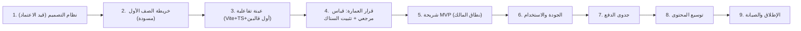

# 🧭 كانفس المشروع الشامل — «تكة» (Takka)

**الإصدار:** 1.0 — 18 أكتوبر 2026
**الاستخدام:** لوحة واحدة تجيب عن: ما المشروع، لمن، كيف يتعلّم، وما العالم، وما الستاك ولماذا، وأين المخاطر والبوابات. كل صندوق هنا مأخوذ من دستور «تكة» ووثائق 00–09، ومحسوم بمقتضى الوثيقة 10 (الرؤية النهائية وحكم الستاك).
**كيف يُقرأ:** الصناديق 1–7 = «لماذا»، 8–12 = «ماذا نبني»، 13–17 = «بأي ثمن وما المخاطر»، 18 = معيار الاتساق النهائي.

```
╔══════════════════════════════════════════════════════════════════════════╗
║  Identity: تكة — أتعلّم وأنا أكتشف، وأقدر أوقف وأرجع وقت ما بدي            ║
╚══════════════════════════════════════════════════════════════════════════╝
```

---

## 1. الهوية والرسالة

| البند | المحتوى |
|---|---|
| **الاسم** | تكة (ثابت) |
| **ما هو** | تطبيق تعلّم ترفيهي عربي، أساسه أوفلاين، لأطفال غزة في الصفوف 1–6 |
| **الرسالة** | تحويل التعلم إلى رحلات قصيرة ممتعة مفهومة، عبر فضول وليس ضغط |
| **ما ليس هو** | بنك أسئلة • نسخة رقمية من الكتاب • لعبة مكافآت يفصلها درس • ادعاء «منهاج كامل» |

## 2. الوعد والسياق الميداني (غزة أولاً)

```
┌─────────────────────────────┬─────────────────────────────┐
│ وعد الطفل                   │ وعد الأسرة                  │
│ تعلّم باكتشاف • خطأ بلا خوف │ محتوى موثق المصدر • تغطية   │
│ • تلميح بلا تأنيب • خروج    │ معلنة بصدق • تقدّم وصفي      │
│ متى شاء بلا خسارة           │ • لا إعلانات • لا بيانات     │
├─────────────────────────────┴─────────────────────────────┤
│ القيود الحاكمة: كهرباء متقطعة • إنترنت شبه معدوم • هواتف   │
│ 2GB RAM وشاشات متضررة • انقطاع طويل عن الدراسة • توتر       │
│ وصدمات تحتاج بيئة آمنة لا ممتحناً                         │
└────────────────────────────────────────────────────────────┘
```

## 3. المستخدمون الثلاثة

| المستخدم | دوره | أهم احتياج |
|---|---|---|
| **الطفل** | المستخدم الأساسي | فهم المطلوب بالنص+الصورة (+صوت اختياري)؛ تجربة وخروج بلا لوم |
| **ولي الأمر** | المضبط والمرافق | ملف رمزي محلي، اختيار الصف والصوت، فهم التقدم والتغطية، بلاغ خطأ |
| **المعلم/المختص** | مرجع استشاري اختياري | لا يشترط توقيعه؛ الفحص الداخلي الموثق هو البوابة |

## 4. نموذج التعلم

- **الحلقة:** ألاحظ ← أفهم ← أجرب ← أكتشف ← أحفظ أو أتابع.
- **الدورة الذرية (~12د):** تنشيط (1د) → نمذجة حسية CPA (1.5د) → ممارسة موجّهة متلاشية (2د) → جولة طلاقة مصغّرة (2.5د) → تحدي نقل في العالم (2د) → تحقق مستقل (1.5د) → تفرّع وتغذية راجعة (1د) → إغلاق آمن (0.5د).
- **الحالات الأربع (لا درجات):** لم يصل إليها بعد / جرّب / أكمل بمساعدة / أظهر إتقاناً مستقلاً — وصف مساند خاص بالمهارة وحدها.
- **التحقق للمساندة لا للإقصاء:** لا يقفل درساً ولا يمنع صفاً تالياً؛ الجسر التأسيسي مقترح لا مفروض.

## 5. العالم والقصة

| العنصر | القرار |
|---|---|
| العالم | «أرخبيل السحاب العجيب» — جزر دافئة ورحلات قصيرة (قابل للتعديل بعد تجربة الأسر) |
| الرفيق | «فطين» — فضولي، في الهامش، لا يمتحن ولا يطالب بالعودة |
| المحرّك القصصي | استعادة العالم: كل مهارة = أثر مرئي (منارة، شجرة، جسر، طائر) |
| الجزر | مشتقّة من المحتوى المتاح فعلياً لكل صف — لا مكان لمبحث لم يُنشر بعد |
| حالات الجزيرة | ساكنة ← صحوة/ترميم ← إزهار (حالات بيانات لا سبريتات منفصلة) |

## 6. الجاذبية الصحية (ممنوعات مطلقة)

لا قلوب تنفد • لا سلاسل أيام عقابية • لا لوحات صدارة عامة • لا صناديق حظ • لا مؤقت ضغط • لا إشعارات استدراج • لا تمرير لا نهائي • لا منافسة بين الإخوة • الحفظ والخروج دائماً بلا سؤال • الجوائز معلنة مسبقاً ولا ترتبط بمدة الاستخدام. **معيار النجاح: الفهم والراحة والعودة الطوعية — لا طول الجلسة.**

## 7. نظام المحتوى وحالة المنهاج

- **البنية:** صف ← مادة ← فصل ← وحدة ← درس ← مهارة ← نشاط (مع مصدر+إصدار+وحدة/صفحة+حالة تدقيق+صوت اختياري).
- **حالة الصف الأول (تدقيق 0.2):** العربية مطابقة جيدة • الإنجليزية مطابقة قوية (14 وحدة) • الرياضيات مطابقة جزئية (قياس الطول/الزمن: قيد تحقق بصري) • الوطنية والحياتية جزئية (2019 مقابل 2024) • الإسلامية والمسيحية: غير متوفرة في رزم غزة.
- **العبارة المعتمدة للنطاق:** «مسار رزم غزة المتاحة للصف الأول» — لا «المنهاج كامل» قبل خريطة تغطية موثقة.
- **الحقوق:** لا نسخ صفحات/رسوم؛ أنشطة أصلية + إحالة مصدر.


## 8. القوالب الثمانية وسياسة المصيّر

| # | القالب | المواد/المهارة | المصيّر |
|---|---|---|---|
| 1 | سحب ومطابقة حسية | الحروف، التصنيف، الأشكال | `dom`+SVG |
| 2 | تتبع مسارات الرسم | كتابة الحروف والأرقام | `canvas2d` |
| 3 | تمييز سمعي بصري | الحركات، الأصوات | `dom`+Howler |
| 4 | مجمع كلمات وجمل | بناء الكلمة والجملة | `dom` |
| 5 | ميزان الكسور | تكافؤ الكسور | `canvas2d` (Phaser عند فيزياء حقيقية) |
| 6 | متاهة منطق وتسلسل | تفكير متعدد الخطوات | `canvas2d` (Phaser عند tilemap/تصادم) |
| 7 | مختبر استقصائي مصغّر | فرضية ← تجربة ← ملاحظة | `canvas2d` (Phaser عند مشاهد/كاميرا) |
| 8 | قصة تفاعلية متفرّعة | فهم قرائي واستنتاج | `dom` |

**القاعدة الحاكمة:** النص والفعل في DOM؛ الحركة المستمرة في Canvas؛ المحرك الثقيل عند الحاجة فقط.

## 9. الستاك — الحكم النهائي للمالك

> ✅ **أقرّه كاتجاه عمل مع شروط** (تفصيل القرار في الوثيقة 10):

| العنصر | الحكم | الشرط / ملاحظة |
|---|---|---|
| **React** | ✅ إقرار | لا تمرير أحداث اللمس عبر حالة React في كل إطار (عبر `refs + rAF`) |
| **TypeScript** | ✅ إقرار | `core-learning` نقي؛ حدود صريحة عبر حزمة `contracts` |
| **Canvas 2.5D لعالم الجزر** | ✅ إقرار بشرطين | قائمة متطلبات مكتوبة + عزل خلف واجهة `WorldStage` (استبدال المصيّر لا إعادة الكتابة) |
| **Phaser لاحقاً** | ✅ إقرار التأجيل | محفّزات: فيزياء صلبة/تصادم • tilemap/مسارات • مشاهد/كاميرا • أو 3 قوالب محتاجة. `import()` ديناميكي فقط |
| **Three.js مؤجَّل** | ✅ إقرار التأجيل | معيار العودة الأول المتوقع: **المجسمات** (رياضيات ص1/وحدة4 وأعلى) • أو فشل 2.5D بصرياً • وحدة عند الطلب فقط |

**إكمال الستاك:** Vite+TS • Zustand • Dexie.js (Repository + `storage.persist()`) • Zod • Howler (Opus/Ogg Mono 24–32kbps) • Capacitor 6 • Vitest • خط عربي WOFF2 مستضاف محلياً.
**الأصول:** أطلس WebP/AVIF + SVG — لا Blender/glTF/KTX2 في هذه المرحلة.
**ما تغيّر عن وثيقة 09:** عالم الجزر Canvas بدل Three.js/R3F؛ خط أصول مبسّط؛ محرّك الأنشطة لكل قالب على حدة.

## 10. ميزانية الأداء والحجم (أهداف قياس لا وعود)

| المؤشر | الهدف |
|---|---|
| APK للـMVP (صف 1، المواد المتاحة) | ≤ 25MB |
| ذاكرة الذروة (جهاز 2GB RAM مرجعي) | ≤ 150MB RSS |
| البدء البارد | ≤ 3 ثوانٍ |
| حزمة JS الأساسية | ≤ ~300KB مضغوطة (تقدير يُقاس) |
| إطارات العالم | 60fps هدف / 30fps مقبول |
| جزيرة في الذاكرة | واحدة + `dispose()` صريح |
| البيانات بعد إعادة التشغيل | لا فقد — يُختبر فعلياً |

## 11. الخصوصية والأوفلاين

- **أوفلاين أصلي:** كل قدرات التطبيق بلا شبكة؛ المحتوى في مساحة ملفات دائمة داخل التطبيق (لا Cache).
- **أدنى بيانات:** لا اسم/حساب/بريد/هاتف/موقع/صور/تسجيلات صوت للطفل؛ ملف محلي رمزي فقط.
- **الـMVP:** لا حسابات، لا مزامنة، لا سحابة، لا إعلانات، لا دفع، لا ميكروفون.
- **الصوت اختياري:** يقرأ ما يُعرَض فقط؛ لا معلومة حصراً بالصوت؛ النص والصورة يبقيان.
- **بلاغ الخطأ:** يُحفظ محلياً عند انقطاع الاتصال ويُصدَّر لولي الأمر.

## 12. الشمال البصري (في انتظار اعتماد المالك)

- **الإحساس المعتمد:** «مغامرة هادئة» (المعتمد الوحيد الذي أقرّه المالك حتى الآن).
- **الاتجاه المقترح (DESIGN.md):** ورق دافئ `#F5F1E6` • حبر بحري `#173F38` • أخضر رحلة `#286253` • مشمشي `#E99B54` • Noto Sans Arabic محلياً • قاعدة 8px • لمس ≈56dp • زوايا 10/16/24.
- **قرار مطلوب:** توحيد هذه اللوحة مع لوحة وثيقة 05 (باستيل صارخة) قبل بناء `ui-kit`.
- **إتاحة:** لا يُعتمد اللون وحده لمعنى النجاح/الخطأ • دعم تقليل الحركة • تباين يُقاس • النصوص داخل العالم = DOM فوق Canvas (موصى به).

## 13. نموذج الولوج المالي المستقبلي (بعد المجاني — غير منفَّذ في MVP)

- **الآن:** مجاني بالكامل — عينة مترابطة + «تكة تفكير» + تأسيس عام.
- **لاحقاً:** المجاني يبقى مفيداً؛ أول درسين فعليين من كل مسار منشور كتجربة.
- **الباقة المستهدفة:** بطاقة فتح مسار صف/إصدار محدد — دفعة واحدة لا تتجدد تلقائياً • لا عداد 365 يوماً • لا قفل لمحتوى حُمّل • حق على جهاز الأسرة • تقدم محلي منفصل لكل طفل.
- **الشيكل** تفضيل عرض محلي؛ العملة/الرسوم/الاستعادة تنتظر Jawwal Pay + سلطة النقد — لا وعود قبل ذلك.
- **الصيانة:** كل تصحيح أو استكمال داخل نطاق الرزمة الموعودة مشمول للمشتري.

## 14. المخاطر الكبرى ومعالجتها

| الخطر | المعالجة |
|---|---|
| إنتاج المحتوى (عنق الزجاجة) | JSON + قوالب + فحص داخلي موثق + عينة مصغّرة أولاً |
| توقّعات 3D مقابل واقع 2.5D | تدوين التنازل + معاينة بصرية معتمدة قبل بناء العالم |
| أجهزة ضعيفة/WebView قديم | بوابة قياس على جهاز مرجعي + تدهور تدريجي |
| تضخّم النطاق | MVP رفيع بموافقة المالك |
| P2P أوفلاين | مؤجل؛ البديل مشاركة ملف/APK |
| TTS مقابل تسجيل | عينة مقارنة على جهاز ضعيف |
| فقدان التقدم/لا استعادة | رسائل صادقة؛ لا وعد قبل بناء آلية واختبارها |
| تباعد الوثائق | كل قرار جديد يُسجَّل في الوثيقة 10 + ملحق في المتأثرة |

## 15. البوابات وخريطة الطريق



**أين نحن الآن:** بوابتا المالك المعلّقتان: (أ) اعتماد النظام البصري، (ب) اعتماد خريطة الصف الأول. لا كود إنتاجي قبل ذلكما.

## 16. مؤشرات النجاح (ليست تقنية)

فهم الطفل للمهمة دون مساعدة مفرطة • قدرته على التوقف وقتما يريد • عودة طوعية بلا استدراج • راحة ولي الأمر من صدق التغطية والوصف • صلابة الحفظ المحلي عند انقطاع الكهرباء. **لا نقيس النجاح بطول الجلسة ولا بعدد مرات الفتح.**

## 17. الاتساق النهائي: كل قرار تقني يخدم هدفاً تربوياً

```
DOM للنص العربي  ← يفهم الطفل المتفاوت القراءة  (إتاحة)
Canvas للحركة    ← يضبط البطارية والذاكرة      (عتاد غزة)
حزمة JSON+Zod    ← محتوى موثق بلا أخطاء تصل للطفل (صدق)
تصيير لكل قالب   ← أرخص أداء كافٍ لكل مهارة   (اقتصاد)
WorldStage معزول ← لا يعاد بناء المشروع عند تغيّر المصيّر (استمرار)
بوابة القياس     ← لا يُعَد برقم قبل قياسه      (صدق)
حصاد وصفي لا درجات ← أمان نفسي بدل الامتحان   (رفاه)
كل ذلك يدور في مدار واحد: الطفل يتعلّم ويحب العودة لأنه فهم وأنجز.
```

---

**مراجع هذه اللوحة:** دستور `تكة.md` • وثائق 00–09 • `DESIGN.md` • الوثيقة 10 (الرؤية النهائية وحكم الستاك).
