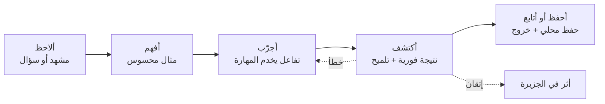
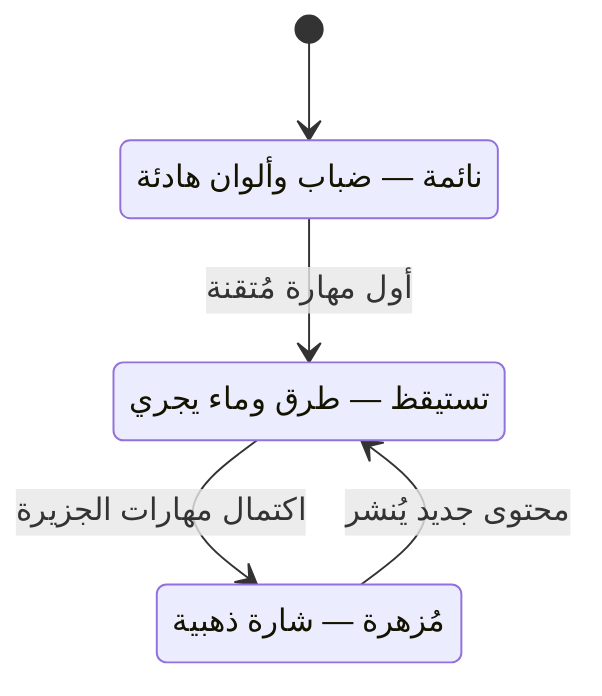
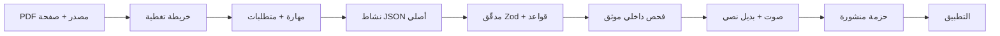
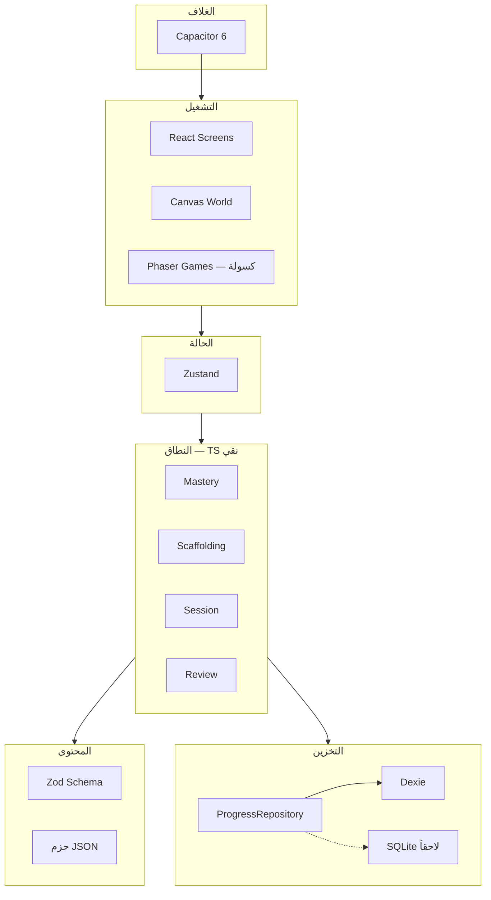
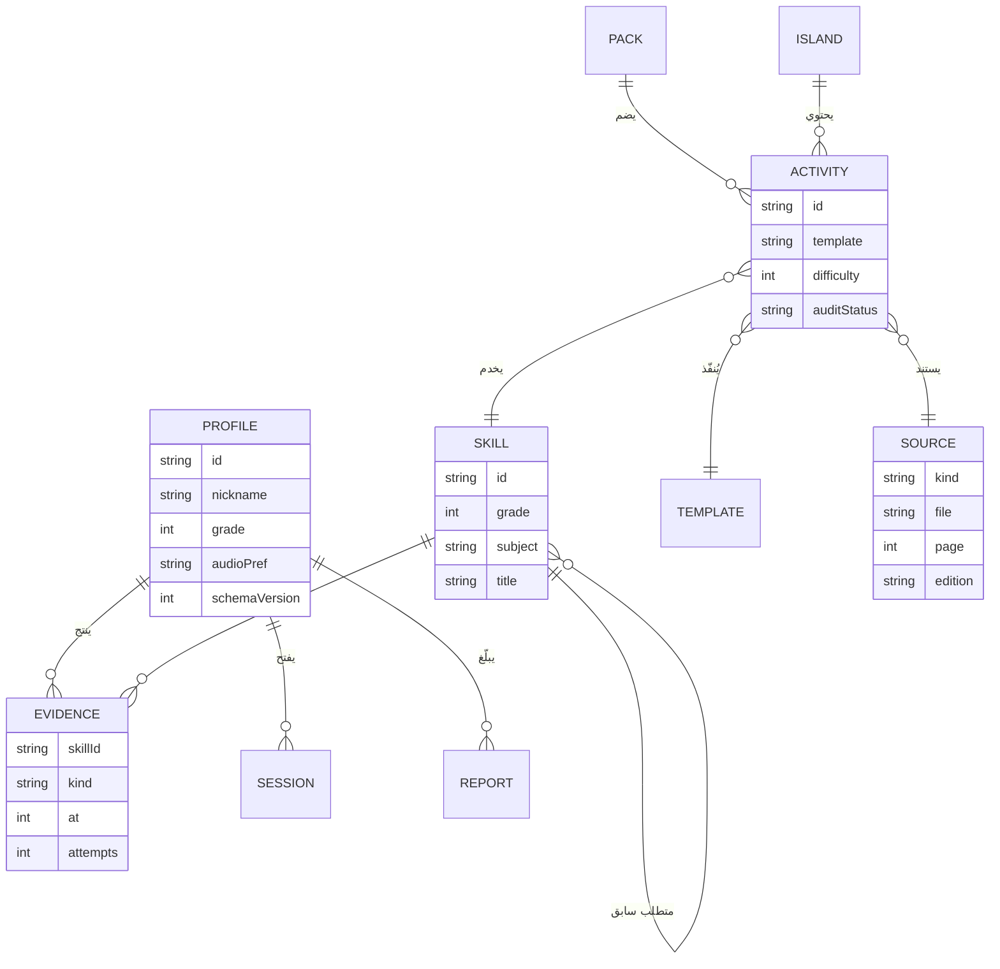
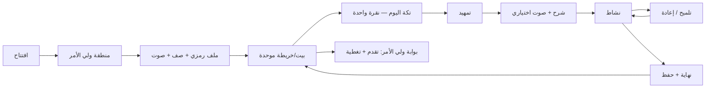

# 🗺️ كانفس المشروع الكامل — «تكة»

> **الإصدار:** 1.0 — 18 تشرين الأول 2026
> **الغرض:** لوحة واحدة تجمع كل ما يلزم لبناء «تكة» ومراجعته: المشكلة، المستخدم، الوعد، النموذج التربوي، العالم، المحتوى، المعمارية، البيانات، الشاشات، الجودة، المخاطر، والخطة.
> **العلاقة بالوثائق:** هذا الملف **مشتق** من `10 - الرؤية النهائية للمشروع`، ويظل **الدستور** (`takka-main/تكة.md`) هو المرجع الحاكم عند أي تعارض.
> **قاعدة الاستخدام:** كل بلوك يحمل حالة (✅ موجود / 🟡 جزئي / ⬜ غير موجود / ⛔ مؤجل) ومالكاً وبوابة. لا يُغلق بلوك إلا بدليل، ولا يُفتح بلوك جديد قبل إغلاق سابقه.

---

## 0. بطاقة المشروع

| البند | القيمة |
| :--- | :--- |
| **الاسم** | تكة (Takka) |
| **النوع** | تطبيق تعلّم ترفيهي عربي، أوفلاين أولاً، لأطفال المرحلة الأساسية |
| **الجمهور الأول** | أطفال غزة، الصفوف 1–6، في البيت بمساعدة ولي الأمر |
| **الرفيق** | «فطين» — شخصية فضولية تستكشف مع الطفل ولا تمتحنه |
| **العالم** | «أرخبيل السحاب العجيب» — جزر عائمة كرتونية تُرمَّم بالتعلم |
| **الوعد** | «أتعلم وأنا أكتشف، وأقدر أوقف وأرجع وقت ما بدي.» |
| **المكدس** | React + TypeScript + Canvas 2.5D · Phaser عند الحاجة · Three.js مؤجل |
| **النموذج المالي** | MVP مجاني بالكامل؛ لاحقاً بطاقة فتح مسار صف (مؤجلة) |
| **المرحلة الحالية** | تصميم النظام ببيانات شكلية + خريطة صف أول مسودة تنتظر اعتماد المالك |
| **حالة الكود** | ⬜ لا يوجد كود تطبيق في المستودع |
| **المالك** | أسامة (صاحب المشروع) |
| **المراجع الناقد** | Argon (Gemini) — مراجعة كل مرحلة قبل العبور |

---

## 1. اللوحة المختصرة (نظرة واحدة)

```text
┌───────────────────────────────────┬───────────────────────────────────┬───────────────────────────────────┐
│ 1. المشكلة                        │ 2. المستخدمون                     │ 3. الوعد                          │
│ • انقطاع تعليمي طويل              │ • الطفل 6–12 (قراءة متفاوتة)      │ • تعلّم قصير واضح                 │
│ • فجوات تأسيسية                   │ • ولي الأمر (يشغّل، يتابع)        │ • توقف بلا خسارة                  │
│ • إنترنت/كهرباء متقطعان           │ • المعلم (مستشار اختياري)         │ • عالم يُرمَّم بالتعلم             │
│ • أجهزة ضعيفة، جهاز أسرة واحد     │                                   │ • لا إعلان ولا دفع للطفل          │
├───────────────────────────────────┼───────────────────────────────────┼───────────────────────────────────┤
│ 4. الحل                           │ 5. الميزة غير المقلَّدة           │ 6. القنوات                        │
│ • «تكة» = جلسة 4–15 دقيقة         │ • محرك إتقان محلي بلا حساب        │ • APK أندرويد (Capacitor)         │
│ • محتوى أصلي موثق بمصدر           │ • عالم 2.5D خفيف على 2GB          │ • نقل ملف APK محلياً              │
│ • صوت اختياري + نص + صورة         │ • تغطية معلنة بصدق، لا ادعاء      │ • مشاركة جهاز الأسرة              │
│ • حفظ محلي + تصدير تقدم           │ • لا تلعيب استدراجي               │                                   │
├───────────────────────────────────┼───────────────────────────────────┼───────────────────────────────────┤
│ 7. بنية التكلفة                   │ 8. المقاييس                       │ 9. المخاطر الحاكمة                │
│ • إنتاج المحتوى هو الكلفة الأكبر  │ • إتقان مستقل ≥ 40%               │ • حجم المحتوى (قاتل)              │
│ • هندسة التطبيق صغيرة نسبياً      │ • معدل تلميح 15–30%               │ • قوالب بلا محتوى                 │
│ • الصوت ~5MB/صف                   │ • نجاح التوقف ≥ 90%               │ • أداء Canvas على 2GB             │
│ • لا كلفة خادم (لا خادم)          │ • عودة طوعية ≥ 50%                │ • حقوق الكتب                      │
└───────────────────────────────────┴───────────────────────────────────┴───────────────────────────────────┘
```

---

## 2. بلوك المشكلة

**الحالة:** ✅ موثق في الوثائق `00`, `01`, `08`

| العنصر | التفصيل |
| :--- | :--- |
| **المشكلة الأساسية** | أطفال انقطعوا عن الدراسة لفترات طويلة، ولديهم فجوات تأسيسية، ويحتاجون تعلماً قصيراً واضحاً يعمل دون إنترنت وعلى أجهزة متواضعة. |
| **المشكلة الثانوية** | التطبيقات التعليمية المتاحة إما ثقيلة (تحتاج اتصالاً وذاكرة)، أو تلعيب سطحي (نقاط وسلاسل) ينهار عند انقطاع الكهرباء. |
| **الفجوة التي نملؤها** | مسار قصير، موثق المصدر، بلا حساب ولا شبكة، يعيد للطفل الإحساس بالكفاءة والسيطرة. |
| **ما لا نحاول حله** | بديل عن المدرسة، أو تغطية المنهاج كاملاً، أو تشخيص طبي/نفسي، أو تعليم متزامن. |

**اختبار صحة المشكلة:** إذا لم يستطع طفل الصف الأول إكمال أول «تكة» وحده بعد شرح واحد، فالتصميم لم يحل المشكلة بعد — بغض النظر عن جمال الشاشة.

---

## 3. بلوك المستخدمين

### 3.1 الطفل

| البعد | الوصف |
| :--- | :--- |
| العمر | 6–12 |
| القدرة القرائية | متفاوتة؛ قد لا يقرأ التعليمة |
| الجلسة | 4–15 دقيقة بحسب الصف |
| الدافع | فضول + كفاءة + أثر مرئي في العالم |
| الخوف | الفشل، العقاب، ضياع التقدم |
| ما يحتاجه | تعليمة واحدة، عنصر تفاعل واحد، تلميح، خروج آمن |

### 3.2 ولي الأمر

| البعد | الوصف |
| :--- | :--- |
| المهمة | يضيف ملفاً رمزياً، يختار الصف، يضبط الصوت، يتابع، يبلّغ عن خطأ |
| ما يريده | صدق في التغطية، لغة غير جارحة، لا مفاجآت مالية |
| ما لا نطلبه منه | بريد، هاتف، هوية، صورة إيصال، كلمة مرور |

### 3.3 المعلم / المختص

- مصدر استشارة اختياري، **ليس بوابة تعطيل**.
- الفحص الداخلي الموثق إلزامي، وتوقيعه الخارجي ليس شرطاً.

### 3.4 مهام المستخدم (Jobs To Be Done)

1. «أعطني شيئاً قصيراً أفعله الآن وأشعر أنني أنجزت.»
2. «أرني أنني تحسّنت دون أن تُشعرني أنني متأخر.»
3. «دعني أوقف الآن وأرجع كما كنت.»
4. «أرني ما تعلّمه طفلي وما لم يُغطَّ بعد بصدق.»

---

## 4. بلوك الوعد والقيمة

**الوعد المركزي:** جلسة قصيرة، مفهومة، قابلة للتوقف، تترك أثراً في عالم الطفل.

| القيمة | لمن | كيف تتحقق تقنياً |
| :--- | :--- | :--- |
| وضوح | الطفل | تعليمة واحدة + صورة + صوت اختياري |
| كفاءة | الطفل | سقالات متلاشية، لا فشل، لا خسارة |
| أمان | الطفل | لا أحمر، لا صوت خطأ، لا مؤقت، خروج دائم |
| صدق | ولي الأمر | بيان تغطية + مصدر + حالة تدقيق |
| خفة | الجهاز | 2.5D، حزم كسولة، ميزانية أداء |
| استمرارية | الأسرة | حفظ محلي ذري + تصدير/استيراد |

**معادلة العودة الصحية:** `عودة = فهم محقَّق + أثر مرئي + توقف مريح − ضغط` — لا `عودة = نقاط + سلاسل + إشعارات`.

---

## 5. بلوك المبادئ غير القابلة للتفاوض

كل مبدأ **قابل للاختبار**، لا شعاراً:

| # | المبدأ | كيف نختبره |
| :--- | :--- | :--- |
| 1 | الطفل يستطيع التوقف في أي لحظة | زر «نوقف هون» ظاهر في كل شاشة نشاط |
| 2 | لا خسارة عند الخطأ | لا نقاط سالبة، لا محاولات محدودة، لا قفل |
| 3 | لا معلومة أساسية في الصوت وحده | كل صوت له نص وصورة مقابلة |
| 4 | كل نشاط مربوط بمصدر أو موسوم «تأسيس» | المدقّق يفشل البناء بدونه |
| 5 | لا ادعاء تغطية كاملة | بيان التغطية يسرد الموجود والناقص |
| 6 | لا حساب ولا شبكة في الجوهر | تشغيل بوضع الطيران من الفتح حتى الإغلاق |
| 7 | لا شراء في رحلة الطفل | لا كلمة «سعر» أو «اشتراك» في أي شاشة طفل |
| 8 | اللمس ≥ 56dp | قياس على شاشة 360dp |
| 9 | اللون ليس الوسيلة الوحيدة | كل حالة لون + رمز + نص |
| 10 | الوضع المنخفض يعطي نفس المحتوى | تشغيل بـ `prefers-reduced-motion` |

---

## 6. بلوك النطاق

### 6.1 داخل النطاق (الآن)

| العنصر | الحد |
| :--- | :--- |
| الصفوف | **الصف الأول فقط** حتى المرحلة 3 |
| المواد | العربية + الرياضيات (الإنجليزية والوطنية بعد إثبات الخط) |
| القوالب | 3 + 1 (سحب/مطابقة، تتبع، استماع/تمييز، ميزان SVG) |
| الأنشطة | 20 نشاطاً موثقاً كهدف أول |
| الشاشات | بيت/خريطة، تمهيد، شرح، نشاط، تلميح، نهاية، بوابة ولي الأمر |
| الصوت | تسجيلات مشتركة صغيرة + بديل نصي |
| التخزين | Dexie + تصدير/استيراد JSON |

### 6.2 خارج النطاق (صراحةً)

| العنصر | الحالة | السبب |
| :--- | :--- | :--- |
| الصفوف 2–6 | ⛔ بعد البوابات | قاعدة التدرج 1→6 في الدستور |
| التربية الإسلامية/المسيحية | ⛔ لا مصدر | لا رزمة غزة متاحة لهما |
| الدفع والترخيص | ⛔ مؤجل | ينتظر رد Jawwal Pay/PMA |
| الحساب والمزامنة والسحابة | ⛔ ممنوع في MVP | الدستور §8 |
| الميكروفون وتقييم النطق | ⛔ ممنوع | خصوصية + لا دليل |
| Three.js / 3D كامل | ⛔ مؤجل | لا حاجة مثبتة |
| مشاركة P2P دون إنترنت | ⛔ غير معتمدة | تعقيد بلا حاجة مثبتة |
| تحليلات عن بعد | ⛔ ممنوع | خصوصية |

### 6.3 منطقة رمادية تحتاج قراراً

- عدد الجزر الظاهرة في الصف الأول: 2 أم 5؟ (الجزيرة تظهر فقط إذا كان لها محتوى منشور).
- هل تُسمّى الجلسة «تكة» في الواجهة؟ (توصية: نعم — اسم العلامة نفسه).
- سقف الحجم: حزمة لكل صف أم سقف 45MB.

---

## 7. بلوك النموذج التربوي



### 7.1 طول الجلسة بحسب الصف

| الصف | الطول | المراحل | تفاعلات |
| :--- | :--- | :--- | :--- |
| 1–2 | 4–6 د | تنشيط، نمذجة، ممارسة، تحقق، احتفال | 3–5 |
| 3–4 | 7–10 د | + طلاقة + نقل أثر | 6–9 |
| 5–6 | 11–15 د | الدورة الثمانية كاملة | 10–14 |

### 7.2 حالات التقدم الأربع

| الحالة | المعنى | ما يراه ولي الأمر |
| :--- | :--- | :--- |
| لم يصل إليها بعد | لم يفتحها أو تجاوزها للاستكشاف | «لسّا ما وصلنا لها في الرحلة» |
| جرّب | تفاعل وغادر قبل التحقق | «استكشف النشاط» |
| أكمل بمساعدة | نجح بعد تلميح/سقالة | «استخدم تلميحاً أو مساعدة» |
| أظهر إتقاناً مستقلاً | نجح بلا مساعدة | «حلّ نشاط التحقق دون تلميح» |

### 7.3 قواعد الإتقان

> المهارة مُتقنة = **3 نجاحات مستقلة** في **جلستين مختلفتين** بفاصل **≥ يوم**، بلا تلميح.

- الانحدار: 21 يوماً بلا دليل → «تحتاج مراجعة» في الاقتراح فقط، لا حذف ولا عقاب.
- لا معدل عام على الطفل، ولا استنتاج أن إتقان مهارة يثبت أخرى.

### 7.4 السقالات

| الدرجة | التدخل | التوقيت |
| :--- | :--- | :--- |
| 1 | نمذجة كاملة من «فطين» | أول لقاء |
| 2 | توجيه بصري (إبراز/سهم) | بعد خطأ 1 |
| 3 | تلميح نصي/صوتي | بعد خطأ 2 |
| 4 | تبسيط المهمة + اقتراح جسر تأسيسي | بعد خطأ 3 |

---

## 8. بلوك العالم البصري

**الحالة:** 🟡 الاتجاه مقرّر، التنفيذ خارج المستودع

| العنصر | القرار |
| :--- | :--- |
| الأسلوب | أيزومتري Low-Poly مسطّح، حواف مستديرة، بلا زوايا حادة |
| التقنية | **Canvas 2.5D** — إسقاط أيزومتري + طبقات |
| الإضاءة | ظلال مرسومة مسبقاً (Baked)، لا إضاءة ديناميكية |
| اللوحة | ورق دافئ `#F5F1E6`، حبر البحر `#173F38`، أخضر الرحلة `#286253`، مشمشي `#E99B54` |
| الخط | Noto Sans Arabic (محزوم محلياً) — بديل Tajawal |
| النصوص | **في DOM دائماً**، لا داخل الكانفس |
| الرفيق | فطين في الهامش، لا في مركز كل شاشة |

### 8.1 حالات الجزيرة



**قاعدة:** الحالة **مشتقة** من بيانات الإتقان، لا مخزّنة كحقل.

### 8.2 الوضع المنخفض

يُفعَّل عند: `deviceMemory < 2GB` أو `hardwareConcurrency ≤ 4` أو إطار > 25ms لثلاث ثوانٍ أو `prefers-reduced-motion`.
النتيجة: خريطة شبه ثابتة، بلا موج/جزيئات، نفس المحتوى والوظائف.

### 8.3 ميزانية الأداء

| البند | السقف |
| :--- | :--- |
| إطارات | 60 هدف / 30 حد أدنى |
| عناصر متحركة | ≤ 120 |
| DPR | ≤ 2 |
| ذاكرة | ≤ 120MB |
| فتح بارد | < 3ث |
| JS أولي | ≤ 450KB gzip |

---

## 9. بلوك هندسة المحتوى

### 9.1 خط الأنابيب



### 9.2 قواعد إلزامية

1. لا نشاط بلا `source` (ملف + صفحة/وحدة + إصدار) أو وسم `foundational`.
2. لا نشاط بلا `audit.status`.
3. لا نسخ نص/رسم/نشيد من الكتب قبل إذن مكتوب.
4. لا اختلاق وحدة أو هدف أو ترتيب لم يذكره المصدر.
5. كل نشاط يمر بفحص: صحة الإجابة، خلو المشتتات من احتمال الصحة، سلامة العربية والتشكيل، ملاءمة العمر، وجود تلميح، مطابقة الصوت.

### 9.3 ميزانية الإنتاج (الرقم الحاسم)

| البند | الصف الأول | ستة صفوف |
| :--- | :--- | :--- |
| دروس/وحدات | ~70 | ~420 |
| أنشطة (6/درس) | ~420 | ~2,500 |
| ساعات (30–60 د/نشاط) | 210–420 | 1,300–2,500 |
| بوتيرة 20 س/أسبوع | 2.5–5 أشهر | 15–30 شهراً |

### 9.4 القوالب

| # | القالب | الحالة | التقنية |
| :--- | :--- | :--- | :--- |
| 1 | سحب ومطابقة | ✅ الآن | DOM + Pointer Events |
| 2 | تتبع حروف/أرقام | ✅ الآن | SVG Path + مسار |
| 3 | استماع وتمييز | ✅ الآن | DOM + Web Audio |
| 5 | ميزان/كسور مبسّط | ✅ الآن | SVG |
| 4 | تجميع كلمات | ⛔ لاحقاً | DOM |
| 6 | متاهة منطقية | ⛔ لاحقاً — **مرشح Phaser الأول** | Phaser |
| 7 | مختبر افتراضي | ⛔ لاحقاً | Phaser/Canvas |
| 8 | قصة متفرعة | ⛔ لاحقاً | DOM |

**قاعدة:** لا قالب قبل 10 أنشطة حقيقية تحتاجه.

---

## 10. بلوك المعمارية التقنية

### 10.1 الطبقات



**قاعدة الاعتماد:** `domain` لا يستورد React ولا Canvas ولا Dexie. **اتجاه واحد فقط.**

### 10.2 المكدس

| الطبقة | التقنية | الترخيص |
| :--- | :--- | :--- |
| البناء | Vite + TypeScript (strict) | MIT |
| الواجهة | React 18/19 | MIT |
| العالم | Canvas 2.5D | — |
| الألعاب | Phaser (كسول) | MIT |
| الحالة | Zustand | MIT |
| التحقق | Zod | MIT |
| التخزين | Dexie | Apache 2.0 |
| الصوت | Howler / Web Audio | MIT |
| الغلاف | Capacitor 6 | MIT |
| الاختبار | Vitest | MIT |
| 3D | Three.js | ⛔ مؤجل |

### 10.3 هيكل المجلدات

```text
التطبيق/src/
├─ domain/      mastery · session · scaffolding · review · content
├─ data/        dexie · export · import
├─ runtime/     screens · world · games · design
├─ assets/      fonts · audio · svg · map
└─ content-packs/
tools/          validator · generators · coverage-report
```

---

## 11. بلوك نموذج البيانات



### قواعد البيانات

| القاعدة | التفصيل |
| :--- | :--- |
| مصدر حقيقة واحد | حالة الجزيرة تُشتق من `EVIDENCE`، لا تُخزَّن |
| كتابة ذرية | كل تغيير في معاملة Dexie واحدة |
| إصدار مخطط | `schemaVersion` + هجرة واضحة |
| ملفات متعددة | كل طفل ملف مستقل على الجهاز نفسه |
| لا حذف | لا يُحذف دليل تعلم إلا بطلب ولي الأمر الصريح |

---

## 12. بلوك الشاشات والرحلات



### 12.1 قائمة الشاشات

| # | الشاشة | الحالة | ملاحظة |
| :--- | :--- | :--- | :--- |
| 1 | افتتاح | ⬜ | زر بدء واحد |
| 2 | منطقة ولي الأمر (بوابة) | ⬜ | تمنع النقر العرضي فقط |
| 3 | ملف رمزي + اختيار صف | ⬜ | بلا بيانات شخصية |
| 4 | إعداد الصوت | ⬜ | عينة + كتم |
| 5 | بيت/خريطة موحدة | 🟡 معاينة | بطاقة «تكة اليوم» + محطات |
| 6 | تمهيد الدرس | 🟡 معاينة | مشهد/سؤال فضولي |
| 7 | الشرح | 🟡 معاينة | مثال + صوت اختياري |
| 8 | النشاط | 🟡 معاينة | عنصر تفاعل واحد |
| 9 | التلميح | 🟡 معاينة | متدرج بلا خصم |
| 10 | نهاية الجلسة | 🟡 معاينة | حفظ + «نوقف هون» |
| 11 | مهمة الوحدة | ⬜ | اختيارية الترتيب |
| 12 | حصاد الفصل | ⬜ | جلسات قصيرة |
| 13 | مراجعة السنة | ⬜ | خريطة وصفية |
| 14 | تكة تفكير | ⬜ | اختيارية |
| 15 | واحة الإثراء | ⬜ | بعد المسار |
| 16 | لوحة ولي الأمر | ⬜ | تقدم + تغطية |
| 17 | إدارة الملفات | ⬜ | إضافة/حذف |
| 18 | تفاصيل المهارة | ⬜ | هدف + مصدر + تدقيق |
| 19 | بيان التغطية | ⬜ | الموجود والناقص |
| 20 | إبلاغ عن خطأ | ⬜ | حفظ محلي |

### 12.2 الحالات التي يجب أن تعمل

- إجابة صحيحة · إجابة خاطئة · صوت غير متوفر · انقطاع الشبكة · لا محتوى للصف · إغلاق التطبيق · نقص مساحة · الطفل يريد التوقف.

---

## 13. بلوك نظام التصميم

| العنصر | القرار |
| :--- | :--- |
| المسافات | أساس 8px (4/8/12/16/24/32/48) |
| الزوايا | 10 حقول · 16 بطاقات · 24 بطاقات محطة |
| اللمس | ≥ 56dp |
| الخط | Noto Sans Arabic محزوم · عنوان 24–28 · نص 16–18 · حد أدنى 14 |
| التباين | ≥ 4.5:1 — **لم يُقس بعد** |
| الحركة | قصيرة وظيفية · احترام `prefers-reduced-motion` |
| اللون | لا معنى باللون وحده: لون + رمز + نص |
| الظلال | خفيفة فقط |

### 13.1 المكونات

شريط علوي خفيف · بطاقة «تكة اليوم» · عقدة محطة · مفتاح صوت · زر تلميح · زر «نوقف هون» · بطاقة ولي الأمر · شارة مصدر/تغطية · حوار تأكيد.

---

## 14. بلوك الأوفلاين والأداء

| البند | القرار |
| :--- | :--- |
| جوهر التطبيق | يعمل كاملاً دون شبكة |
| المحتوى | في مساحة ملفات دائمة، لا Cache |
| الحفظ | ذري عند كل تغيير |
| التخزين الدائم | `navigator.storage.persist()` |
| الحجم | 6–8MB/صف — يحتاج قرار السقف |
| الصوت | Opus 24kbps أحادي ≈ 3KB/ث |
| الفشل | رسالة صادقة، لا شاشة معلّقة |
| الاستعادة | تصدير/استيراد JSON محلي |

---

## 15. بلوك الخصوصية والسلامة

| ممنوع | مسموح |
| :--- | :--- |
| اسم حقيقي، هاتف، بريد، موقع | لقب رمزي محلي |
| صورة الطفل، صوته، ميكروفون | اختيار رمز بصري |
| حسابات، مزامنة، سحابة | ملفات محلية متعددة |
| إعلانات، شراء، تحليلات | بلاغ خطأ محلي |
| إشعارات استدراج | تذكير اختياري داخل التطبيق فقط |

---

## 16. بلوك التلعيب والحدود

| ممارسة | الحكم |
| :--- | :--- |
| ترميم الجزيرة | ✅ مسموح — الفعل التعليمي نفسه |
| شارات كفاءة | ✅ مسموح — معلنة ومحددة مسبقاً |
| فتح أدوات جديدة | ✅ مسموح — دليل على قدرة |
| نقاط XP عامة | ❌ ممنوع |
| سلاسل أيام | ❌ ممنوع |
| حيوات/قلوب | ❌ ممنوع |
| لوحة صدارة | ❌ ممنوع |
| صناديق حظ | ❌ ممنوع |
| مؤقت ضغط | ❌ ممنوع |
| تمرير لا نهائي | ❌ ممنوع |
| إشعار استدراج | ❌ ممنوع |

---

## 17. بلوك المخاطر والافتراضات

| # | الخطر/الافتراض | النوع | التخفيف |
| :--- | :--- | :--- | :--- |
| 1 | حجم المحتوى يوقف المشروع | خطر | تضييق النطاق + خط إنتاج |
| 2 | قوالب بلا محتوى | خطر | قاعدة العشرة |
| 3 | أداء Canvas على 2GB | افتراض | وضع منخفض + قياس فعلي |
| 4 | خط/تشكيل عربي سيئ | خطر | خط محزوم + مراجعة بصرية |
| 5 | ادعاء تغطية كاملة | خطر | بيان تغطية صريح |
| 6 | حقوق الكتب | خطر | أنشطة أصلية + سجل |
| 7 | ضياع التقدم | خطر | ذرية + تصدير |
| 8 | انزلاق تلعيبي | خطر | قائمة ممنوعات في المراجعة |
| 9 | التشتت بين الصفوف | خطر | بوابات الدستور |
| 10 | جدوى الدفع | افتراض | مؤجل حتى رد المزود |
| 11 | فاعلية التعلم | افتراض | لا ندّعي أثراً بلا تجربة |

---

## 18. بلوك خطة التنفيذ

| المرحلة | المخرج | شرط العبور | الحالة |
| :--- | :--- | :--- | :--- |
| 0 | مستودع + عالم Canvas داخل `runtime/world` | بناء ناجح + فتح على جهاز | ⬜ |
| 1 | `domain/` + اختبارات | تغطية ≥ 80% لمنطق الإتقان | ⬜ |
| 2 | Schema + مدقّق + حزمة تجريبية | حزمة تُبنى وتُعرض | ⬜ |
| 3 | 20 نشاطاً حقيقياً بـ3 قوالب | فحص داخلي لكل نشاط | ⬜ |
| 4 | بوابة ولي الأمر + تصدير | ولي أمر يفهم بلا مساعدة | ⬜ |
| 5 | APK ≤ 28MB على 2GB | 30fps + فتح < 3ث | ⬜ |
| 6 | تجربة أسر | موافقة ولي أمر + خصوصية | ⬜ |

**بوابة إلزامية:** حزمة مراجعة للمالك (وArgon إن أمكن) عند نهاية كل مرحلة، ثم توقف.

---

## 19. بلوك المقاييس

| المقياس | التعريف | الهدف **[افتراض]** | التخزين |
| :--- | :--- | :--- | :--- |
| إتقان مستقل | مهارات مستقلة ÷ مُجرَّبة | ≥ 40% | محلي |
| معدل التلميح | تلميحات ÷ تفاعلات | 15–30% | محلي |
| نجاح التوقف | خروج بلا إحباط ملاحظ | ≥ 90% | ملاحظة ولي الأمر |
| عودة طوعية | خلال 72 ساعة | ≥ 50% | محلي |
| فك التعليمة | إتمام أول نشاط بلا مساعدة | ≥ 70% | محلي |
| أداء | إطارات + فتح بارد | 60/30 · < 3ث | قياس يدوي |

**ممنوع قياسه:** مدة الشاشة · عدد الفتحات · ترتيب بين الأطفال.

---

## 20. بلوك القرارات المفتوحة

| # | السؤال | الأثر | مالك القرار |
| :--- | :--- | :--- | :--- |
| 1 | حزمة لكل صف أم سقف 45MB؟ | بنية البيانات والتوزيع | المالك |
| 2 | TTS أم تسجيلات؟ | الحجم والوضوح | قياس على جهاز |
| 3 | عدد الجزر في الصف الأول؟ | التصميم والعالم | المالك |
| 4 | هل تُسمّى الجلسة «تكة»؟ | اللغة والعلامة | المالك |
| 5 | ترتيب العربية أم الرياضيات أولاً؟ | خطة الإنتاج | المالك |
| 6 | عملة ورسوم وقناة الدفع | لاحقاً | Jawwal Pay/PMA |
| 7 | هل يُضاف Three.js لاحقاً؟ | معمارية | دليل من اختبار أسر |

---

## 21. سجل القرارات (ADR مختصر)

| # | التاريخ | القرار | السبب |
| :--- | :--- | :--- | :--- |
| 1 | 2026-10-14 | «مغامرة هادئة» كإحساس بصري | أقره المالك |
| 2 | 2026-10-14 | بيانات شكلية فقط في النموذج | إثبات النظام قبل المحتوى |
| 3 | 2026-10-15 | لا سلاسل/مؤقتات/لوحات صدارة | دستور §6 |
| 4 | 2026-10-18 | **2.5D على Canvas بدل Three.js** | حجم وبطارية وأجهزة ضعيفة |
| 5 | 2026-10-18 | **Phaser مؤجل الاستخدام** | لا حاجة تفاعل مثبتة بعد |
| 6 | 2026-10-18 | **3+1 قوالب بدل 8** | طاقة الإنتاج |
| 7 | 2026-10-18 | **«تكة» متغيرة الطول** | تعارض الانتباه/الدورة |
| 8 | 2026-10-18 | **تصدير/استيراد JSON للتقدم** | يغلق سؤال الاستعادة |
| 9 | 2026-10-18 | **Dexie خلف مستودع مجرّد** | قابلية التبديل |

---

## 22. فهرس الملفات

| الملف | الدور |
| :--- | :--- |
| [`تكة.md`](takka-main/تكة.md) | الدستور الحاكم |
| [`DESIGN.md`](takka-main/DESIGN.md) | نظام التصميم 0.1 |
| [`10 - الرؤية النهائية`](10%20-%20الرؤية%20النهائية%20للمشروع%20%28Final%20Vision%29.md) | الرؤية والقرار المعماري |
| [`11 - كانفس المشروع`](11%20-%20كانفس%20المشروع%20الكامل%20%28Project%20Canvas%29.md) | هذا الملف |
| [`00`](00%20-%20الرؤية%20الشاملة%20والميثاق%20المعماري%20للمشروع.md) … [`09`](09%20-%20المناظرة%20المعمارية%20والهندسية%20للمشروع%20والمكدس%20المفتوح%20المصدر.md) | وثائق الأساس |
| [`الصف الأول.md`](takka-main/العمل/تدقيق%20المنهاج/الصف%20الأول.md) | خريطة الصف الأول 0.2 |
| [`manifest.csv`](takka-main/المراجع/رزم%20غزة/manifest.csv) | فهرس المصادر (24 ملفاً · 898.8 MiB) |
| [`تصور النظام الأولي.html`](takka-main/العمل/التصميم/تصور%20النظام%20الأولي.html) | معاينة ببيانات شكلية |

---

## 23. قائمة الإنجاز لكل بلوك (Definition of Done)

| البلوك | لا يُغلق إلا إذا… |
| :--- | :--- |
| المشكلة | وُثّق مصدرها وحدودها |
| المستخدم | جُرّبت رحلة الطفل وولي الأمر مع شخص واحد على الأقل |
| الوعد | كل قيمة لها اختبار في الشاشة |
| المبادئ | كل مبدأ له فحص آلي أو يدوي |
| النطاق | مكتوب ومعلن ولا يفتح بلوكاً مؤجلاً |
| التربوي | قواعد الإتقان مغطاة باختبارات |
| العالم | يعمل بوضع منخفض + نص في DOM |
| المحتوى | مدقّق يفشل البناء عند نقص المصدر |
| المعمارية | `domain` بلا أي استيراد من React |
| البيانات | تصدير/استيراد يعملان على ملف حقيقي |
| الشاشات | كل حالة من §12.2 لها سلوك محدد |
| التصميم | تباين مقيس + لمس مقيس |
| الأوفلاين | تشغيل كامل بوضع الطيران |
| الخصوصية | لا حقل شخصي واحد في المخطط |
| التلعيب | لا ممارسة ممنوعة في أي شاشة |
| المخاطر | كل خطر له إشارة إنذار |
| الخطة | كل مرحلة لها شرط عبور مكتوب |
| المقاييس | كل مقياس له تعريف ومكان تخزين |

---

## 24. كيف تستخدم هذا الكانفس في جلسة عمل

1. **قبل أي مهمة:** اقرأ البلوك المتعلق بها فقط + الدستور.
2. **أثناء العمل:** غيّر حالة البلوك (⬜ → 🟡) عند البدء، ووثّق القرار في §21.
3. **عند الانتهاء:** مرّ على قائمة §23 للبلوك الذي عملت عليه.
4. **عند الخلاف:** الدستور يحكم؛ إن خالفه هذا الملف فالدستور أولى، ويُصحَّح هذا الملف.
5. **عند نهاية مرحلة:** جهّز حزمة مراجعة المالك، وتوقف.
