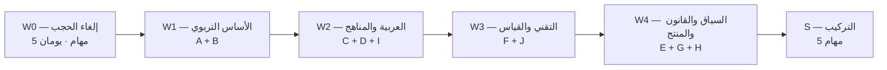

# 🔬 خطة مهام البحث والاستطلاع للوكلاء — «تكة»

> **الإصدار:** 1.0 — 18 تشرين الأول 2026
> **الغرض:** عقود مهام جاهزة للإسناد إلى وكلاء البحث. كل بطاقة مهمة = مدخل واحد لوكيل واحد، بمخرج محدد ومعيار قبول قابل للفحص.
> **المرجع الحاكم:** دستور المنتج `takka-main/تكة.md`، ثم `10 - الرؤية النهائية` و`11 - كانفس المشروع`. عند أي تعارض، الدستور أولى.
> **القاعدة الذهبية:** لا مهمة بلا **قرار تخدمه**. إن لم تجد المهمة في §8 (مصفوفة التغطية)، فهي ترفيه بحثي لا عمل.

---

## 0. كيف تُستخدم هذه الخطة

### 0.1 ما هذا الملف، وما ليس

| هو | ليس |
| :--- | :--- |
| عقود مهام قابلة للنسخ إلى وكيل. | بحثاً جاهزاً أو خلاصة نتائج. |
| قائمة قرارات يخدمها كل بحث. | قائمة قراءات أو اهتمامات عامة. |
| بوابة جودة تمنع الادعاء بلا دليل. | مسوّغاً لتأخير البناء. |

### 0.2 الموجات الأربع



- **W0** تُنفَّذ فوراً وبالتوازي؛ هدفها رفع الحجب عن الهندسة، لا إنتاج معرفة.
- **W1 → W4** تُنفَّذ على موجات؛ داخل الموجة يمكن تشغيل 4–6 وكلاء بالتوازي.
- **S** لا تبدأ قبل إغلاق الموجة الرابعة؛ مخرجها تحديث وثائق القرار.

### 0.3 الأدوار الخمسة

| الدور | يتولى | مخرجاته تُقرأ بواسطة |
| :--- | :--- | :--- |
| **باحث تربوي** | A, B, C, D, J1 | مصمم المحتوى والمالك |
| **باحث لغة عربية** | C, I1, I4 | كاتب المحتوى |
| **مهندس أداء** | F, W0 | قائد البناء |
| **باحث سياق وسياسات** | G, H, E | المالك |
| **مهندس منتج** | I2, I3, J2, S | قائد البناء والمالك |

### 0.4 قاعدة الإغلاق

> **لا تُغلق مهمة إلا بملف بحث مكتمل الأقسام السبعة (§1.6) + اجتياز بوابة الجودة (§6) + سطر واحد يقول: «هذا ما يتغيّر في تكة نتيجة هذا البحث».**

---

## 1. بروتوكول البحث الإلزامي

> يُنسخ هذا القسم حرفياً في مقدمة كل برومبت وكيل (§7).

### 1.1 سلّم المصادر

| الدرجة | أمثلة | الاستخدام |
| :--- | :--- | :--- |
| **1 — أساسي** | مراجعة منهجية، تحليل تلوي، تجربة عشوائية، تقرير حكومي/دولي رسمي (وزارة، OECD، UNESCO، IES/WWC, EEF, MEXT, MOE China) | يُبنى عليه القرار |
| **2 — مساند** | مراجعة نطاقية، دراسة حالة، تقرير منظمة، كتاب أكاديمي محكّم | يدعم ويوسّع |
| **3 — سياقي** | مقال، مدونة، صفحة منتج، فيديو، منشور مجتمعي | للاستكشاف فقط، **لا يُستند إليه وحده** |

**قاعدة:** كل ادعاء جوهري يحتاج مصدراً من الدرجة 1 أو 2. أي ادعاء بدرجة 3 يُوسم `[سياقي — غير حاسم]`.

### 1.2 وسوم قوة الدليل (متوافقة مع الدستور §3.3)

| الوسم | المعنى |
| :--- | :--- |
| `[دليل قوي]` | مراجعة منهجية أو تجارب متعددة متسقة |
| `[دليل متوسط]` | دراسات محدودة أو نتائج متباينة |
| `[دليل محدود]` | دراسة واحدة أو عينة صغيرة |
| `[غير مباشر]` | دليل من سياق آخر (لغة/بلد/عمر مختلف) |
| `[فرضية تصميم]` | قرارنا نحن، لا نتيجة بحث |

### 1.3 صيغة الاقتباس الإلزامية

```text
[العنوان الأصلي بالإنجليزية] — المؤلف/الجهة، السنة — نوع المصدر (مراجعة/تجربة/تقرير)
الرابط: https://...
تاريخ الاطلاع: YYYY-MM-DD
ما يدعمه فعلاً: جملة واحدة.
حدوده: العمر/اللغة/البلد/حجم العينة.
```

### 1.4 سجل البحث (إلزامي في نهاية كل ملف)

| الاستعلام | المصدر الذي جُلب | قُبل/استُبعد | السبب |
| :--- | :--- | :--- | :--- |

**لماذا:** يمنع تكرار العمل، ويسمح لك بالتحقق من التغطية، ويكشف ما لم يوجد أصلاً.

### 1.5 الممنوعات الثمانية

1. اختلاق دراسة أو رقم أو رابط أو اقتباس.
2. ترجمة عنوان بحث كأنه نتيجته.
3. تعميم دليل إنجليزي K–3 على العربية وغزة دون وسم `[غير مباشر]`.
4. تقديم «أفضل طريقة» بلا سياق (عمر، مادة، جهاز، معلم).
5. الاستشهاد بملخص مدونة بدل الورقة الأصلية.
6. تجاهل النتائج المخالفة أو الفاشلة في التكرار (replication failures).
7. خلط «شائع في المنتجات» مع «مثبت في البحث».
8. توصية بلا «ماذا يعني لتكة» + «ما الذي يغيّره في الكود/التصميم».

### 1.6 بنية كل ملف بحث (سبعة أقسام)

1. **سؤال المهمة** ولماذا طُرح.
2. **ما وجدناه** — مرتّباً بقوة الدليل، لا بالجاذبية.
3. **ما لا نعرفه / تناقض الأدلة.**
4. **ما ينطبق على تكة** وما لا ينطبق (وسم كل بند).
5. **أثر مباشر على المنتج** — قرار، أو تعديل واجهة، أو تعديل محتوى.
6. **الأسئلة المفتوحة للمالك** (بحد أقصى 5).
7. **المصادر + سجل البحث.**

### 1.7 قاعدة «ماذا يعني لتكة»

كل ملف ينتهي بجدول:

| التوصية | الأثر على تكة | الكلفة | الثقة | القرار المطلوب |
| :--- | :--- | :--- | :--- | :--- |

---

## 2. هيكل مجلدات البحث

```text
takka-main/البحث/
├─ 00-تركيب/                 # مخرجات S
├─ 01-تربوي/                 # A, B
├─ 02-عربية/                 # C, I1
├─ 03-رياضيات-ومواد/         # D
├─ 04-تقني/                  # F, W0
├─ 05-سياق-ومستخدمون/        # G
├─ 06-قانوني-ومنصة/          # H
├─ 07-منتج-ومنافسون/         # E
├─ 08-إنتاج-المحتوى/         # I2, I3, I4
└─ 09-قياس/                  # J
```

**تسمية الملف:** `R-{ID} - {عنوان قصير}.md` — مثال: `R-A1 - اليابان توكاتسو ودرس البحث.md`

---

## 3. فهرس المهام

### W0 — إلغاء الحجب (فوري، بالتوازي)

| ID | المهمة | الجهد | المخرج | يخدم قرار |
| :--- | :--- | :--- | :--- | :--- |
| W0-1 | قياس أداء Canvas على جهاز أندرويد ضعيف | 4 س | `R-W01 - قياس Canvas.md` | 2.5D أم لا |
| W0-2 | خط الأساس لحجم الحزمة (Vite + Capacitor) | 3 س | `R-W02 - خط أساس الحجم.md` | سقف الحجم |
| W0-3 | اختبار خط عربي محزوم مع التشكيل | 3 س | `R-W03 - اختبار الخط.md` | الخط المعتمد |
| W0-4 | مقارنة TTS مقابل التسجيل (عينة عربية) | 6 س | `R-W04 - عينة الصوت.md` | الصوت |
| W0-5 | اختبار التخزين والاستمرارية على WebView | 4 س | `R-W05 - التخزين.md` | Dexie/OPFS/SQLite |

### A — الأنظمة التربوية الدولية

| ID | المهمة | الجهد | يخدم قرار |
| :--- | :--- | :--- | :--- |
| A1 | اليابان: توكاتسو، درس البحث، الرياضيات، القراءة | 8 س | طول الجلسة، إدارة التقدم |
| A2 | الصين: إتقان شنغهاي، التأسيس المزدوج، سياسة 2021 | 8 س | الطلاقة، حدود الاستخدام |
| A3 | أوروبا الشمالية: فنلندا، إستونيا، السويد | 6 س | التقييم للمساندة |
| A4 | بريطانيا: EEF، إتقان الرياضيات، الفونيكس | 6 س | السقالات والتغذية الراجعة |
| A5 | مونتيسوري/ريجيو/والدورف: دليل أم أيديولوجيا | 5 س | الاستقلالية والاختيار |
| A6 | أمريكا: WWC، تدرج الرياضيات، Science of Reading | 6 س | القوالب والتدرج |
| A7 | سياقات الأزمات: TaRL، Kolibri، التعليم المتسارع | 8 س | الجسر التأسيسي |

### B — علم التعلم

| ID | المهمة | الجهد | يخدم قرار |
| :--- | :--- | :--- | :--- |
| B1 | الاسترجاع والتباعد والتشابك عند 6–12 | 6 س | قواعد الإتقان والمراجعة |
| B2 | الحمل المعرفي، الأمثلة المحلولة، الشرح الصريح | 6 س | بنية الشرح والسقالات |
| B3 | الدافعية والتلعيب: ما يثبت وما لا يثبت | 7 س | قائمة الممنوعات |
| B4 | التغذية الراجعة: النوع والتوقيت | 5 س | نصوص التغذية الراجعة |
| B5 | ما وراء المعرفة عند الأطفال الصغار | 4 س | أسئلة «كيف عرفت؟» |
| B6 | التعلم الرقمي: ألعاب، تكيفي، معلم ذكي | 8 س | هل نبني تكيفاً؟ |
| B7 | الصعوبات التعليمية: ديسلكسيا، ديسكالكوليا | 5 س | حدود التطبيق |

### C — العربية والقراءة

| ID | المهمة | الجهد | يخدم قرار |
| :--- | :--- | :--- | :--- |
| C1 | بنية العربية: أشكال الحروف، الاتصال، التشكيل | 7 س | محتوى الحروف والتشكيل |
| C2 | الازدواجية: فصحى/عامية والجسر الشفهي | 6 س | لغة التعليمات |
| C3 | طرق تعليم القراءة العربية (نورانية، مقاطع، فونيكس) | 8 س | قالب التتبع والتمييز |
| C4 | المفردات والفهم: الحجم والمستوى | 5 س | بنك الكلمات |
| C5 | الكتابة والخط على الشاشة اللمسية | 5 س | قالب التتبع |
| C6 | الإنجليزية كلغة أجنبية لطفل عربي | 4 س | مادة الإنجليزية |

### D — الرياضيات والمواد

| ID | المهمة | الجهد | يخدم قرار |
| :--- | :--- | :--- | :--- |
| D1 | الحس العددي: التدرج والطلاقة والقلق الرياضي | 7 س | تدرج الرياضيات |
| D2 | العلوم والوطنية/الحياتية للصفوف الصغرى | 5 س | قوالب المواد |
| D3 | تصميم أسئلة الرياضيات والمشتتات والأخطاء الشائعة | 6 س | بنك الأسئلة |

### E — منتجات ومنافسون

| ID | المهمة | الجهد | يخدم قرار |
| :--- | :--- | :--- | :--- |
| E1 | تحليل 12 تطبيقاً تعليمياً (حلقة، حجم، أوفلاين، عربية) | 10 س | القوالب والتموضع |
| E2 | أدوات أوفلاين: Kolibri، RACHEL، Kiwix، Sugarizer | 5 س | نموذج الحزم |
| E3 | أنماط تلعيب مرتبطة بتعلم فعلي | 6 س | §16 في الكانفس |

### F — تقني

| ID | المهمة | الجهد | يخدم قرار |
| :--- | :--- | :--- | :--- |
| F1 | أداء Canvas 2D وWebView على أندرويد منخفض | 6 س | 2.5D وحدوده |
| F2 | Phaser: الحجم، الأداء، حدود العربية | 5 س | متى نضيف Phaser |
| F3 | التخزين: IndexedDB، OPFS، SQLite، الاستمرارية | 6 س | Dexie أم بديل |
| F4 | الصوت: Opus، الضجيج، التطبيع، TTS أوفلاين | 6 س | ميزانية الصوت |
| F5 | الخطوط العربية: التجزئة، الأداء، التشكيل | 5 س | الخط والحجم |
| F6 | الحجم والتوزيع: Vite، APK، حزم، تحديث | 6 س | سقف الحجم |
| F7 | التوزيع في غزة: متجر، تحميل مباشر، تحديث | 4 س | قناة التوزيع |

### G — السياق والمستخدمون

| ID | المهمة | الجهد | يخدم قرار |
| :--- | :--- | :--- | :--- |
| G1 | مشهد الأجهزة والاتصال والكهرباء في غزة | 6 س | الأهداف التقنية |
| G2 | بروتوكولات اختبار الاستخدام مع الأطفال | 5 س | خطة التجربة |
| G3 | التصميم الحساس للصدمات: ما يثبت وما يُدّعى | 6 س | قائمة الممنوعات |
| G4 | الإتاحة: WCAG، حركي، بصري، TalkBack عربي | 5 س | متطلبات الوصول |

### H — قانوني ومنصة

| ID | المهمة | الجهد | يخدم قرار |
| :--- | :--- | :--- | :--- |
| H1 | حقوق رزم غزة والمنهاج الفلسطيني | 5 س | ما يجوز نسخه |
| H2 | تراخيص الأصول: خطوط، صوت، رسوم، أيقونات | 4 س | سجل التراخيص |
| H3 | متطلبات المتاجر لتطبيقات الأطفال | 4 س | بيان البيانات |
| H4 | الدفع: Jawwal Pay وPMA (مؤجل) | 6 س | نموذج لاحق |

### I — إنتاج المحتوى

| ID | المهمة | الجهد | يخدم قرار |
| :--- | :--- | :--- | :--- |
| I1 | دليل كتابة عربية للأطفال وكتابة الأسئلة | 6 س | أسلوب المحتوى |
| I2 | خرائط الصفوف 2–6 (مهمة لكل صف) | 12 س/صف | التغطية والتوسع |
| I3 | دليل الأسلوب البصري 2.5D ومواصفات الأصول | 8 س | إنتاج الرسوم |
| I4 | إنتاج الصوت: نص، تسجيل، معايير | 5 س | خط الصوت |

### J — القياس

| ID | المهمة | الجهد | يخدم قرار |
| :--- | :--- | :--- | :--- |
| J1 | قياس التعلم دون تجربة عشوائية | 6 س | ما يجوز ادعاؤه |
| J2 | مقاييس محلية غير تتبعية | 4 س | لوحة ولي الأمر |

### S — التركيب

| ID | المهمة | الجهد | المخرج |
| :--- | :--- | :--- | :--- |
| S1 | مصفوفة «دليل → قرار» موحّدة | 6 س | `S1-مصفوفة-القرار.md` |
| S2 | تحديث ملفي 10 و11 بالنتائج | 5 س | نسخة 1.1 |
| S3 | مواصفة المحتوى v1 (نشاط، مهارة، مصدر، تدقيق) | 6 س | `S3-مواصفة-المحتوى.md` |
| S4 | بروتوكول القياس على الأجهزة | 4 س | `S4-بروتوكول-القياس.md` |
| S5 | سجل «ما لا نعرفه» | 3 س | `S5-المجهولات.md` |

**الإجمالي التقديري:** ~250 ساعة بحث، منها 20 ساعة حرجة (W0) تسبق أي كود.

---

## 4. بطاقات المهام

> كل بطاقة قابلة للنسخ في §7. الحقول: الهدف · أسئلة · مصادر بداية · المخرج · معيار القبول · يخدم.

---

### W0 — إلغاء الحجب

#### W0-1 · قياس أداء Canvas على جهاز أندرويد ضعيف
- **الهدف:** معرفة ما إذا كان عالم 2.5D الحالي يعمل بـ30fps على جهاز 2GB، قبل تثبيت القرار.
- **أسئلة:** ما متوسط الإطارات لخريطة بعدد N عنصراً؟ أين الاختناق (رسم/ظلال/نص)؟ أثر DPR 1 مقابل 2؟ أثر `offscreenCanvas`؟
- **الطريقة:** قياس فعلي على جهاز (أو محاكاة Chrome DevTools CPU 6× + شبكة مقيّدة كبديل مُوسم).
- **المخرج:** جدول: عناصر/إطارات/ذاكرة/حرارة تقديرية + عتبة العناصر الآمنة.
- **القبول:** أرقام من جهاز فعلي أو محاكاة موسومة بوضوح، لا تقديرات.
- **يخدم:** قرار 2.5D (ملف 10 §8.5).

#### W0-2 · خط الأساس لحجم الحزمة
- **الهدف:** رقم حقيقي لحجم APK الفارغ + React + Vite + Capacitor.
- **أسئلة:** حجم JS الأساسي؟ حجم WebView overhead؟ كم يتبقى من 25MB للمحتوى؟
- **المخرج:** تفكيك حجم بالكيلوبايت لكل اعتماد.
- **القبول:** أرقام `vite build` + APK مفكوك، مع الأمر المستخدم.
- **يخدم:** سقف الحجم (ملف 10 §13.2).

#### W0-3 · اختبار خط عربي محزوم مع التشكيل
- **الهدف:** اختيار الخط النهائي بناءً على قياس لا ذوق.
- **أسئلة:** أي خط يعرض الفتحة/الضمة/الشدة دون تداخل في 14–24px؟ حجم WOFF2 بعد التجزئة؟ أداء التشكيل؟
- **مقارنة:** Noto Sans Arabic · Tajawal · Cairo · Readex Pro · IBM Plex Sans Arabic.
- **المخرج:** جدول مقارنة + لقطات + توصية.
- **القبول:** لقطات فعلية على شاشة 360dp + حجم كل خط.
- **يخدم:** الخط (DESIGN.md §الخطوط).

#### W0-4 · عينة صوت: TTS مقابل التسجيل
- **الهدف:** حسم سؤال الصوت المفتوح منذ إصدار الدستور.
- **أسئلة:** أي خيار أوضح للطفل في نطق التشكيل وأواخر الكلمات؟ الحجم؟ يعمل أوفلاين؟ على جهازين ضعيفين؟
- **الخيارات:** Android TTS عربي · Piper · eSpeak-NG · تسجيل بشري · تسجيل + TTS احتياطي.
- **المخرج:** عينة قابلة للسماع + جدول وضوح/حجم/أداء.
- **القبول:** تشغيل فعلي أوفلاين، وقياس حجم الدقيقة الواحدة لكل خيار.
- **يخدم:** الصوت (ملف 10 §13.1، دستور §5).

#### W0-5 · التخزين والاستمرارية على WebView
- **الهدف:** ضمان ألا يضيع تقدم الطفل عند إغلاق مفاجئ أو نقص مساحة.
- **أسئلة:** هل `navigator.storage.persist()` يعمل فعلياً على WebView أندرويد؟ متى يحذف النظام IndexedDB؟ هل OPFS أكثر صموداً؟ سلوك Capacitor Filesystem؟
- **المخرج:** مصفوفة سلوك + توصية + خطة تصدير/استيراد.
- **القبول:** تجربة إغلاق قسري + مسح Cache + إعادة فتح.
- **يخدم:** التخزين (ملف 10 §11، دستور §8).

---

### A — الأنظمة التربوية الدولية

#### A1 · اليابان: توكاتسو، درس البحث، الرياضيات، القراءة
- **الهدف:** استخراج ما يمكن نقله إلى تطبيق فردي، وفصل ما يحتاج مدرسة ومعلمين.
- **أسئلة:** ما «توكاتسو» وما مكوناته؟ ما دور «درس البحث» (Lesson Study) في تحسين الدرس؟ كيف يُدرَّس الحساب الابتدائي (تدرج، تمثيلات، مسائل)؟ كيف تُعلَّم القراءة (kokugo)؟ كيف يُدار التقدم دون ترتيب تنافسي؟
- **مصادر بداية (تحقق منها):** MEXT Course of Study، أدبيات Tokkatsu الإنجليزية، دراسات Lesson Study، كتب الحساب الابتدائي اليابانية المترجمة.
- **المخرج:** جدول «مكوّن → يحتاج معلم؟ → قابل للنقل إلى تكة؟».
- **القبول:** ≥6 مصادر درجة 1–2، وفصل صريح بين ما ينتقل وما لا ينتقل.
- **يخدم:** طول الجلسة، إدارة التقدم، السقالات.

#### A2 · الصين: إتقان شنغهاي، التأسيس المزدوج، سياسة 2021
- **الهدف:** فهم كيف تُبنى الطلاقة بلا ملل، وماذا تقول السياسة الصينية عن حدود الواجب والشاشة.
- **أسئلة:** ما «المعرفة الأساسية + المهارة الأساسية»؟ كيف يُنوَّع التدريب (variation theory)؟ ما أثر سياسة 2021 (تقليل الواجب والتدريس الخصوصي) على المنتجات التعليمية؟ ما قيود وقت اللعب للقاصرين وما مسوّغها؟
- **المخرج:** تقرير + «ما نأخذه / ما نتجنبه».
- **القبول:** مصادر رسمية صينية أو مراجعات محكّمة؛ لا اعتماد على مقالات إخبارية وحدها.
- **يخدم:** جولة الطلاقة، حدود الاستخدام، قائمة الممنوعات.

#### A3 · أوروبا الشمالية: فنلندا، إستونيا، السويد
- **الهدف:** كيف تقيس هذه الأنظمة التقدم للمساندة لا للترتيب، وكيف تبني منصات رقمية تعمل في المدرسة.
- **أسئلة:** كيف يعمل التقييم التكويني الفنلندي؟ كيف وصلت إستونيا لقمة PISA رقمياً؟ ما دور المنصات الوطنية (eKool ونظائرها)؟ ما حدود «التعلم الظواهري»؟
- **المخرج:** جدول «ممارسة → دليل → قابلية النقل».
- **القبول:** تمييز واضح بين ما يثبته البحث وما هو سياسة تعليمية.
- **يخدم:** بوابة ولي الأمر، التقييم، لغة الحالات الأربع.

#### A4 · بريطانيا: EEF، إتقان الرياضيات، الفونيكس
- **الهدف:** الحصول على أرقام أثر قابلة للاستخدام في ترتيب أولويات الميزات.
- **أسئلة:** ما حجم الأثر في EEF Toolkit للرياضيات الابتدائية والقراءة والتغذية الراجعة؟ ما «Teaching for Mastery» وحدوده؟ ما دليل الفونيكس المنهجي وأين لا ينطبق على العربية؟
- **المخرج:** جدول أحجام أثر + تحذيرات + ما يترجم إلى قرار.
- **القبول:** أرقام من المصدر الأصلي لا من ملخصات.
- **يخدم:** أولويات القوالب، التغذية الراجعة، القراءة.

#### A5 · مونتيسوري/ريجيو/والدورف: دليل أم أيديولوجيا
- **الهدف:** فصل ما يسنده البحث من فلسفة هذه المناهج، قبل استعارة «الاستقلالية» أو «الاختيار».
- **أسئلة:** ما جودة أدلة مونتيسوري (دراسات، أحجام عينات، تكرار)؟ ما القابل للنقل رقمياً؟ أين تتعارض مع الحاجة إلى شرح صريح للأطفال ذوي الفجوات؟
- **المخرج:** تقرير نقدي قصير + قرار: ماذا نستعير.
- **القبول:** ذكر الدراسات المعاكسة أو الفاشلة في التكرار.
- **يخدم:** حرية الاختيار، بنية النشاط.

#### A6 · أمريكا: WWC، تدرج الرياضيات، Science of Reading
- **الهدف:** تثبيت التدرج والممارسات ذات الدليل الأقوى في القراءة والرياضيات.
- **أسئلة:** ما توصيات WWC للرياضيات K–6 والقراءة K–3 بدرجاتها؟ ما تدرج الحس العددي في المعايير؟ ما «Science of Reading» وما حدودها؟
- **المخرج:** جدول توصية → درجة دليل → تطبيق في تكة.
- **القبول:** درجة الدليل منقولة كما صنّفها المصدر.
- **يخدم:** تدرج المحتوى، السقالات، التقييم.

#### A7 · سياقات الأزمات والتعافي التعليمي
- **الهدف:** هذا هو الأقرب لسياق غزة؛ يجب أن يتقدم على الجميع في الأولوية.
- **أسئلة:** كيف يعمل TaRL (التعليم بالمستوى)؟ كيف تُبنى «الجسور التأسيسية» في التعلم المتسارع؟ ما دروس Kolibri وECW وINEE؟ كيف تُدار الفجوات بعد انقطاع سنوات؟ ما دليل برامج التعلم عن بعد في النزاعات؟
- **المخرج:** تقرير مركزي + توصية بجسر تأسيسي مبني على TaRL.
- **القبول:** ≥8 مصادر، منها تقارير منظمات رسمية وتقييمات برامج.
- **يخدم:** الجسر التأسيسي، التدرج، التغطية، تصميم المحتوى.

---

### B — علم التعلم

#### B1 · الاسترجاع والتباعد والتشابك عند 6–12
- **الهدف:** تحويل قاعدة «3 مرات مستقلة في جلستين» من حدس إلى قاعدة مسندة.
- **أسئلة:** ما حجم أثر الاسترجاع عند الأطفال؟ كيف يختلف عن البالغين؟ ما أفضل فواصل للمراجعة في هذا العمر؟ هل التشابك مفيد أم ضار للمبتدئين؟
- **المخرج:** جدول توصية → فاصل مقترح → قاعدة في المحرك.
- **القبول:** تمييز بين أدلة البالغين وأدلة الأطفال؛ ذكر حدود العمر.
- **يخدم:** قواعد الإتقان (ملف 10 §6.2) والمراجعة (§6.4).

#### B2 · الحمل المعرفي، الأمثلة المحلولة، الشرح الصريح
- **الهدف:** تثبيت بنية الشرح: متى نُظهر مثالاً محلولاً كاملاً، ومتى نطلب المحاولة.
- **أسئلة:** ما «أثر المثال المحلول» و«انعكاس الخبرة»؟ ما مبادئ Rosenshine؟ متى يصبح الشرح الصريح عبئاً؟ كيف نطبق ذلك في 60 ثانية؟
- **المخرج:** قالب شرح من 5 خطوات مسند بكل خطوة.
- **القبول:** كل خطوة مربوطة بمصدر أو موسومة `[فرضية تصميم]`.
- **يخدم:** شاشة الشرح والسقالات.

#### B3 · الدافعية والتلعيب: ما يثبت وما لا يثبت
- **الهدف:** تثبيت قائمة الممنوعات بدليل، لا بذوق.
- **أسئلة:** ماذا تقول مراجعات التلعيب في التعليم الابتدائي؟ ما أثر المكافآت الخارجية على الدافع الداخلي (وما حدود نظرية التخفيف)؟ هل «عقلية النمو» صمدت في التكرار؟ ما أثر السلاسل والترتيب على الأطفال؟
- **المخرج:** جدول: ممارسة → دليل → قرار تكة (مسموح/ممنوع).
- **القبول:** ذكر تكرارات فاشلة إن وجدت.
- **يخدم:** §16 في الكانفس وقائمة الممنوعات.

#### B4 · التغذية الراجعة: النوع والتوقيت
- **الهدف:** كتابة نصوص تغذية راجعة فعّالة بدل «أحسنت/حاول مرة أخرى».
- **أسئلة:** ما أنواع التغذية الراجعة وأيها أنفع للأطفال؟ متى تضر؟ كيف تُصاغ عربياً لطفل لا يقرأ؟
- **المخرج:** مكتبة 20 عبارة مصنّفة + قواعد صياغة.
- **القبول:** كل عبارة مربوطة بنوع ومصدر.
- **يخدم:** نصوص الأنشطة، مكتبة الصوت.

#### B5 · ما وراء المعرفة عند الأطفال الصغار
- **الهدف:** تحديد العمر الذي يصبح فيه سؤال «كيف عرفت؟» مفيداً لا محرجاً.
- **أسئلة:** متى يبدأ الأطفال بمراقبة فهمهم؟ ما صيغ السؤال المناسبة لكل صف؟ ما خطر تحويله إلى اختبار؟
- **المخرج:** جدول: صف → صيغة سؤال → شرط الاستخدام.
- **القبول:** لا تعميم من أدلة البالغين.
- **يخدم:** مرحلة «التحقق المستقل» للصفوف 5–6.

#### B6 · التعلم الرقمي: ألعاب، تكيفي، معلم ذكي
- **الهدف:** الحكم على «هل نبني تعلماً تكيفياً» بأدلة لا بحماس.
- **أسئلة:** ما أحجام أثر الألعاب التعليمية (Clark et al.)؟ ما أثر الأنظمة الذكية (ITS)؟ هل ادعاءات «التكيف» في المنتجات التجارية مسندة؟ ما حدود Bloom 2-sigma؟
- **المخرج:** تقرير + توصية: تكيّف بسيط بالقواعد أم لا شيء.
- **القبول:** تمييز حاد بين نتائج التجارب وادعاءات التسويق.
- **يخدم:** قرار «لا تعلّم آلة» في ملف 10 §6.2.

#### B7 · الصعوبات التعليمية: ديسلكسيا، ديسكالكوليا
- **الهدف:** رسم حدود ما يستطيع التطبيق فعله وما لا يستطيع، بلا تشخيص.
- **أسئلة:** ما علامات الصعوبة التي يمكن للتطبيق ملاحظتها بلا تشخيص؟ ما تعديلات العرض المفيدة؟ ما خطر الوسم؟
- **المخرج:** قائمة «ما نفعله / ما لا نفعله» + تنبيه لولي الأمر بلا تسمية.
- **القبول:** لا لغة تشخيصية في أي نص مقترح.
- **يخدم:** بوابة ولي الأمر، حدود المنتج.

---

### C — العربية والقراءة

#### C1 · بنية العربية: أشكال الحروف، الاتصال، التشكيل
- **الهدف:** بناء نموذج بيانات صحيح للحرف العربي قبل تصميم أي قالب حروف.
- **أسئلة:** كم شكلاً لكل حرف؟ كيف تُنمذج الوصلات؟ كيف تُخزَّن الحركات وترتبط بالحرف؟ ما أثر التشكيل على الفهم والطلاقة بحسب العمر (تكملة لما في ملف 07)؟
- **المخرج:** مخطط بيانات حرف/مقطع + قواعد عرض.
- **القبول:** يغطي كل الحروف والحركات والتنوين والشدة والهمزات.
- **يخدم:** قالب التتبع، بنك الحروف.

#### C2 · الازدواجية: فصحى/عامية والجسر الشفهي
- **الهدف:** حسم لغة التعليمات: فصحى مبسطة؟ عامية؟ مزيج؟
- **أسئلة:** ما دليل استخدام العامية كجسر؟ ما خطر الاعتماد عليها؟ كيف تتعامل التطبيقات العربية الناجحة مع ذلك؟ ماذا يتوقع المنهاج؟
- **المخرج:** سياسة لغوية مكتوبة + أمثلة قبل/بعد.
- **القبول:** تمييز بين دليل فلسطيني مباشر ودليل غير مباشر.
- **يخدم:** كل نصوص التطبيق.

#### C3 · طرق تعليم القراءة العربية
- **الهدف:** تقييم نقدي للطرق الشائعة (القاعدة النورانية، نور البيان، المقاطع، الفونيكس العربي).
- **أسئلة:** ما الأساس اللغوي لكل طريقة؟ ما دليلها المنشور؟ ما قابلية نقلها إلى تطبيق فردي؟ أين تتعارض مع هدف الفهم لا التهجئة؟
- **المخرج:** جدول مقارنة + توصية بمسار للصف الأول.
- **القبول:** لا تبنّي طريقة بلا دليل، ولا رفض بلا سبب.
- **يخدم:** قالب التتبع والتمييز، مسار القراءة.

#### C4 · المفردات والفهم: الحجم والمستوى
- **الهدف:** تقدير حجم المفردات المستهدف لكل صف ومستوى تعقيد النص.
- **أسئلة:** ما تقديرات حجم المفردات العربية في هذا العمر؟ كيف نقيس تعقيد نص عربي؟ ما طول النص المناسب لكل صف؟
- **المخرج:** جدول: صف → عدد كلمات → طول نص → نوع سؤال الفهم.
- **القبول:** أرقام موسومة كتقديرات إن لم توجد دراسة عربية مباشرة.
- **يخدم:** بنك الكلمات، نصوص الفهم.

#### C5 · الكتابة والخط على الشاشة
- **الهدف:** هل تتبع الحروف بالإصبع يعلّم الكتابة فعلاً؟
- **أسئلة:** ما دليل التتبع اللمسي على تشكيل الحرف؟ ما الفرق بين التتبع والكتابة الحرة؟ كيف نقيس جودة الرسم بلا ذكاء اصطناعي؟
- **المخرج:** قرار: هل نبقي قالب التتبع؟ وبأي معيار نجاح؟
- **القبول:** تمييز بين تحسين الشكل وبين تعلّم الكتابة.
- **يخدم:** قالب التتبع (D2 في ملف 10 §10).

#### C6 · الإنجليزية كلغة أجنبية لطفل عربي
- **الهدف:** تصميم مادة الإنجليزية دون افتراض قراءة لاتينية.
- **أسئلة:** ما تداخل L1→L2 في القراءة؟ هل يُستخدم الفونيكس الإنجليزي مع متعلم مبتدئ؟ كيف نعرض نصاً لاتينياً داخل واجهة RTL؟
- **المخرج:** مبادئ تصميم + قواعد BiDi.
- **القبول:** أمثلة عرض فعلية للنص المختلط.
- **يخدم:** مادة الإنجليزية، قواعد RTL.

---

### D — الرياضيات والمواد

#### D1 · الحس العددي: التدرج والطلاقة والقلق
- **الهدف:** تثبيت تدرج رياضي مبني على الفهم لا الحفظ.
- **أسئلة:** ما تدرج العد → الجمع → الضرب؟ أين موضع خط الأعداد والتمثيل المحسوس؟ كيف نبني الطلاقة بلا ضغط؟ ما «القلق الرياضي» وكيف نخففه؟
- **المخرج:** خريطة تدرج للصفوف 1–3 + قواعد طلاقة.
- **القبول:** كل عنصر تدرج له مصدر أو وسم `[فرضية تصميم]`.
- **يخدم:** مادة الرياضيات، جولة الطلاقة.

#### D2 · العلوم والوطنية/الحياتية للصفوف الصغرى
- **الهدف:** قوالب مناسبة لمواد ليست لغة ولا حساباً.
- **أسئلة:** كيف تُبنى المفردة العلمية عند 6–9؟ ما دور الملاحظة والتفسير؟ كيف نعالج موضوعات وطنية حساسة باحترام وبلا وصاية؟ ما الأنشطة المنزلية الآمنة؟
- **المخرج:** 3 أنماط نشاط لكل مادة + أمثلة.
- **القبول:** لا نشاط يتطلب مواد أو أدوات غير متاحة للأسرة.
- **يخدم:** قوالب المواد، محتوى الوطنية.

#### D3 · تصميم أسئلة الرياضيات والمشتتات
- **الهدف:** منع الأسئلة التي فيها أكثر من إجابة صحيحة أو مشتت يحتمل الصحة.
- **أسئلة:** ما الأخطاء الشائعة في كل مفهوم؟ كيف يُصمم مشتت يكشف الخطأ؟ كم خياراً؟ كيف نمنع التخمين؟
- **المخرج:** كتالوج أخطاء شائعة + قواعد مشتتات.
- **القبول:** 10 أمثلة سيئة مقابل محسّنة.
- **يخدم:** الفحص الداخلي، بنك الأسئلة.

---

### E — منتجات ومنافسون

#### E1 · تحليل 12 تطبيقاً تعليمياً
- **الهدف:** معرفة ما ينجح فعلاً في السوق، وما نأخذه وما نتجنبه.
- **المرشحون:** Duolingo ABC · Khan Academy Kids · Teach Your Monster to Read · Prodigy · Beast Academy · Lingokids · Lamsa · عصافير · نور البيان · IQRA · Read Along · Kolibri.
- **لكل تطبيق:** الحلقة الأساسية، التلعيب، النموذج المالي، الأوفلاين، الحجم، دعم العربية، الإتاحة، ما يُنسخ، ما يُتجنب.
- **المخرج:** جدول مقارنة واحد + 5 دروس.
- **القبول:** معلومات من متجر التطبيقات/الموقع الرسمي، لا من مراجعات مدفوعة.
- **يخدم:** القوالب، التموضع، قائمة الممنوعات.

#### E2 · أدوات أوفلاين
- **الهدف:** استعارة أنماط التوزيع والصيانة بدل اختراعها.
- **أسئلة:** كيف يحزم Kolibri محتواه؟ كيف يحدّث بلا إنترنت؟ كيف يدير RACHEL مساحة التخزين؟
- **المخرج:** مقارنة معمارية + توصية لحزم تكة.
- **القبول:** مبنية على وثائق المشاريع نفسها.
- **يخدم:** بنية الحزم، التحديث.

#### E3 · أنماط تلعيب مرتبطة بتعلم فعلي
- **الهدف:** فصل الزينة عن المحرك.
- **أسئلة:** أي عناصر تلعيب ترتبط بتحسن مقاس؟ أيها يرتبط فقط بوقت استخدام أطول؟
- **المخرج:** جدول: عنصر → دليل → قرار.
- **القبول:** تمييز صريح بين الارتباط والسببية.
- **يخدم:** §16، تصميم المكافآت.

---

### F — تقني

#### F1 · أداء Canvas 2D وWebView على أندرويد منخفض
- **الهدف:** معرفة الحدود الحقيقية قبل تصميم العالم.
- **أسئلة:** ما الفرق بين Canvas وWebGL على أجهزة ضعيفة؟ أثر `willReadFrequently` والظلال والنص؟ متى نستخدم OffscreenCanvas؟ ما سلوك `requestAnimationFrame` عند انخفاض البطارية؟
- **المخرج:** مبادئ أداء + عتبات + أنماط يجب تجنبها.
- **القبول:** أرقام أو مصادر موثقة + تجربة محلية.
- **يخدم:** §8 في ملف 10.

#### F2 · Phaser: الحجم، الأداء، حدود العربية
- **الهدف:** معرفة التكلفة الحقيقية لإضافة Phaser قبل إضافته.
- **أسئلة:** ما أصغر بناء مخصص؟ حجمه gzip؟ أداؤه على 2GB؟ كيف يتعامل مع النص العربي (وهل يجب تجنبه)؟
- **المخرج:** رقم حجم + توصية «أي لعبة تستحق Phaser».
- **القبول:** بناء فعلي وقياس حجم، لا تقدير.
- **يخدم:** قرار Phaser.

#### F3 · التخزين: IndexedDB، OPFS، SQLite
- **الهدف:** اختيار طبقة التخزين بعد مقارنة سلوكية لا نظرية.
- **أسئلة:** حدود الحجم والاستمرارية؟ أداء الكتابة المتكررة؟ سلوك الحذف عند نقص المساحة؟ تكلفة SQLite على WebView؟
- **المخرج:** مصفوفة قرار + توصية + خطة تصدير.
- **القبول:** مبني على وثائق المتصفح/أندرويد + تجربة.
- **يخدم:** §11، دستور §8.

#### F4 · الصوت: Opus، الضجيج، التطبيع، TTS
- **الهدف:** ميزانية صوت دقيقة ونمط إنتاج واضح.
- **أسئلة:** أفضل إعدادات Opus لكلام طفولي؟ كيف نطبّع الجهارة (EBU R128)؟ كيف نتعامل مع ضجيج محيط؟ ما خيارات TTS العربية الأوفلاين وحجمها؟
- **المخرج:** مواصفة إنتاج صوت (نص + تسجيل + ترميز + تحقق).
- **القبول:** أرقام حجم لكل دقيقة + عينة.
- **يخدم:** §13، I4.

#### F5 · الخطوط العربية: التجزئة والأداء
- **الهدف:** تقليل حجم الخط دون كسر التشكيل.
- **أسئلة:** كيف نجزّئ مجموعة محارف مع الحركات؟ هل تتأثر جودة التشكيل بالتجزئة؟ أداء التصيير على أجهزة ضعيفة؟
- **المخرج:** إجراءات بناء + أحجام قبل/بعد.
- **القبول:** مقارنة بصرية قبل/بعد التجزئة.
- **يخدم:** W0-3، §13.

#### F6 · الحجم والتوزيع
- **الهدف:** نموذج توزيع يعمل بلا متجر.
- **أسئلة:** APK أم AAB؟ حزم على الطلب؟ كيف نحدّث حزمة محتوى بلا إنترنت؟ كيف نتحقق من سلامة الملف؟
- **المخرج:** نموذج حزم + إجراء تحديث.
- **القبول:** مخطط تدفق + تقدير حجم.
- **يخدم:** قرار سقف الحجم، التحديث.

#### F7 · التوزيع في غزة
- **الهدف:** معرفة كيف يصل التطبيق فعلاً إلى الأسر.
- **أسئلة:** هل يمكن الاعتماد على Play Store؟ ما بدائل التحقق من التثبيت؟ كيف تُنقل الملفات بين الأجهزة؟ ما مخاطر التثبيت من مصادر غير موثوقة؟
- **المخرج:** خيارات توزيع + مخاطر + توصية.
- **القبول:** مصادر عن الوصول للمتاجر في السياق، مع وسم عدم اليقين.
- **يخدم:** خطة الإطلاق.

---

### G — السياق والمستخدمون

#### G1 · مشهد الأجهزة والاتصال والكهرباء في غزة
- **الهدف:** تثبيت أهداف الأداء على أرقام واقعية لا تخمين.
- **أسئلة:** توزيع إصدارات أندرويد؟ الذاكرة والتخزين الشائعان؟ ساعات الكهرباء والاتصال؟ شاشات شائعة؟
- **المخرج:** ملف سياق بأرقام موسومة بدرجة الثقة.
- **القبول:** كل رقم له مصدر وتاريخ؛ ما لا يوجد مصدر يُكتب «غير متاح».
- **يخدم:** كل أهداف الأداء، الحجم، التخزين.

#### G2 · بروتوكولات اختبار الاستخدام مع الأطفال
- **الهدف:** خطة تجربة آمنة وأخلاقية.
- **أسئلة:** كيف تُصمم جلسة 20 دقيقة مع طفل 6–8؟ ما الموافقة المطلوبة؟ كيف نتجنب أسئلة تُحرج الطفل؟ ما طرق الملاحظة بلا تسجيل؟
- **المخرج:** بروتوكول كامل + نموذج موافقة + قائمة مهام.
- **القبول:** متوافق مع مبادئ حماية الطفل والخصوصية.
- **يخدم:** المرحلة 6، بوابة الجودة.

#### G3 · التصميم الحساس للصدمات
- **الهدف:** فصل الممارسات المسندة عن الادعاءات الشائعة.
- **أسئلة:** ما الدليل الفعلي على ممارسات التصميم الحساس للصدمات في التطبيقات؟ ما توصيات INEE/MHPSS؟ ما الذي يُقال شائعاً بلا دليل؟
- **المخرج:** قائمة ممنوعات ومسموحات + وسم الدليل لكل بند.
- **القبول:** صراحة في أن الدليل في هذا المجال محدود.
- **يخدم:** §12، قائمة الممنوعات.

#### G4 · الإتاحة
- **الهدف:** متطلبات وصول قابلة للتنفيذ والفحص.
- **أسئلة:** ما معايير WCAG المطبقة على تطبيق أطفال؟ كيف يعمل TalkBack مع العربية وRTL؟ ما تعديلات ضعف البصر والحركة؟
- **المخرج:** قائمة متطلبات + اختبارات فحص.
- **القبول:** كل متطلب قابل للاختبار.
- **يخدم:** نظام التصميم، القبول.

---

### H — قانوني ومنصة

#### H1 · حقوق رزم غزة والمنهاج
- **الهدف:** معرفة ما يجوز فعلاً نسخه.
- **أسئلة:** ما شروط استخدام البوابة والوزارة؟ هل يسمح بالاستخدام غير التجاري؟ ماذا عن الرسوم والأناشيد؟ ما معنى «جميع الحقوق محفوظة» عملياً؟
- **المخرج:** جدول: عنصر → حالة الحقوق → ما يجوز.
- **القبول:** لا استنتاج قانوني بلا نص مصدر؛ التوصية النهائية للمالك.
- **يخدم:** كل المحتوى.

#### H2 · تراخيص الأصول
- **الهدف:** سجل تراخيص يمنع مشكلة لاحقة.
- **أسئلة:** ترخيص كل خط وأيقونة وصورة ومقطع؟ شروط الإسناد؟ ما الآمن للاستخدام التجاري؟
- **المخرج:** سجل تراخيص (جدول) + نصوص الإسناد.
- **القبول:** كل أصل له ترخيص مكتوب.
- **يخدم:** الإصدار، المتاجر.

#### H3 · متطلبات المتاجر للأطفال
- **الهدف:** معرفة ما يمنع الرفض قبل البناء.
- **أسئلة:** ما سياسات عائلة Google Play؟ ما متطلبات بيانات الأطفال؟ ما COPPA/GDPR-K؟ ماذا يلزم لتطبيق بلا جمع بيانات؟
- **المخرج:** قائمة متطلبات + نموذج بيان بيانات.
- **القبول:** من وثائق المتجر الرسمية.
- **يخدم:** الإطلاق.

#### H4 · الدفع (مؤجل)
- **الهدف:** تحضير الأسئلة الصحيحة للمزود، بلا بناء.
- **أسئلة:** أهلية التاجر؟ العملة والتسوية؟ QR Quick وE-SADAD؟ إشعار موثوق؟ الاسترداد؟
- **المخرج:** قائمة أسئلة رسمية + تدفقان مفترضان.
- **القبول:** لا أرقام أو رسوم مفترضة.
- **يخدم:** المرحلة 7 في الدستور.

---

### I — إنتاج المحتوى

#### I1 · دليل كتابة عربية للأطفال وكتابة الأسئلة
- **الهدف:** توحيد أسلوب كل نصوص التطبيق.
- **أسئلة:** ما طول الجملة لكل صف؟ متى نُشكّل؟ كيف نكتب تعليمة لا تُقرأ خطأً؟ كيف نكتب تلميحاً لا يكشف الجواب؟ كيف نكتب تغذية راجعة داعمة؟
- **المخرج:** دليل أسلوب + 30 مثالاً قبل/بعد.
- **القبول:** قابل للتطبيق من كاتب غير متخصص.
- **يخدم:** كل المحتوى، I4.

#### I2 · خرائط الصفوف 2–6
- **الهدف:** تكرار منهج تدقيق الصف الأول لكل صف، بالتتابع.
- **الطريقة:** نفس قالب `العمل/تدقيق المنهاج/الصف الأول.md`: مصفوفة تغطية، فجوات، حقوق، أسئلة.
- **المخرج:** ملف خريطة لكل صف.
- **القبول:** لا يُبدأ صف قبل اعتماد سابقه؛ لا ادعاء تغطية كاملة.
- **يخدم:** التوسع، بيان التغطية.

#### I3 · دليل الأسلوب البصري 2.5D
- **الهدف:** تمكين رسّام آخر من إنتاج أصول متسقة.
- **أسئلة:** شبكة أيزومتري؟ لوحة ألوان؟ مواصفات SVG (حجم، طبقات، أسماء)؟ كيف نرسم «الإزهار» بثلاث حالات؟
- **المخرج:** دليل بصري + قوالب أصول + 5 أمثلة.
- **القبول:** رسّام جديد ينتج أصلاً متسقاً بالدليل وحده.
- **يخدم:** العالم، الإنتاج.

#### I4 · إنتاج الصوت
- **الهدف:** خط إنتاج صوت قابل للتكرار.
- **أسئلة:** كيف نكتب النص للصوت؟ معايير التسجيل؟ الترميز؟ التسمية؟ إعادة الاستخدام؟
- **المخرج:** مواصفة + قالب تسمية + قائمة تحقق.
- **القبول:** ينتج ملفات مطابقة للمواصفة من أول مرة.
- **يخدم:** F4، مكتبة الصوت.

---

### J — القياس

#### J1 · قياس التعلم دون تجربة عشوائية
- **الهدف:** معرفة ما يجوز ادعاؤه وما لا يجوز.
- **أسئلة:** ما تصاميم الحالة الواحدة؟ ما قبل/بعد؟ كيف نتعامل مع صعوبة المفردات؟ ما حدود عينة صغيرة؟ كيف نمنع ادعاء أثر غير مثبت؟
- **المخرج:** إطار قياس + قائمة «ما لا يجوز قوله».
- **القبول:** كل ادعاء مسموح مربوط بتصميم.
- **يخدم:** §16، المرحلة 6، التسويق الأخلاقي.

#### J2 · مقاييس محلية غير تتبعية
- **الهدف:** تعريف المقاييس وتخزينها بلا انتهاك خصوصية.
- **أسئلة:** ما الحد الأدنى من الأحداث لقياس إتقان/تلميح/توقف؟ كيف نخزنها محلياً؟ كيف نعرضها لولي الأمر بلا إحراج؟
- **المخرج:** مخطط أحداث + تعريف كل مقياس + طريقة عرض.
- **القبول:** لا حقل شخصي، لا إرسال شبكي.
- **يخدم:** بوابة ولي الأمر، §19.

---

## 5. مهام التركيب

| ID | المهمة | المخرج |
| :--- | :--- | :--- |
| **S1** | مصفوفة «دليل → قرار»: كل توصية من A–J في صف واحد مع كلفتها وثقتها والقرار المطلوب | `S1-مصفوفة-القرار.md` |
| **S2** | تحديث ملفي 10 و11: ما تغيّر، ما أُلغي، ما أُضيف، مع سجل تغيير | نسخة 1.1 |
| **S3** | مواصفة المحتوى v1: مخطط النشاط، المهارة، المصدر، التدقيق، قواعد التحقق | `S3-مواصفة-المحتوى.md` |
| **S4** | بروتوكول القياس على الأجهزة: أي جهاز، أي مقياس، أي عتبة قبول | `S4-بروتوكول-القياس.md` |
| **S5** | سجل المجهولات: كل ما لم نجده أو لم يُحسم، مع أثره | `S5-المجهولات.md` |

**قاعدة التركيب:** لا تُقبل توصية في S1 إلا إذا كانت قابلة للتنفيذ في أسبوع، أو مرفوضة صراحةً مع سبب.

---

## 6. بوابة جودة البحث

لا تُغلق مهمة إلا باجتياز هذه القائمة:

- [ ] الملف يحتوي الأقسام السبعة (§1.6).
- [ ] كل ادعاء جوهري له مصدر درجة 1 أو 2.
- [ ] كل مصدر له رابط وتاريخ اطلاع.
- [ ] وُسمت الأدلة بقوة الدليل.
- [ ] ذُكرت حدود كل مصدر (عمر/لغة/بلد/عينة).
- [ ] ذُكرت النتائج المخالفة أو التكرارات الفاشلة إن وُجدت.
- [ ] فصل صريح بين «ما وجدناه» و«ما نوصي به».
- [ ] جدول «ماذا يعني لتكة» مكتمل.
- [ ] سجل البحث موجود ويشمل ما استُبعد ولماذا.
- [ ] لا توصية عامة بلا سياق (صف/مادة/جهاز).
- [ ] ≤5 أسئلة مفتوحة، كلها محددة وقابلة للإجابة.
- [ ] لا ادعاء أثر تعليمي لتكة نفسها.

---

## 7. قالب البرومبت الجاهز للإسناد

```text
أنت وكيل بحث في مشروع «تكة» — تطبيق تعليمي ترفيهي عربي لأطفال غزة (الصفوف 1–6)،
أوفلاين أولاً، على أجهزة أندرويد ضعيفة.

قبل البدء اقرأ:
1) takka-main/تكة.md — الأقسام 1–8 (الدستور).
2) takka-main/10 - الرؤية النهائية للمشروع — القسم المتعلق بالمهمة.
3) takka-main/11 - كانفس المشروع الكامل — البلوك المتعلق بالمهمة.
4) القسم 1 (بروتوكول البحث) من ملف خطة المهام.

المهمة: {ID} — {العنوان}
الهدف: {الهدف}
أسئلة البحث: {الأسئلة}

المطلوب:
- نفّذ البروتوكول حرفياً: سلّم المصادر، وسوم قوة الدليل، صيغة الاقتباس، سجل البحث.
- اكتب ملفاً واحداً في: takka-main/البحث/{المجلد}/R-{ID} - {عنوان}.md
- التزم بالأقسام السبعة. لا تخرج عن نطاق المهمة.
- لا تختلق مصدراً أو رقماً. إن لم تجد دليلاً، اكتب «لم أجد دليلاً» واذكر ما بحثت عنه.
- ميّز دائماً: ما يثبته البحث / ما هو فرضية تصميم / ما لا ينطبق على سياق غزة.

معيار القبول: {معيار القبول}

عند الانتهاء، أرسل: ملخصاً في 10 أسطر + مسار الملف + أهم 3 نتائج + أهم سؤالين للمالك.
```

---

## 8. مصفوفة التغطية: قرار مفتوح → مهام

| القرار المفتوح | المهام التي تحسمه | الحالة |
| :--- | :--- | :--- |
| سقف الحجم: حزمة لكل صف أم 45MB | W0-2 · F4 · F6 · I4 | ⬜ |
| TTS أم تسجيلات | W0-4 · F4 · I4 | ⬜ |
| الخط المعتمد | W0-3 · F5 | ⬜ |
| Dexie أم OPFS أم SQLite | W0-5 · F3 | ⬜ |
| 2.5D يكفي أم نحتاج 3D | W0-1 · F1 · I3 | ⬜ |
| متى نضيف Phaser | F2 · D2 | ⬜ |
| طول «تكة» لكل صف | A1 · B1 · B5 | ⬜ |
| قواعد الإتقان والمراجعة | B1 · B4 · J1 | ⬜ |
| لغة التعليمات (فصحى/عامية) | C2 · I1 | ⬜ |
| طريقة تعليم القراءة | C3 · C4 · A6 | ⬜ |
| القوالب الثلاثة الأولى | D3 · E1 · B2 · C5 | ⬜ |
| شكل الجسر التأسيسي | A7 · B6 · D1 | ⬜ |
| حدود التلعيب | B3 · E3 · G3 | ⬜ |
| متطلبات الإتاحة | G4 · G2 | ⬜ |
| ما يجوز نسخه | H1 · H2 | ⬜ |
| قناة التوزيع | F7 · H3 | ⬜ |
| ما يجوز ادعاؤه عن التعلم | J1 · S1 | ⬜ |
| عدد الجزر | I2 · I3 | ⬜ |

**اختبار التغطية:** كل صف في هذا الجدول يجب أن ينتهي بـ ✅ أو بقرار صريح «مؤجل بوعي».

---

## 9. الانضباط الزمني: منع الشلل البحثي

| القاعدة | التفصيل |
| :--- | :--- |
| **سقف زمني صارم** | كل مهمة لها سقف (الجدول §3). عند بلوغه: اكتب ما وصلت إليه وسلّم. |
| **لا بحث بلا سؤال قرار** | إن لم يكن للمهمة صف في §8، لا تُنفَّذ. |
| **قاعدة 80%** | إذا حُسم 80% من السؤال، توقف — الباقي يُحسم بالقياس لا بالقراءة. |
| **القياس يتقدم على القراءة** | W0 (قياس فعلي) تتقدم على أي بحث نظري عن الأداء. |
| **لا تكرار** | اقرأ سجل البحث في الملفات السابقة قبل البدء. |
| **الاكتفاء** | مصدر واحد قوي أفضل من عشرة ضعيفة. |
| **التوقف عند الفجوة** | إن لم يوجد دليل عربي، سجّل الفجوة ولا تعمّم. |

---

## 10. ما لا نبحثه (خارج النطاق)

- نماذج لغوية سحابية لتوليد الأسئلة (ممنوعة في تجربة الطفل).
- الواقع الافتراضي/المعزز.
- البلوكشين، الشهادات الرقمية، NFT.
- تحليلات سلوكية عن بعد أو تتبع.
- أنظمة توصية اجتماعية.
- محركات ألعاب ثلاثية الأبعاد ثقيلة (Unity/Unreal).
- الذكاء الاصطناعي لتشخيص الصعوبات التعليمية.
- مقارنات تسويقية مع منافسين بلا معيار موحد.

**السبب:** كلها إما ممنوعة بالدستور، أو تكلفتها تتجاوز عائدها لطفل على جهاز 2GB.

---

## 11. سجل التنفيذ (يُملأ أثناء العمل)

| ID | الوكيل | بدأ | انتهى | الملف | اجتاز البوابة | ملاحظة |
| :--- | :--- | :--- | :--- | :--- | :--- | :--- |
| W0-1 | | | | | ⬜ | |
| W0-2 | | | | | ⬜ | |
| W0-3 | | | | | ⬜ | |
| W0-4 | | | | | ⬜ | |
| W0-5 | | | | | ⬜ | |
| A1 | | | | | ⬜ | |
| A2 | | | | | ⬜ | |
| A3 | | | | | ⬜ | |
| A4 | | | | | ⬜ | |
| A5 | | | | | ⬜ | |
| A6 | | | | | ⬜ | |
| A7 | | | | | ⬜ | |
| B1–B7 | | | | | ⬜ | |
| C1–C6 | | | | | ⬜ | |
| D1–D3 | | | | | ⬜ | |
| E1–E3 | | | | | ⬜ | |
| F1–F7 | | | | | ⬜ | |
| G1–G4 | | | | | ⬜ | |
| H1–H4 | | | | | ⬜ | |
| I1–I4 | | | | | ⬜ | |
| J1–J2 | | | | | ⬜ | |
| S1–S5 | | | | | ⬜ | |

---

## 12. البداية المقترحة اليوم

| الترتيب | المهمة | لماذا الآن |
| :--- | :--- | :--- |
| 1 | **W0-2** | رقم واحد يحدد كل قرارات الحجم. |
| 2 | **W0-1** | يحدد إن كان 2.5D صالحاً أصلاً. |
| 3 | **A7** | الأقرب لسياق غزة، ويغذّي أول قرار محتوى. |
| 4 | **B1** | يحوّل قواعد الإتقان من حدس إلى قاعدة. |
| 5 | **C2** | يحسم لغة كل نص قبل كتابة أي نص. |

**خمس مهام، أسبوع عمل واحد، وتُغلق أربعة قرارات حاكمة.**

---

## 13. خلاصة

> هذه الخطة ليست دعوة للبحث الطويل؛ هي **قائمة قرارات مؤجلة** أعطيت لكل واحدة منها وكيلاً وسقفاً زمنياً ومعيار قبول.
> البحث الذي لا ينتهي بقرار مكتوب في ملف 10 أو 11 أو 12 هو بحث فاشل، ولو كان صحيحاً.
