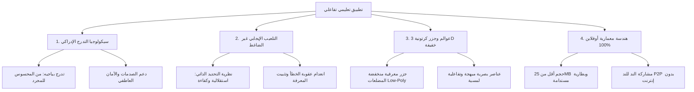

# 🌟 الرؤية الشاملة والميثاق المعماري للمشروع
> **تطبيق تعليمي تفاعلي ترفيهي لأطفال غزة (من الصف الأول حتى السادس الابتدائي)**
> **المبدأ الحاكم:** أوفلاين 100% | خفيف الوزن (< 25 ميغابايت) | ستايل كرتوني وجزر ثلاثية الأبعاد | تدرج إدراكي وسيكولوجي دقيق.

---

## 🎯 1. بيان المهمة (Mission Statement)
بناء بيئة تعليمية تفاعلية غامرة، تدمج بين **التعلم الحقيقي المتقن** و**المتعة واللعب الاستكشافي**، مصممة خصيصاً لتجاوز تحديات الواقع الميداني في قطاع غزة (انقطاع الكهرباء، شح الإنترنت، تواضع مواصفات الهواتف الذكية، والانقطاع الطويل عن مقاعد الدراسة).

المشروع ليس مجرد بنك أسئلة أو كتاب مدرسي رقمي، بل **عالم كرتوني حي من الجزر العائمة ثلاثية الأبعاد**، يقود فيه الطفل رفيقه الكرتوني في رحلة استكشاف وبناء وترميم للمعرفة خطوة بخطوة.

---

## 🏛️ 2. الركائز الجوهرية الأربع (The 4 Core Pillars)

---

## 🧭 3. محددات التصميم لواقع غزة (Crisis-Conscious Design)

1. **انعدام شروط الاتصال (Zero-Connectivity Native):** التطبيق يعمل بكامل قدراته ومؤثراته وأصواته وألعابه دون الحاجة لطلب اتصال بالشبكة إطلاقاً.
2. **انعدام ضغط "سلاسل الأيام" (No Toxic Daily Streaks):** في التطبيقات التجارية مثل Duolingo، يُعاقب المستخدم بكسر الـ Streak إذا انقطع يوماً. في غزة تنقطع الكهرباء أياماً؛ لذا يعتمد التطبيق على **"بنك الإنجاز التراكمي المستمر"**، أينما توقف الطفل يعود ليجد عالمه ومكافآته كما تركها تماماً دون أي شعور بالذنب.
3. **أمان الخطأ والتشجيع غير المشروط (Safe-to-Fail Environment):** لا توجد شاشات حمراء صارخة، ولا أصوات "طنين الفشل الخاطئ" (Buzzer sound) التي ترفع التوتر والقلق لدى الأطفال الذين يعانون من صدمات الحرب، بل توجيه لطيف وفرص استكشاف جديدة فورية.
4. **توفير استهلاك البطارية والعتاد:** كود عالي الكفاءة، تقليل معدل الرسوميات الثقيلة عند السكون، واستخدام أنظمة Vector / Canvas خفيفة تضمن بقاء الجهاز يعمل لساعات طويلة على بطارية متواضعة.

---

## 🗺️ 4. هيكل ملفات المشروع في Obsidian

- `01 - سيكولوجية الطفل وتدرج النمو الإدراكي (الصفوف 1-6)`
- `02 - محرك التلعيب والتعلم بالترفيه (Gamification & Edutainment)`
- `03 - معمارية عوالم وجزر المعرفة الكرتونية ثلاثية الأبعاد`
- `04 - مصفوفة القوالب والألعاب التفاعلية لكل صف`
- `05 - كانفس تصميم الواجهات وتجربة المستخدم (UI-UX Design Canvas)`
- `06 - المكدس التقني والهندسة البرمجية للعمل أوفلاين 100%`
- `07 - خلاصة الأبحاث والمصادر الأكاديمية (Apodex & ChatGPT Analysis)`
