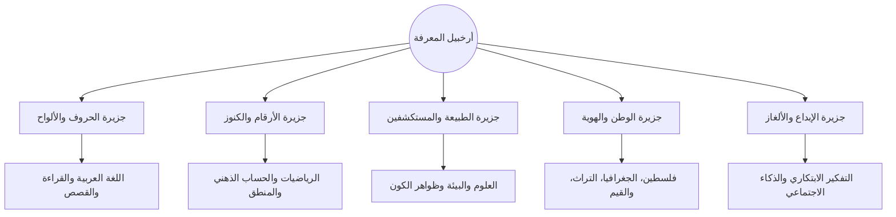

> ⚠️ **مستبدل بالنسخة v4 (2026-10-21):** لم يعد المشروع أرخبيل جزر. المرجع المعتمد هو «جزيرة واحدة» في:
> `C:\Users\M.S.I\Desktop\الخطط\2\تكة\ISLAND-DESIGN.md` و`CONSTITUTION.md` و`ECONOMY.md`.
> أُبقيت هذه الوثيقة كمرجع تاريخي لفكرة «الجزر» فقط.

# 🏝️ معمارية عوالم وجزر المعرفة الكرتونية ثلاثية الأبعاد (3D Islands World Map)
> هندسة العالم البصري، الثيمة الكرتونية ثلاثية الأبعاد، ومعادلة الجمع بين الجمال البصري الفائق والحجم الخفيف جداً (< 20MB).

---

## 🎨 1. الهوية البصرية والستايل الفني (Visual Style Guide)

* **الأسلوب العام:** **Isometric Low-Poly Cartoon** (عالم كرتوني أيزومتري ناعم الملامح ثلاثي الأبعاد).
* **الإلهام البصري:** ميكس دافئ بين *Monument Valley* و*Animal Crossing* و*Townscaper*:
  * أشكال هندسية مبسطة (Low-polygon meshes) ذات حواف مستديرة ناعمة.
  * لوحة ألوان دافئة ومبهجة (Pastel & Warm Vibrancy): أزرق مياه البحر الفيروزي، أخضر المروج، ترابي دافئ، وأصفر شمس الصباح.
  * إضاءة محيطية ناعمة (Ambient Occlusion & Soft Vertex Colors) مدمجة في المجسمات مباشرة دون الحاجة لمعالجة إضاءة ديناميكية تستهلك بطارية الهاتف.
  * غياب الزوايا الحادة والمخيفة، والاعتماد على العناصر اللطيفة (سحب قطنية، أمواج كرتونية هادئة، فوانيس مضيئة).

---

## ⚙️ 2. المعادلة التقنية للثري دي: كيف يبقى الحجم تحت 20MB؟

في العادة، محركات الألعاب مثل Unity وUnreal تُخرج ملفات بحجم 100–300 ميغابايت وتستنزف بطارية أجهزة الأندرويد الرخيصة. لتحقيق المعادلة الذهبية:

### 2.1 المعمارية الهجينة (The Hybrid Architecture)
```
┌─────────────────────────────────────────────────────────────┐
│                      واجهة التطبيق                          │
├──────────────────────────────┬──────────────────────────────┤
│ 1. خريطة الجزر الرئيسية     │ 2. شاشات التمارين والدروس     │
│   (3D World Map)             │   (2D Micro-Game Engine)     │
├──────────────────────────────┼──────────────────────────────┤
│ • محرك Three.js خفيف         │ • رسوميات SVG و Canvas 2D   │
│ • مجسمات Low-Poly مضغوطة     │ • تحريك CSS + Framer Motion  │
│   بتقنية Draco / GLB         │ • أداء 60 FPS على أضعف هاتف │
│ • الحجم الإجمالي: ~3.5 ميغا   │ • الحجم الإجمالي: ~4 ميغا    │
└──────────────────────────────┴──────────────────────────────┘
```

* **خريطة الجزر (3D Canvas):** تُعرض في شاشة اختيار العوالم عبر **Three.js** خفيف ومحسن. الطفل يستطيع تدوير الجزيرة لمسياً برفق، تكبيرها، ورؤية تفاصيلها وهي تزهر مع كل درس ينجزه.
* **التمارين التفاعلية (2D Engine):** بمجرد نقر الجزيرة للدخول في درس، ننتقل لواجهة ألعاب ثنائية الأبعاد عالية النقاء تعتمد على الـ SVG التفاعلي السريع جداً واللمسي.

---

## 🗺️ 3. أرخبيل جزر المعرفة (The Archipelago of Islands)

تنقسم كل مرحلة دراسية إلى أرخبيل يضم 5 جزر رئيسية متخصصة:



### تفاصيل الجزر التفاعلية:
1. **جزيرة الحروف والألواح (Language Island):**
   * **الشكل البصري:** مكتبة أثرية عائمة وسط أشجار نخيل، منازل بكتب مفتوحة، وأبراج بأقلام حبر كرتونية.
   * **التفاعل:** كل حرف يُتقنه الطفل يُضيء مصباحاً على كورنيش الجزيرة.
2. **جزيرة الأرقام والكنوز (Math & Logic Island):**
   * **الشكل البصري:** طاحونة مائية تدار بتروس رقمية، جسور حجرية مدمجة بأشكال هندسية، ومناجم بلورات براقة.
   * **التفاعل:** حل المعادلات الحسابية يجمع الحجارة لإتمام تشييد الجسر الأيزومتري.
3. **جزيرة الطبيعة والمستكشفين (Science & Inquiry Island):**
   * **الشكل البصري:** بيئات مصغرة (غابة صغيرة، نبع ماء، شمس ورياح تدير مراوح هوائية).
   * **التفاعل:** زرع نباتات واكتشاف دورة حياة الفراشة وتدفق المياه.
4. **جزيرة الوطن والهوية (Palestine & Heritage Island):**
   * **الشكل البصري:** مدرجات جبلية، بيوت قروية فلسطينية بحجارة بيضاء وأبواب خشبية، وأشجار زيتون وتطريز كنعاني كرتوني.
   * **التفاعل:** التعرف على معالم فلسطين (القدس، يافا، عكا، غزة) وترميم اللوحات التراثية.
5. **جزيرة الإبداع والألغاز (Creative Mind Island):**
   * **الشكل البصري:** مرسم عائم، آلات موسيقية تفاعلية، وألغاز ميكانيكية حركية.
   * **التفاعل:** أنشطة الاسترخاء، الرسم الحر، وتحديات الذكاء المكاني.

---

## 🌟 4. ديناميكية ترقية الجزر (Island Progression States)

كل جزيرة لها 3 حالات تطور بصري مبهجة يشهدها الطفل بعينيه:
1. **الحالة الساكنة (The Sleeping State):** الجزيرة مغطاة بضباب كرتوني خفيف وألوانها هادئة.
2. **حالة الصحوة والترميم (The Awakening State):** تظهر الطرق وتفتح الأبواب ويبدأ الماء بالتدفق في الجداول.
3. **حالة الإزهار الذهبي (The Blooming Island):** اكتملت جميع كفايات المنهج للجزيرة؛ تطلق الجزيرة ألعاباً نارية خفيفة وترتفع شارة الإتقان الذهبية فوق البرج الرئيسي.
