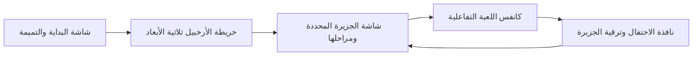

# 🎨 كانفس تصميم الواجهات وتجربة المستخدم (UI-UX Design Canvas)
> موجه خصيصاً للمصمم: معايير التصميم البصري، هندسة التفاعل اللمسي، ونظام التصميم المخصص للأطفال.

---

## 📐 1. لوحة كانفس تجربة المستخدم (UX Design Canvas)

```
┌─────────────────────────────────┬─────────────────────────────────┐
│ 1. سياق المستخدم الميداني      │ 2. الأهداف النفسية والتجربة     │
│ • طفل في غزة (6-12 سنة)         │ • بناء شعور بالأمان والبهجة    │
│ • شاشة هاتف متواضعة (300-400 DPI)│ • تحفيز الفضول والاستكشاف       │
│ • إضاءة متغيرة (شمس خيمة/عتمة)  │ • انعدام الخوف من الخطأ         │
├─────────────────────────────────┼─────────────────────────────────┤
│ 3. التفاعل وهندسة اللمس         │ 4. اللغة البصرية والمظهر        │
│ • منطقة الإبهام (Thumb Zone)    │ • كرتوني ثلاثي الأبعاد Low-Poly │
│ • أزرار ضخمة (حجم أدنى 56×56px) │ • ألوان باستيل دافئة وحيوية     │
│ • إيماءات بديهية (سحب، نقر، رسم) │ • خلو الواجهة من النصوص المعقدة  │
├─────────────────────────────────┴─────────────────────────────────┤
│ 5. نظام الصوت واللمسيات (Audio-Haptics)                            │
│ • أصوات آلات خشبية وماريمبا وأوتار دافئة (تجنب التنبيهات الإلكترونية)│
│ • نقرات اهتزازية خفيفة جداً (Subtle Haptics) عند الإفلات الصحيح     │
└───────────────────────────────────────────────────────────────────┘
```

---

## 🎨 2. نظام الألوان والدلالات السيكولوجية (Color System)

| اللون | الدرجة اللونية (Hex) | الدلالة السيكولوجية والوظيفة في الواجهة |
| :--- | :--- | :--- |
| **سماوي الأمل (Sky Blue)** | `#38BDF8` | خلفية سماء الجزر والبحار، يمنح شعوراً بالاتساع والهدوء النفسي |
| **أخضر البساتين (Meadow Green)** | `#22C55E` | إتمام التحدي، زراعة الأشجار، وتأكيد الإتقان بنجاح |
| **ذهبي الشعلة (Golden Sun)** | `#F59E0B` | النجوم، العملات الرمزية، منارات الجزر، والاحتفال بالإنجاز |
| **وردي البهجة (Coral Rose)** | `#F43F5E` | أزرار الإجراءات الرئيسية المرحة (Call to Action) وعناصر التميمة |
| **بنفسجي الحكمة (Magic Purple)** | `#8B5CF6` | جزر الألغاز، أدوات المختبر، والترقيات الخاصة |
| **رمادي دافئ مريح (Warm Surface)** | `#F8FAFC` | خلفية البطاقات التفاعلية لتقليل إجهاد العين في الإضاءة الخافتة |

> [!IMPORTANT]
> **قاعدة ذهبية في واجهات الأطفال في الأزمات:** 
> **منع استخدام اللون الأحمر التحذيري الصارخ (`#EF4444`) أو علامة الخطأ الضخمة (❌) عند الإجابة غير الموفقة.** بدلاً من ذلك، نستخدم لوناً برتقالياً دافئاً (`#FB923C`) مع حركة اهتزاز كرتونية لطيفة (Soft Wiggle) تعني: *"جرّب مرة أخرى يا بطل!"*.

---

## 🔤 3. التيبوغرافيا والخطوط العربية (Typography System)

* **الخط المعتمد:** **`Tajawal`** أو **`Readex Pro`** (مفتوح المصدر، مدمج محلياً داخل التطبيق بحجم < 200 كيلوبايت بصيغة WOFF2).
* **معايير الخط:**
  * دعم كامل ودقيق للحركات وتشكيل الحروف العربية (الفَتْحَة، الضَّمَّة، الكَسْرَة، السُّكُون) دون أي تداخل في السطور.
  * حجم الخط الأساسي للطفل في الصفوف الأولى: لا يقل عن **`24px`** للعناوين و**`20px`** للكلمات التفاعلية.
  * أسطر متباعدة وواضحة (Line-height: 1.6) لسهولة التمييز البصري.

---

## 📱 4. شاشات التدفق والواجهات الرئيسية (Screen Flow)



### وصف الشاشات:
1. **خريطة الأرخبيل (3D World Canvas):**
   * جزر عائمة تدور بنعومة في بحر كرتوني، يحيط بها سحب بيضاء ناعمة.
   * كل جزيرة تعلوها راية توضح نسبة الإتقان (مثلاً: ⭐️ 8/12).
2. **شاشة الجزيرة (Island Stages):**
   * مسار حجري متعرج كرتوني، كل حجر يمثل درساً أو نشاطاً. الأحجار المفتوحة تشع نوراً، والمغلقة تبدو كبذور نائمة تنتظر السقي.
3. **كانفس التمرين التفاعلي (Play Canvas):**
   * شاشة خالية من أي شريط علوي معقد أو إعلانات.
   * فقط زر "عودة" كبير في الزاوية، والرفيق الكرتوني يقف في الأسفل مبتسماً ليشجع الطفل.
