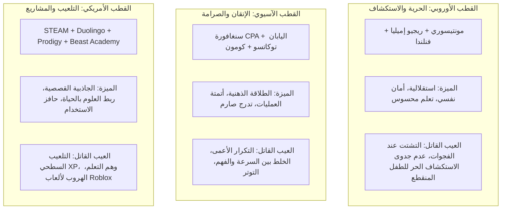

# 🌍 دراسة مقارنة عالمية نقدية (أوروبا، آسيا، أمريكا الشمالية)
## نحو النموذج الهجين الأمثل ودورة الدرس الذرية (The Atomic Micro-Lesson Cycle)
> خلاصة حوار ونقاش نقدي استقصائي مع نماذج الذكاء الاصطناعي لتفكيك أفضل وأسوأ ما في النظم التعليمية العالمية واستخلاص المعمارية المثلى لتطبيق تعليمي تفاعلي.

---

## 🔍 1. تفكيك ونقد الأقطاب التعليمية الثلاثة



---

## ⚖️ 2. جدول المقارنة النقدية الشاملة

| المعيار | القطب الأوروبي (فنلندا / مونتيسوري) | القطب الآسيوي (سنغافورة / كومون) | القطب الأمريكي (STEAM / EdTech) | **النموذج الهجين المقترح للمشروع** |
| :--- | :--- | :--- | :--- | :--- |
| **فلسفة التعلم الأساسية** | التعلم بالاستكشاف والبيئة المحيطة والرفاه النفسي | الإتقان التام والتدرج الصارم وأتمتة المهارات | المشاريع التفاعلية وحلقات التلعيب والمكافآت | **التدرج الحسي السنغافوري مع الأمان النفسي الفنلندي في عالم كرتوني** |
| **مستوى التوجيه** | منخفض (حرية واسعة للطفل في اختيار النشاط) | مرتفع جداً (مسار محدد وتكرار حتى الإتقان) | متغير (يعتمد على مسار اللعبة أو القصة) | **توجيه صريح في البداية (Rosenshine EDI) يتلاشى تدريجياً نحو الاستقلالية** |
| **التعامل مع العمليات الأساسية** | مفاهيمي بطيء عبر أدوات محسوسة | تدريب مكثف حتى تحقيق الطلاقة الآلية (Automaticity) | غالباً اختيار من متعدد سريع ومغلف بألعاب | **محرك طلاقة ميكرو قصير (دقيقتان) دون ملل التكرار الورقي** |
| **طبيعة التلعيب** | غائب عمداً لحماية الدافع الداخلي الصافي | شكلي أو غائب (انضباط وواجب) | خارجي دوباميني كثيف (نقاط XP، سلاسل أيام، حيوات) | **تلعيب جوهري متصل بالمعنى (إصلاح الجزر وترميم العالم الكرتوني)** |
| **الملاءمة لأطفال الأزمات** | ممتازة نفسياً، لكن تفشل أكاديمياً عند وجود فجوات | ترفع التوتر والضغط إذا اقترنت بالاختبارات والسرعة | تزيد التشتت السمعي البصري وهروب الطفل للعب البحت | **بيئة مهدئة للأعصاب، واضحة الأهداف، تبني الكفاءة خطوة بخطوة** |

---

## 💥 3. حسم المعضلات الجوهرية الثلاث

### المعضلة الأولى: هل الاستكشاف الحر "رفاهية" لا تناسب أطفال الأزمات؟
* **الحقيقة النقدية:** الطفل الذي انقطع عن الدراسة لسنتين (كما هو واقع أطفال غزة) ولديه فجوات تأسيسية في القراءة أو العمليات الرياضية، إذا وُضع أمام "بيئة استكشافية مفتوحة" فسيصطدم بجدار الإحباط فوراً لأن ذاكرته العاملة لا تملك المفاتيح الأولية.
* **الحل المعماري:** **التدريس المباشر الصريح المدمج (Explicit Direct Instruction):**
  * لا نطلب من الطفل تخمين القاعدة.
  * الرفيق الكرتوني يُظهر أولاً نمذجة واضحة خطوة بخطوة («أنا أريك أولاً كيف نزن المعادلة»)، ثم يتدرج إلى الممارسة الموجهة («هيا نجرب معاً»)، وأخيراً الاستكشاف المستقل («الآن الجزيرة بانتظار إبداعك بمفردك!»).

### المعضلة الثانية: دمج أتمتة "كومون" لتحرير الذاكرة العاملة دون إحداث الملل
* **الحقيقة الإدراكية:** أبحاث الحمل المعرفي (Cognitive Load Theory) تؤكد أن الطفل لا يستطيع التفكير في استراتيجية حل مسألة مركبة إذا كان يستهلك كامل طاقة دماغه في عد الأصابع لإيجاد `7 + 8`. أتمتة المهارات الأولية (Automaticity) شرط مسبق للإبداع.
* **الحل المعماري:** **محرك الطلاقة المصغر (Micro-Fluency Engine):**
  * بدلاً من أوراق كومون الجافة التي تحتوي 100 مسألة، يُصمم التدريب على شكل **"جولة نبض سريعة" (Sprint)** مدتها 90 إلى 120 ثانية فقط داخل سياق اللعبة (مثلاً: تعبئة عربة القطار بالوقود عبر ضرب الأرقام).
  * تنويع القوالب البصرية حتى لا يحفظ الطفل موضع الأزرار بل يسترجع المفهوم مجرداً.

### المعضلة الثالثة: التلعيب الحقيقي والاحتفاظ (Retention) ضد سطوة Roblox
* **الحقيقة الميدانية:** التطبيقات التي تقدم "أسئلة مدرسية جافة يغطيها قناع كرتوني رديء" يرفضها الأطفال سريعاً. كما أن التطبيقات التي تغرق في نقاط الـ XP وسلاسل الأيام تصنع دافعاً زائفاً ينهار فور انقطاع الكهرباء أو الهاتف.
* **الحل المعماري: معايير التلعيب الجوهري الأربعة:**
  1. **الهدف القصصي العضوي:** الفعل التعليمي يحل المشكلة في اللعبة (إصلاح المنارة، مد الجسر، فتح البوابة).
  2. **مكافأة الكفاءة الحقيقية:** فتح قدرات وأدوات جديدة تثبت للطفل أنه أصبح أكثر قدرة.
  3. **أثر القرارات:** اختيار مسار الرحلة وتخصيص العالم.
  4. **نهاية الجلسة المريحة:** شعور بالإنجاز عند إغلاق التطبيق بدلاً من طُعم القلق الابتزازي.

---

## ⏱️ 4. المعمارية الذرية لدورة الدرس الواحدة (The 12-Minute Atomic Lesson Cycle)

تمت هندسة دورة الدرس لتستغرق **12 دقيقة متوازنة**، مقسمة بدقة الثواني لتراعي طاقة الانتباه وبناء المعرفة:

```
[00:00 - 01:00] ──► 1. مراجعة وتنشيط المعرفة السابقة (Warm-up / Spaced Retrieval)
[01:00 - 02:30] ──► 2. النمذجة الصريحة والتمثيل الحسي (Concrete CPA Modeling)
[02:30 - 04:30] ──► 3. الممارسة الموجهة وتلاشي السقالات (Guided Scaffolding)
[04:30 - 07:00] ──► 4. جولة الطلاقة والأتمتة السريعة (Micro-Fluency Sprint)
[07:00 - 09:00] ──► 5. التحدي القصصي ونقل الأثر في الجزيرة (World Transfer)
[09:00 - 10:30] ──► 6. التحقق المستقل غير المدعوم (Independent Exit Ticket)
[10:30 - 11:30] ──► 7. التغذية الراجعة التوضيحية والتفرع الذكي (Smart Branching)
[11:30 - 12:00] ──► 8. الاحتفال بالكفاءة والإغلاق الآمن (Competence Closure)
```

### التفصيل التنفيذي للمراحل:

1. **[00:00 - 01:00] تنشيط المعرفة السابقة (Retrieval Practice):**
   * سؤال سريع يسترجع مهارة من الجلسات السابقة (مبدأ الممارسة المتباعدة Spaced Practice) لتهيئة العقل دون أي شرح مطول.
2. **[01:00 - 02:30] النمذجة الصريحة (Explicit Modeling - "أنا أريك أولاً"):**
   * الرفيق الكرتوني يشرح المفهوم الجديد عبر تفاعل حسي ملموس (تمثيل CPA: مكعبات، شرائح، فواكه، صور حية).
3. **[02:30 - 04:30] الممارسة الموجهة (Guided Practice - "نجرب معاً"):**
   * الطفل يحل جزءاً والرفيق يكمل الجزء الآخر أو يوفر إشارات ضوئية مرشدة (سقالات متلاشية).
4. **[04:30 - 07:00] جولة الطلاقة والأتمتة (Fluency Sprint):**
   * دقيقتان ونصف من التحدي السريع الممتع لتثبيت المهارة ونقلها إلى الذاكرة طويلة المدى.
5. **[07:00 - 09:00] التحدي القصصي ونقل المهارة (Transfer Challenge):**
   * توظيف المهارة لحل مشكلة الجزيرة (مثلاً: حساب أوزان التروس لتشغيل الطاحونة المائية في الجزيرة).
6. **[09:00 - 10:30] التحقق المستقل (Independent Proof):**
   * تمرين بدون أي تلميحات أو مساعدة؛ لقياس ما إذا كانت المهارة انتقلت للطفل حقاً.
7. **[10:30 - 11:30] التفرع والتغذية الراجعة (Branching Decision):**
   * النظام يقرر المسار القادم بناءً على عمق الفهم وليس مجرد الإجابة الصحيحة.
8. **[11:30 - 12:00] الإغلاق المبهج (Safe Closure):**
   * إضاءة عنصر جديد في الجزيرة ثلاثية الأبعاد، واستقرار التقدم محلياً على قاعدة بيانات الهاتف.
