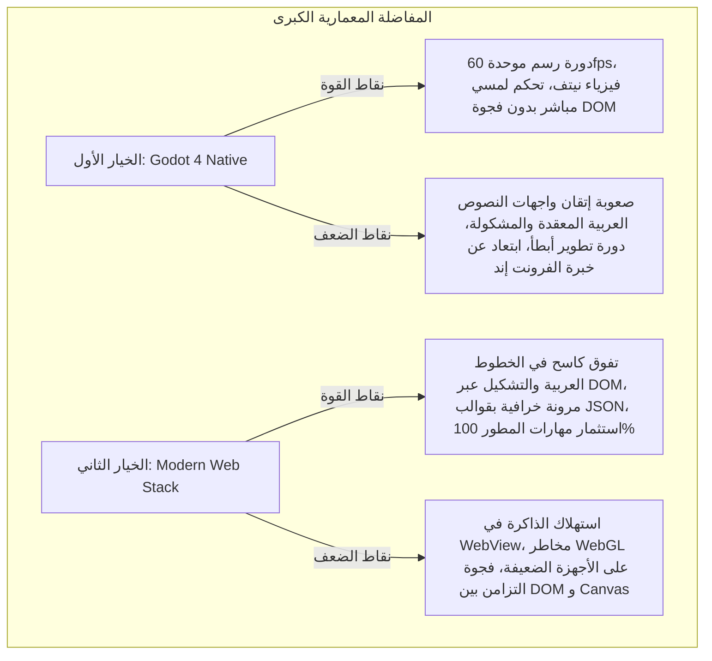
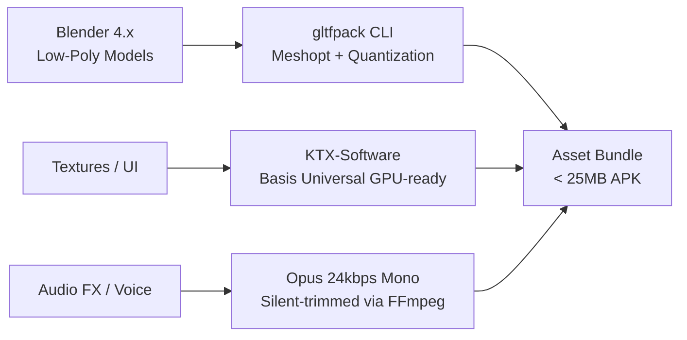

# ⚙️ المناظرة المعمارية والهندسية الشاملة للمشروع
## المفاضلة النقدية بين محركات الألعاب ومكدس الويب، وهندسة الأصول أوفلاين 100%
> توثيق تفصيلي لمناظرة هندسية معمقة مع نماذج الذكاء الاصطناعي لحسم المعمارية البرمجية، خط أنابيب الأصول (Asset Pipeline)، وقائمة الأدوات والمكتبات مفتوحة المصدر (FOSS) بالكامل.

---

## 🏛️ 1. صلب المناظرة: محرك نيتف (Godot 4) أم مكدس ويب هجين (React + Three.js + Capacitor)؟



### المقارنة الفنية الصارمة:

| المحور الهندسي | محرك الألعاب (Godot 4.x) | مكدس الويب الهجين (React + Three.js + Capacitor 6) | القرار المعماري المعتمد |
| :--- | :--- | :--- | :--- |
| **النصوص العربية والتشكيل (Typography & BiDi)** | دعم حديث عبر HarfBuzz/ICU، لكن يتطلب ضبطاً يدوياً للخطوط والالتفاف والتنسيق المركب. | **دعم متأصل وقياسي 100%** عبر محرك تصيير المتصفح (Blink/Gecko) مع خطوط ويب خفيفة كـ Tajawal. | **فوز الويب:** نصوص القراءة والتشكيل والقصص هي جوهر التطبيق التعليمي. |
| **زمن استجابة اللمس (Touch Latency & Drag-and-Drop)** | نيتف داخل شجرة المشهد (SceneTree) بدون أي فجوة زمنية. | قد يتأخر إذا تم تمرير أحداث اللمس عبر React State في كل إطار. | **التعادل مع الضبط:** تنفيذ السحب والإفلات ثلاثي الأبعاد مباشرة داخل Three.js Raycaster دون إشراك React state في حلقة التحديث. |
| **سرعة دورة التطوير وتجربة المطور (DX)** | تتطلب فتح محرك Godot والتصدير لأندرويد أو تجربة GDScript. | **HMR فوري عبر Vite (أقل من ثانية واحدة)**، تطوير واختبار كامل من المتصفح في ثوانٍ. | **فوز ساحق للويب:** يلائم خلفية أسامة كمصمم ومطور فرونت إند متمكن. |
| **حجم الحزمة الأساسية (Base Engine Size)** | ~35 - 45 ميجابايت لملف الـ APK قبل إضافة الأصول. | **أقل من 12 - 15 ميجابايت** لمكتبات الويب المجمعة والمحزومة عبر Capacitor. | **فوز الويب:** يترك مساحة أكبر للأصول والدروس ضمن سقف الـ 25-30 ميجابايت. |

---

## 💾 2. معضلة التخزين المحلي والصمود لانقطاع الكهرباء: Dexie.js أم SQLite؟

### تحليل المفاضلة:
* **SQLite النيتف (`@capacitor-community/sqlite`):** توفر صموداً جباراً ومعاملات ذرية (ACID)، لكنها تعطل مرونة التطوير المحلي عبر المتصفح (Vite) وتتطلب بناء متكرراً لمنصة أندرويد أو محاكاة WASM ثقيلة.
* **Dexie.js (IndexedDB):** توفر سرعة تطوير فائقة، أداءً ممتازاً لعشرات آلاف سجلات التقييم، وتوافقاً تاماً مع المتصفح والـ WebView.
* **حسم الأمان:** تفعيل طلب التخزين الدائم المعتمد في المتصفح:
  ```typescript
  export async function ensurePersistentStorage(): Promise<boolean> {
    if (navigator.storage && navigator.storage.persist) {
      const isPersisted = await navigator.storage.persist();
      console.log(`Persistent storage granted: ${isPersisted}`);
      return isPersisted;
    }
    return false;
  }
  ```

### الحل المعماري: نمط المستودع المجرد (Repository Pattern)
فصل طبقة البيانات عن محرك الإتقان، بحيث يعمل التطبيق بـ Dexie أثناء التطوير والإنتاج، مع إمكانية التبديل إلى SQLite دون المساس بسطر واحد من منطق التعليم:
```
           ┌─────────────────────────────┐
           │   Mastery & Learning Engine │
           └──────────────┬──────────────┘
                          │ (Calls Interface)
           ┌──────────────▼──────────────┐
           │   <<ProgressRepository>>    │
           └──────┬───────────────┬──────┘
                  │               │
  ┌───────────────▼──────┐ ┌──────▼────────────────┐
  │ DexieRepository (Web)│ │ NativeSQLiteRepository │
  └──────────────────────┘ └────────────────────────┘
```

---

## 📦 3. خط أنابيب الأصول (Asset Pipeline) وهندسة الذاكرة للأجهزة الضعيفة (2GB RAM)

### المعادلة الحرجة:
الطفل في غزة قد يمتلك هاتفاً بذاكرة عشوائية 2 جيجابايت فقط ومعالج رسومي متواضع. لضمان عدم حدوث انهيار في الذاكرة (Out-Of-Memory Crash):



### معايير ضبط وضغط الأصول:
1. **هندسة المجسمات (Meshoptimizer vs Draco):**
   * اعتماد **`meshoptimizer` (أداة `gltfpack`)** بدلاً من Draco الخام؛ لأن Meshopt لا يكتفي بتقليل حجم الملف على القرص، بل يرتب رؤوس المجسمات (Vertex Cache Optimization) لتقليل جهد بطاقة الرسوميات (GPU Draw Calls) وتسريع فك الضغط بـ 10 أضعاف مقارنة بـ Draco.
   * أمر المعالجة المعتمد:
     ```bash
     gltfpack -i raw-island.glb -o island-opt.glb -cc -tc
     ```
2. **ضغط الخامات (Texture Pipeline):**
   * اعتماد صيغة **KTX2 / Basis Universal (`KHR_texture_basisu`)**: خامات مضغوطة تبقى مضغوطة داخل ذاكرة الـ VRAM وتُفك شفرتها مباشرة في معالج الرسوميات، مما يمنع تضخم الذاكرة في الهواتف الضعيفة.
3. **قاعدة الذاكرة الذهبية (Active Scene Memory Discipline):**
   * **جزيرة واحدة فقط في الذاكرة:** لا يتم تحميل بيانات جزر المعرفة الـ 5 معاً. عند اختيار جزيرة، يتم استدعاؤها ديناميكياً (Dynamic `import()`).
   * **التحرير الصريح للموارد (Explicit Disposal):** عند مغادرة الدرس، يتم استدعاء `.dispose()` لكل من `Geometry` و `Material` و `Texture` لتفريغ الرام فوراً من محرك Three.js.
4. **ضغط الصوتيات (Audio Discipline):**
   * ترميز الصوت بصيغة **Opus / Ogg Mono** بمعدل بت منخفض (24–32 kbps) وهو كافٍ تماماً للأصوات البشرية والمؤثرات الكرتونية، مع قص فترات الصمت، وتفريغ المقاطع الصوتية غير المستخدمة عبر Howler.js.

---

## 🛠️ 4. المكدس التقني المفتوح المصدر والمجاني 100% المعتمد (The Approved FOSS Stack)

| الطبقة التقنية | التقنية / المكتبة المعتمدة | الترخيص | الدور المعماري الدقيق |
| :--- | :--- | :--- | :--- |
| **بيئة التطوير والتجميع** | **Vite + TypeScript** | MIT | تجميع فائق السرعة، دعم الموديولات الحديثة، وتقسيم الكود التلقائي (Chunking). |
| **إطار واجهة المستخدم** | **React 18 / 19** | MIT | إدارة القوالب التفاعلية، الحالات المعقدة، والواجهات الكرتونية المتجاوبة. |
| **حاوية التطبيق للأندرويد** | **Capacitor 6** | MIT | تغليف الويب إلى تطبيق أندرويد نيتف (APK) خفيف وسريع ووصول كامل لميزات الجهاز. |
| **محرك الرسوميات ثلاثي الأبعاد** | **Three.js + React Three Fiber (R3F)** | MIT | تصيير جزر المعرفة والشخصيات الكرتونية المنخفضة المضلعات (Low-Poly). |
| **أدوات العرض الإضافية** | **@react-three/drei** | MIT | أدوات مساعدة للكاميرا والإضاءة والتحكم والـ OrbitControls. |
| **إدارة الحالة العامة** | **Zustand** | MIT | إدارة حالة اللعبة والدرس بخفة شديدة (أقل من 2KB) وبدون Boilerplate. |
| **قاعدة البيانات والتخزين** | **Dexie.js (IndexedDB)** | Apache 2.0 | تخزين تقدم الطفل والمحاولات محلياً بدون خادم، مع دعم كامل للـ Transactions. |
| **التحقق من صحة البيانات** | **Zod** | MIT | مطابقة ومصادقة ملفات الـ JSON الخاصة بقوالب التمارين الـ 8 والتأكد من سلامتها. |
| **محرك المؤثرات الصوتية** | **Howler.js / Web Audio API** | MIT | تشغيل المؤثرات والتشجيع الصوتي بدون تأخير مع إدارة دورة حياة الذاكرة. |
| **أدوات النمذجة والتصميم ثلاثي الأبعاد** | **Blender 4.x** | GPL | تصميم الجزر والشخصيات والأنيميشن منخفض التفاصيل مجاناً بالكامل. |
| **أدوات تحسين وضغط الأصول** | **gltfpack + KTX-Software** | MIT / Apache | ضغط المجسمات والخامات وجعلها جاهزة للتشغيل على الهواتف المتواضعة. |
| **إطار الاختبارات الآلية** | **Vitest** | MIT | اختبار محرك الإتقان والمنطق التربوي بمعزل عن واجهة المستخدم. |

---

## 🎯 5. خلاصة القرار المعماري

1. **الاعتماد النهائي:** معمارية **Vite + React + Three.js + Capacitor 6** هي الخيار الأمثل والأنسب لإمكانيات أسامة وسياق المشروع؛ حيث تضمن أعلى جودة للخطوط العربية والتشكيل القرائي، وأقصى سرعة في بناء قوالب التمارين المتنوعة، مع الحفاظ على حجم خفيف جداً.
2. **الاستقلالية التامة للتعليم:** منطق الحساب والتقييم والنمو المعرفي (Mastery Engine) مكتوب بلغة TypeScript نقية خالية من أي ارتباط بالـ UI، لضمان استمراريته وقابليته للنقل مستقبلاً لأي منصة.
3. **الانضباط الصارم للأصول:** لا يتجاوز حجم الـ APK الموزع 25–28 ميجابايت بفضل حزمة أدوات `gltfpack` و `Basis Universal`، مع استهلاك ذاكرة لا يتعدى 120MB على أجهزة الأندرويد الضعيفة.
